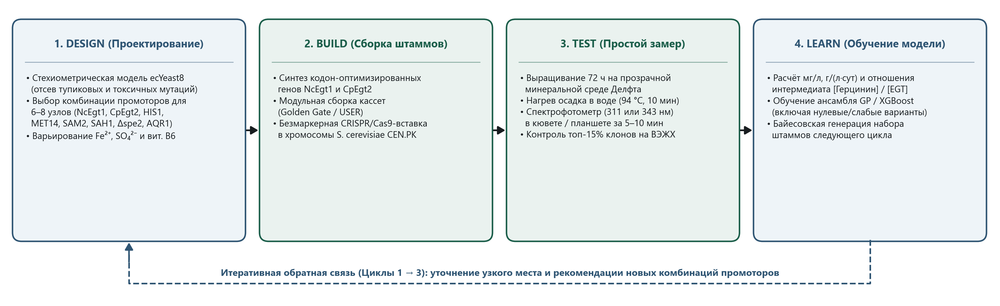
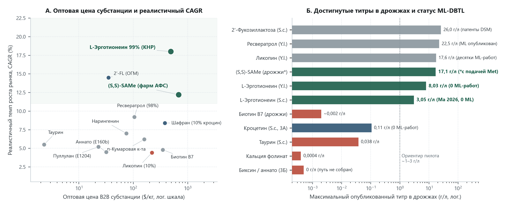
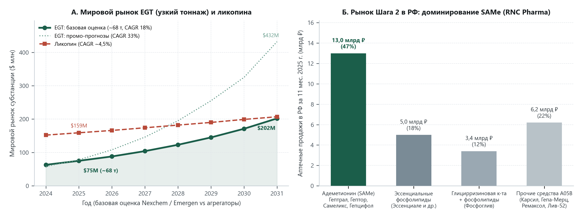

# DBTL · Выбор целевой молекулы и архитектура дрожжевой платформы (L-эрготионеин → узел SAM)

Исследовательский репозиторий проекта **Design–Build–Test–Learn (DBTL)** по метаболической инженерии и машинному обучению: отбор целевой продуктовой платформы из 16 биотехнологических кандидатов, химическая и стехиометрическая схема пути, пошаговый лабораторный регламент на дрожжах *Saccharomyces cerevisiae*, техноэкономические модели (ТЭО), полнотекстовые первоисточники и анализ рынков мира и РФ.

👉 **[Открыть итоговый аналитический отчёт (PDF, А4)](./ergothioneine-dbtl-report.pdf)** · ⚖️ **[Критический фактчек, внутренние дебаты и развилка Сценарий А / Сценарий Б](./docs/critical-review-and-factcheck.md)**

---

## Главное решение и выводы критического фактчека

Для построения воспроизводимого конвейера DBTL с предсказательной моделью метаболизма выбрана задача **биосинтеза конкретного низкомолекулярного вещества с максимизацией концентрации и объёмной скорости накопления (г/л·сут)**. Независимый стресс-тест 16 кандидатов выявил объективный структурный компромисс рынка РФ: молекулы с простым кюветным тестом без ВЭЖХ имеют в России малый физический тоннаж, тогда как многомиллиардные импортозависимые субстанции требуют хроматографии (ВЭЖХ-УФ). Отсюда сформулированы двухшаговая базовая архитектура (**Сценарий А**) и прямой индустриальный маршрут (**Сценарий Б**):

* **Шаг 1 (модельный полигон конвейера DBTL и статьи Q1, Сценарий А):** **L-эрготионеин** (`C9H15N3O2S`), синтезируемый *de novo* из глюкозы и сульфата в дрожжах при вставке **двух грибных генов (`NcEgt1` и `CpEgt2`)** с выходом **46–154 мг/л** уже на нулевом шаге без нокаутов генома; УФ-скрининг супернатанта при **311 / 343 нм** за 5–10 минут; **0 опубликованных работ по ML-DBTL в мире** и отсутствие патентов РФ на рекомбинантные дрожжи (`RU 2788417 C1` закрывает только мицелий *H. erinaceus*, `RU 2550202 C2` — бромный химсинтез). **Критическое рыночное ограничение:** физический объём мирового рынка составляет всего **~68 т/год (~$75 млн, CAGR ~18%)** при профиците мощностей КНР (*GeneIII* — 36–60 т/год на *E. coli*, опт **$400–580/кг**), а из-за микродозировок в косметике (0,01–0,05%) спрос в РФ (*Ангиофарм*, *Alga Spa*, *A.M.&P.M.*, *FUNGILINE*; импортёры *ООО «БИОХИМ»*, *«Лотос Трейдинг»*, *Witec*, *GEON*) измеряется **единицами–десятками кг/год** и не рассчитан на отдельный завод.
* **Шаг 2 (промышленная цель масштабирования — или прямой старт по Сценарию Б при наличии ВЭЖХ-УФ):** **(S,S)-адеметионин (SAMe)** в вакуоли дрожжей с объёмом рынка в РФ **14–16 млрд ₽/год** (>47% всех аптечных гепатопротекторов + госзакупки ЖНВЛП «Фарма-2030» и ветеринарные/кормовые формы по п. 24 Приказа Минсельхоза № 392). При переходе от EGT к SAMe переносится сам конвейер DBTL и энергетический модуль `SAM2 / регенерация АТФ`, тогда как узлы `CYS4` и `HIS1` целенаправленно инвертируются (`↓CYS4` для блокировки слива в цистеин) с переходом на подачу дешёвого L-метионина.

---

## Навигация по репозиторию

### 1. Основные аналитические документы и регламенты
* 📄 **[`ergothioneine-dbtl-report.pdf`](./ergothioneine-dbtl-report.pdf)** — сводный аналитический отчёт А4 с кликабельным оглавлением, таблицами, химическими формулами, лабораторным протоколом, стресс-тестом ограничений и списком из 43 источников.
* ⚖️ **[`docs/critical-review-and-factcheck.md`](./docs/critical-review-and-factcheck.md)** — критический самоаудит и внутренние дебаты по 6 узлам: физический тоннаж EGT в мире и РФ, профицит мощностей КНР, проверка реальных импортёров и брендов РФ, биохимический конфликт `CYS4/HIS1` при переходе к SAMe, сверка с ГРЛС и Приказом МСХ № 392, матрица выбора **Сценарий А vs Сценарий Б**.
* 🧭 **[`docs/project-context-and-decisions.md`](./docs/project-context-and-decisions.md)** — постановка задачи проекта, разбор методологических развилок (почему синтез малой молекулы вместо «DBTL для выбора вида продуцента», сравнение дрожжей и бактерий *P. putida / B. subtilis / C. glutamicum*, учёт критики неселективных антиоксидантов и роль транспортёра `OCTN1`, патентная стратегия в РФ и контуры команды).
* 📊 **[`docs/candidates-audit.md`](./docs/candidates-audit.md)** — полный сравнительный аудит **16 продуктовых кандидатов** (каротиноиды, шафран, аннато E160b, *п*-кумаровая кислота / ресвератрол, пуллулан E1204, биотин B7, химозин, таурин, фолиновая кислота, 7-DHC / 25-OH-D3, 2'-фукозиллактоза, овотиол А, селенонеин, эрготионеин, SAMe) + 4 направления предварительного отсева и сверка с Приказом Минсельхоза № 392.
* 🧪 **[`docs/ergothioneine-yeast-protocol.md`](./docs/ergothioneine-yeast-protocol.md)** — подробный текстовый пошаговый протокол: таблица нативного синтеза предшественников в дрожжах, рецепт прозрачной минеральной среды Делфта на 1 л, трансформация *S. cerevisiae* `CEN.PK`, водная экстракция при 94 °C, прописи спектрофотометрических тестов на **311 нм** и **343 нм** для обычной кюветы и планшета, проверочный ВЭЖХ-УФ.
* 🔍 **[`docs/research-prompts-and-methodology.md`](./docs/research-prompts-and-methodology.md)** — исследовательские промпты, поисковые постановки и критерии верификации технологических и рыночных данных.

### 2. Техноэкономический кейс сравнения (дрожжевой ликопин, линия 1 000 л)
* 📈 **[`lycopene-economics/project-brief.md`](./lycopene-economics/project-brief.md)** — техноэкономический скрининг ликопина (рынок мира и РФ, сравнение дрожжей с мицелиальным грибом *Blakeslea trispora* и химсинтезом BASF/DSM, расчёт CAPEX/OPEX).
* 📑 **[`lycopene-economics/sources-and-assumptions.md`](./lycopene-economics/sources-and-assumptions.md)** — реестр проверенных источников `S01–S23` и формулы производственной модели.
* 📊 **[`lycopene-economics/lycopene-economics.pdf`](./lycopene-economics/lycopene-economics.pdf)** · **[`lycopene-economics.pptx`](./lycopene-economics/lycopene-economics.pptx)** · **[`lycopene-model.xlsx`](./lycopene-economics/lycopene-model.xlsx)** — презентация и финансовая Excel-модель (45 формул).

### 3. Исходные статьи, обзор DBTL и лабораторные протоколы
* 📚 **[`docs/literature-review-and-sources.md`](./docs/literature-review-and-sources.md)** — аннотированный путеводитель по всем изученным статьям с привязкой к локальным файлам.
* 📂 **[`papers/`](./papers/)** — полные тексты ключевых открытых статей из Europe PMC (*van der Hoek et al. 2019; 2022a; 2022b* по дрожжевому эрготионеину; *BioAutomata 2019*; *ART 2020*; *Carbonell 2018*; *Ma et al. 2022* по каротиноидам; *Chen et al. 2023* по пуллулану).
* 🧬 **[`Дрожжевые проекты iGEM.md`](./Дрожжевые%20проекты%20iGEM.md)** и папка **[`Протоколы iGEM/`](./Протоколы%20iGEM/)** — разбор 9 дрожжевых проектов iGEM 2022–2026 гг. и оригинальные PDF-протоколы команд *HBUT-China 2022* (эрготионеин) и *WWU Münster 2022* (71-страничный справочник по *S. cerevisiae*).
* 📝 **[`DBTL-предфинал.docx`](./DBTL-предфинал.docx)** — обзорная методологическая рукопись по архитектуре цикла DBTL, биофабрикам и задачам нацпроекта «Технологическое обеспечение биоэкономики».

### 4. Графики и воспроизводимая сборка отчёта
* 🖼️ **[`assets/`](./assets/)** — итоговые графики позиционирования кандидатов (`fig1_candidates.png`), рынков (`fig4_markets.png`), схемы пути (`fig2_pathway_structures.png`), цикла DBTL (`fig3_dbtl_loop.png`) и 2D химические формулы RDKit (`assets/structures/`).
* ⚙️ **[`scripts/build_ergothioneine_report.py`](./scripts/build_ergothioneine_report.py)** — скрипт сборки PDF-отчёта и всех диаграмм (`python scripts/build_ergothioneine_report.py`).

