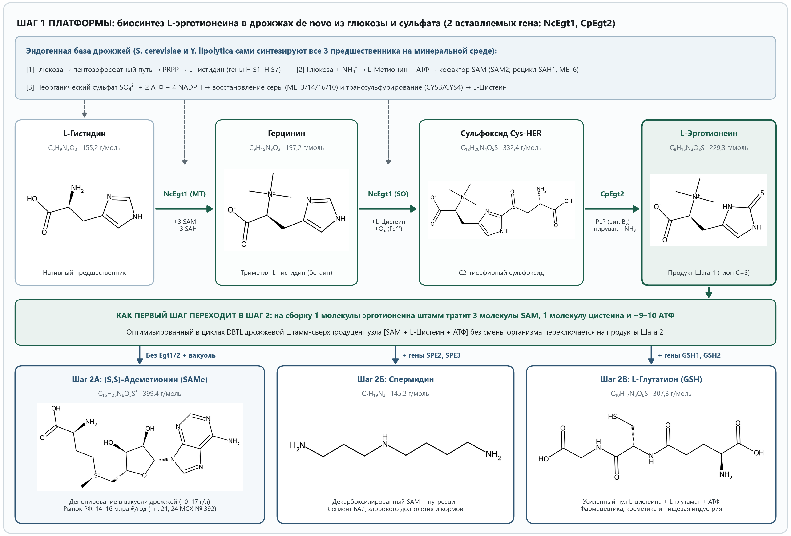

# DBTL · Выбор целевой молекулы и архитектура дрожжевой платформы (L-эрготионеин → узел SAM)

Исследовательский репозиторий проекта **Design–Build–Test–Learn (DBTL)** по метаболической инженерии и машинному обучению: отбор целевой продуктовой платформы из 16 биотехнологических кандидатов, химическая и стехиометрическая схема пути, пошаговый лабораторный регламент на дрожжах *Saccharomyces cerevisiae*, техноэкономические модели (ТЭО), полнотекстовые первоисточники и анализ рынков мира и РФ.

👉 **[Открыть итоговый аналитический отчёт (PDF, А4)](./ergothioneine-dbtl-report.pdf)**

---

## Главное решение проекта

Для построения воспроизводимого конвейера DBTL с предсказательной моделью метаболизма выбрана задача **биосинтеза конкретного низкомолекулярного вещества с максимизацией концентрации и объёмной скорости накопления (г/л·сут)** — однозначной численной метрики качества, на которую опирается цикл DBTL:

* **Шаг 1 (калибровка конвейера и быстрый B2B-продукт):** **L-эрготионеин** (`C9H15N3O2S`), синтезируемый *de novo* из глюкозы и сульфата в дрожжах при вставке всего **двух грибных генов (`NcEgt1` и `CpEgt2`)**. Все три предшественника (L-гистидин, SAM и L-цистеин) дрожжи синтезируют сами по умолчанию, давая **46–154 мг/л** уже на базовом шаге без нокаутов хозяйского генома; измерение занимает 5–10 минут на обычном спектрофотометре при **311 нм** или **343 нм**; в мире опубликовано **0 работ по ML-DBTL** на этом пути и **0 патентов в РФ**, при этом российский косметический рынок (Гельтек, Ангиофарм, Mesomatrix, Superbanka) на 100% импортозависим и открыт для фермент-фильтратов по ТР ТС 009/2011.
* **Шаг 2 (масштабирование метаболического узла):** переключение созданного штамма-сверхпродуцента кофактора SAM (на 1 молекулу эрготионеина тратится 3 молекулы SAM) на накопление в вакуоли дрожжей **(S,S)-адеметионина (SAMe)** — крупнейшей импортозависимой субстанции на рынке гепатопротекторов и ветеринарных/кормовых добавок РФ объёмом **14–16 млрд ₽/год** (**пп. 21 и 24 Приказа Минсельхоза РФ № 392**, стратегия «Фарма-2030»), а также спермидина и L-глутатиона.

---

## Навигация по репозиторию

### 1. Основные аналитические документы и регламенты
* 📄 **[`ergothioneine-dbtl-report.pdf`](./ergothioneine-dbtl-report.pdf)** — сводный аналитический отчёт А4 с кликабельным оглавлением, таблицами, химическими формулами, лабораторным протоколом и списком из 38 источников.
* 🧭 **[`docs/project-context-and-decisions.md`](./docs/project-context-and-decisions.md)** — постановка задачи проекта, разбор методологических развилок (почему синтез малой молекулы вместо «DBTL для выбора вида продуцента», сравнение дрожжей и бактерий *P. putida / B. subtilis / C. glutamicum*, учёт критики неселективных антиоксидантов и роль транспортёра `OCTN1`, патентная стратегия в РФ и контуры команды).
* 📊 **[`docs/candidates-audit.md`](./docs/candidates-audit.md)** — полный сравнительный аудит **16 продуктовых кандидатов** (каротиноиды, шафран, аннато E160b, *п*-кумаровая кислота / ресвератрол, пуллулан E1204, биотин B7, химозин, таурин, фолиновая кислота, 7-DHC / 25-OH-D3, 2'-фукозиллактоза, овотиол А, селенонеин, эрготионеин, SAMe) + 4 направления предварительного отсева и сверка с Приказом Минсельхоза № 392.
* 🧪 **[`docs/ergothioneine-yeast-protocol.md`](./docs/ergothioneine-yeast-protocol.md)** — подробный текстовый пошаговый протокол: таблица нативного синтеза предшественников в дрожжах, рецепт прозрачной минеральной среды Делфта на 1 л, трансформация *S. cerevisiae* `CEN.PK`, водная экстракция при 94 °C, прописи спектрофотометрических тестов на **311 нм** и **343 нм** для обычной кюветы и планшета, проверочный ВЭЖХ-УФ.
* 🔍 **[`docs/research-prompts-and-methodology.md`](./docs/research-prompts-and-methodology.md)** — исследовательские промпты, поисковые постановки и критерии верификации технологических и рыночных данных.

### 2. Техноэкономический кейс сравнения (дрожжевой ликопин, линия 1 000 л)
* 📈 **[`lycopene-economics/project-brief.md`](./lycopene-economics/project-brief.md)** — техноэкономический скрининг ликопина (рынок мира и РФ, сравнение дрожжей с мицелиальным грибом *Blakeslea trispora* и химсинтезом BASF/DSM, расчёт CAPEX/OPEX).
* 📑 **[`lycopene-economics/sources-and-assumptions.md`](./lycopene-economics/sources-and-assumptions.md)** — реестр проверенных источников `S01–S23` и формулы производственной модели.
* 📊 **[`lycopene-economics/lycopene-economics.pdf`](./lycopene-economics/lycopene-economics.pdf)** · **[`lycopene-economics.pptx`](./lycopene-economics/lycopene-economics.pptx)** · **[`lycopene-model.xlsx`](./lycopene-economics/lycopene-model.xlsx)** — презентация и финансовая Excel-модель (45 формул).

### 3. Исходные статьи, обзор DBTL и лабораторные протоколы
* 📚 **[`docs/literature-review-and-sources.md`](./docs/literature-review-and-sources.md)** — аннотированный путеводитель по всем изученным статьям с привязкой к локальным файлам.
* 📂 **[`papers/`](./papers/)** — полные тексты ключевых открытых статей из Europe PMC (*van der Hoek et al. 2019; 2022a; 2022b* по дрожжевому эрготионеину; *BioAutomata 2019*; *ART 2020*; *Carbonell 2018*; *Ma et al. 2022* по каротиноидам; *Chen et al. 2023* по пуллулану).
* 🧬 **[`Дрожжевые проекты iGEM.md`](./Дрожжевые%20проекты%20iGEM.md)** и папка **[`Протоколы iGEM/`](./Протоколы%20iGEM/)** — разбор 9 дрожжевых проектов iGEM 2022–2026 гг. и оригинальные PDF-протоколы команд *HBUT-China 2022* (эрготионеин) и *WWU Münster 2022* (71-страничный справочник по *S. cerevisiae*).
* 📝 **[`DBTL-предфинал.docx`](./DBTL-предфинал.docx)** — обзорная методологическая рукопись по архитектуре цикла DBTL, биофабрикам и задачам нацпроекта «Технологическое обеспечение биоэкономики».

### 4. Графики и воспроизводимая сборка отчёта
* 🖼️ **[`assets/`](./assets/)** — итоговые графики позиционирования кандидатов (`fig1_candidates.png`), рынков (`fig4_markets.png`), схемы пути (`fig2_pathway_structures.png`), цикла DBTL (`fig3_dbtl_loop.png`) и 2D химические формулы RDKit (`assets/structures/`).
* ⚙️ **[`scripts/build_ergothioneine_report.py`](./scripts/build_ergothioneine_report.py)** — скрипт сборки PDF-отчёта и всех диаграмм (`python scripts/build_ergothioneine_report.py`).

