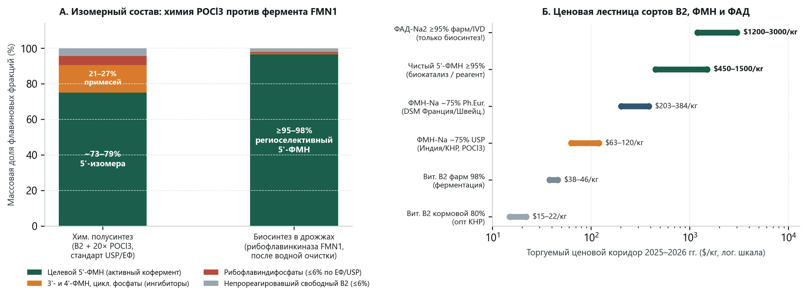
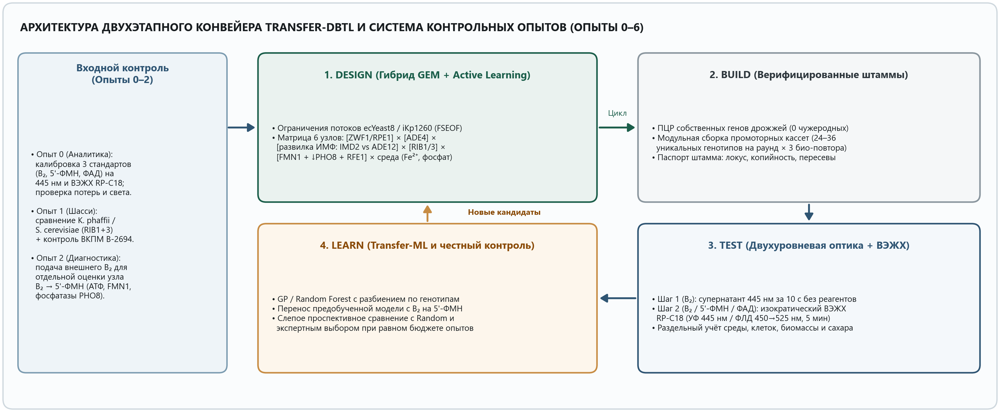

# DBTL · Выбор целевой молекулы и архитектура дрожжевой платформы метаболической инженерии

Исследовательский репозиторий проекта **Design–Build–Test–Learn (DBTL)** по метаболической инженерии дрожжей и машинному обучению: отбор целевой продуктовой платформы из 16 биотехнологических кандидатов, сравнение с химическим синтезом, эндогенные метаболические схемы с 2D-формулами, лабораторные регламенты и контрольные опыты, техноэкономические модели (ТЭО), полнотекстовые первоисточники и аудит рынков мира и РФ (Приказ Минсельхоза № 392, реестр ГРЛС, каталог БРЦ ВКПМ).

👉 **[Основной отчёт (Платформа № 1): Рибофлавин (B2) → 5'-ФМН → ФАД (PDF, А4)](./fmn-riboflavin-dbtl-report.pdf)** · 🧭 **[Научный путеводитель и план опытов 0–6 (PDF, 15 стр.)](./docs/Riboflavin_FMN_FAD_nauchnyi_putevoditel_2026.pdf)** · 📘 **[Платформа № 2 (альтернатива): L-эрготионеин → SAMe (PDF, А4)](./ergothioneine-dbtl-report.pdf)**

---

## Главное решение проекта: каскад `Рибофлавин (B2) → 5'-ФМН (→ ФАД)` в дрожжах

По итогам перекрёстного аудита 16 кандидатов и сверки химических, аналитических и рыночных ограничений в качестве **основной целевой платформы (Платформа № 1)** зафиксирован прямой эндогенный флавиновый каскад дрожжей **`Рибофлавин (Витамин B2) → Рибофлавин-5'-мононуклеотид (5'-ФМН) → ФАД`** ([`fmn-riboflavin-dbtl-report.pdf`](./fmn-riboflavin-dbtl-report.pdf), текстовая версия [`docs/fmn-riboflavin-dbtl-report.md`](./docs/fmn-riboflavin-dbtl-report.md)):

1. **Шаг 1 (`Витамин B2`, `C17H20N4O6`) — безотказный оптический полигон Цикла 0 и тоннажный сырьевой фундамент (п. 32 Приказа МСХ № 392):**
   * **0 чужеродных генов на старте:** все 6 генов синтеза $B_2$ (`RIB1, RIB7, RIB2, RIB3, RIB4, RIB5`) изначально присутствуют в хромосомах базовых дрожжей (*Komagataella phaffii* `X-33/GS115`, *Saccharomyces cerevisiae* `CEN.PK`, *Yarrowia lipolytica*). ПЦР-сборка собственных `RIB1 + RIB3` под конститутивными промоторами (`pGAP / pTEF1`) за 2 недели даёт жёлтый секретирующий штамм (**10–20 мг/л** в колбах и **50–175 мг/л** в реакторе на шестёрке `RIB`), а в БРЦ ВКПМ (Москва) доступен готовый эталон *B. subtilis* `ВКПМ B-2694` за 3 000 ₽ (**3,5–4,5 г/л**; а также `ВКПМ B-6797`, `B-8386/8387` до 18–21 г/л с истекшими патентами РФ).
   * **Измерение за 10 секунд без реагентов:** прямое поглощение супернатанта минеральной среды при **445 нм** ($\varepsilon_{445} = 12\,500\text{ М}^{-1}\cdot\text{см}^{-1}$).
   * **Импорт в РФ 300–500 т/год (0% отечественной ферментации):** сам кормовой $B_2$ ($15–22/кг) на малом реакторе не продаётся как отдельный товар, а служит дешёвой тест-системой обучения модели DBTL и собственным субстратом Шага 2.
2. **Шаг 2 (`5'-ФМН`, `C17H21N4O9P`) — целевой высокомаржинальный продукт и ответ на вопрос «почему не химический синтез?»:**
   * Стандартный коммерческий *Riboflavin Sodium Phosphate* ($63–120/кг КНР/Индия USP и $203–384/кг *DSM* Ph.Eur. по сделкам *Tridge* мая 2026 г.) получают неселективным фосфорилированием импортного ферментационного $B_2$ **20-кратным избытком токсичного $\text{POCl}_3$** в пиридине/$\gamma$-бутиролактоне (включая белгородское ООО «Полисинтез» — дочерний химзавод НТФФ «ПОЛИСАН»). Из-за атаки $\text{POCl}_3$ по четырём гидроксилам рибитила химический порошок содержит лишь **73–79% целевого 5'-изомера и 21–27% примесей** (`3'-ФМН`, `4'-ФМН`, дифосфаты, остаточный $B_2$), ингибирующих апо-флавопротеины, и на 100% зависит от импорта зарубежного $B_2$.
   * Экспрессия собственного дрожжевого гена монофункциональной рибофлавинкиназы **`FMN1`** (в отличие от бактериального слитого `ribC/ribF` с `RFN`-рибопереключателем) переводит **отечественный сахар сразу в >95–98% региоселективный `5'-ФМН` в одном водном биореакторе** без $\text{POCl}_3$ — для рецептурного блокбастера ЖНВЛП **«Цитофлавин®»** (НТФФ «ПОЛИСАН», >4 млрд ₽/год), офтальмологического кросслинкинга роговицы («Декстралинк», «Риболинк», FDA *Epioxa™* окт. 2025) и биокатализа.
   * **Нетривиальная задача для ML (Transfer-DBTL, 0 работ в мире):** разрешение стехиометрического конфликта на развилке инозинмонофосфата **`ИМФ` (`ГТФ` для сборки $B_2$ против `АТФ` для киназы `FMN1`)** и подавления холостого цикла клеточных фосфатаз (`↓PHO8`), с проспективной проверкой того, сокращает ли GP-модель (`ecYeast8 / iKp1260`), предобученная на данных $B_2$, число опытов для оптимизации `5'-ФМН` (раздельный счёт $B_2$, ФМН и ФАД на обычном ВЭЖХ `RP-C18` при 445 нм за 5–7 мин без масс-спектрометра).
3. **Шаг 3 (`ФАД`, опциональное расширение 2-го года):** подключение второго собственного гена дрожжей **`FAD1`** ведёт к коферменту **ФАД** ($1 200–3 000+/кг за сорт $\ge 95\%$ для офтальмологии и тест-полосок глюкометров `FAD-GDH`), для которого промышленный химический синтез невозможен в принципе.

*Параллельно в репозитории полностью сохранена проработанная **Платформа № 2 (`L-эрготионеин → (S,S)-SAMe`, [`ergothioneine-dbtl-report.pdf`](./ergothioneine-dbtl-report.pdf))** как сильный резервный вариант с модельным 3-субстратным узлом `HIS + CYS + 3 SAM` и механикой R&D-коллаборации с российскими косметическими брендами.*

---

## Навигация по репозиторию

### 1. Платформа № 1 (основная): `Рибофлавин (B2) → 5'-ФМН → ФАД`
* 📄 **[`fmn-riboflavin-dbtl-report.pdf`](./fmn-riboflavin-dbtl-report.pdf)** и **[`docs/fmn-riboflavin-dbtl-report.md`](./docs/fmn-riboflavin-dbtl-report.md)** — **полная итоговая аналитическая записка А4** (сравнение с химсинтезом $\text{POCl}_3$, эндогенная биохимия и конфликт развилки `ИМФ`, штаммы БРЦ ВКПМ, архитектура Transfer-DBTL, двухуровневая аналитика 445 нм + ВЭЖХ `RP-C18`, дорожная карта 12 нед. / 24 мес., выгрузка ГРЛС по «Цитофлавину» и «Полисинтезу», 30 первоисточников).
* 🧭 **[`docs/Riboflavin_FMN_FAD_nauchnyi_putevoditel_2026.pdf`](./docs/Riboflavin_FMN_FAD_nauchnyi_putevoditel_2026.pdf)** — **15-страничный научный путеводитель команды** (Артур Фомин, 22.11.2026): учебно-методический разбор биологии пути, матрица аналитических контролей, постановка диагностических **Опытов 0–6**, правила предотвращения утечки данных в ML, шаблон записи эксперимента и чек-лист решений до заказа генов.
* 📙 **[`riboflavin-fmn-fad-dbtl-brief.pdf`](./riboflavin-fmn-fad-dbtl-brief.pdf)** и **[`docs/riboflavin-fmn-fad-brief.md`](./docs/riboflavin-fmn-fad-brief.md)** — краткий 6-страничный обзорный бриф по флавиновому варианту.

### 2. Платформа № 2 (резервная альтернатива): `L-эрготионеин → (S,S)-SAMe`
* 📘 **[`ergothioneine-dbtl-report.pdf`](./ergothioneine-dbtl-report.pdf)** — сводный аналитический отчёт А4 (17 стр.) по связке `L-эрготионеин → SAMe` (механика R&D-пилота с косметическим брендом РФ, лабораторный протокол и 43 источника).
* ⚖️ **[`docs/critical-review-and-factcheck.md`](./docs/critical-review-and-factcheck.md)** — критический самоаудит и внутренние дебаты по 6 узлам платформы эрготионеина и SAMe.
* 🧪 **[`docs/ergothioneine-yeast-protocol.md`](./docs/ergothioneine-yeast-protocol.md)** — пошаговый лабораторный протокол по дрожжевому эрготионеину (среда Делфта, тесты 311 и 343 нм).

### 3. Сквозной скрининг 16 кандидатов, контекст проекта и кейс ликопина
* 📊 **[`docs/candidates-audit.md`](./docs/candidates-audit.md)** — сравнительный аудит всех **16 продуктовых кандидатов** и сверка с Приказом Минсельхоза № 392.
* 🗂️ **[`docs/project-context-and-decisions.md`](./docs/project-context-and-decisions.md)** и **[`docs/research-prompts-and-methodology.md`](./docs/research-prompts-and-methodology.md)** — методологические развилки проекта, патентная гигиена и поисковые постановки.
* 📈 **[`lycopene-economics/`](./lycopene-economics/)** — техноэкономический кейс сравнения по дрожжевому ликопину ([`project-brief.md`](./lycopene-economics/project-brief.md), [`lycopene-economics.pdf`](./lycopene-economics/lycopene-economics.pdf), [`lycopene-model.xlsx`](./lycopene-economics/lycopene-model.xlsx)).
* 📚 **[`docs/literature-review-and-sources.md`](./docs/literature-review-and-sources.md)**, папка **[`papers/`](./papers/)**, **[`Дрожжевые проекты iGEM.md`](./Дрожжевые%20проекты%20iGEM.md)**, **[`Протоколы iGEM/`](./Протоколы%20iGEM/)** и **[`DBTL-предфинал.docx`](./DBTL-предфинал.docx)** — полнотекстовые первоисточники и протоколы.

### 4. Скрипты воспроизводимой генерации PDF и графиков
* ⚙️ **[`scripts/build_fmn_report.py`](./scripts/build_fmn_report.py)** — сборка основного отчёта `fmn-riboflavin-dbtl-report.pdf` и диаграмм `fig_fmn1..4`.
* ⚙️ **[`scripts/build_riboflavin_brief.py`](./scripts/build_riboflavin_brief.py)** — сборка краткого брифа `riboflavin-fmn-fad-dbtl-brief.pdf`.
* ⚙️ **[`scripts/build_ergothioneine_report.py`](./scripts/build_ergothioneine_report.py)** — сборка отчёта `ergothioneine-dbtl-report.pdf`.
