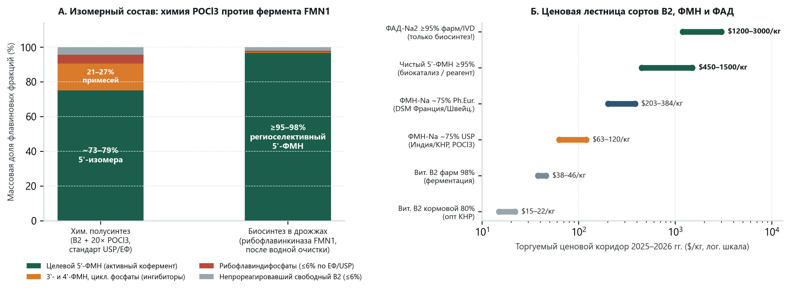
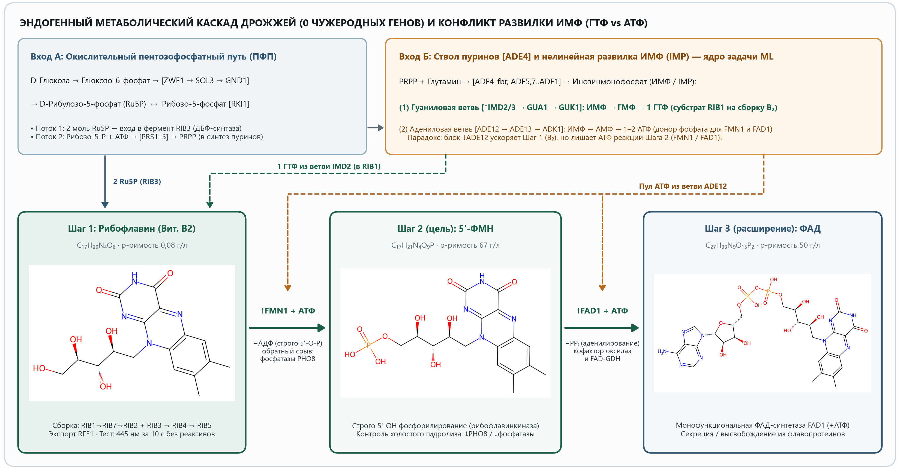
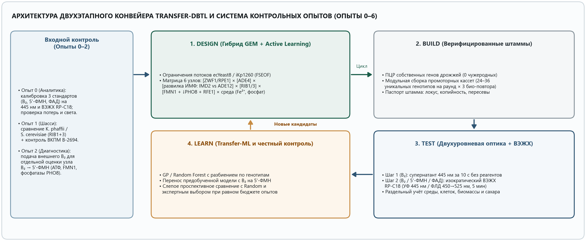

# Обоснование выбора каскада Рибофлавин ($B_2$) → Рибофлавин-5'-мононуклеотид (5'-ФМН) → ФАД для отработки цикла Design–Build–Test–Learn (DBTL)

Полноформатная аналитическая записка по целевой продуктовой платформе № 1 проекта DBTL: разбор химического полусинтеза ($\text{POCl}_3$) против прямой микробной ферментации *de novo*, эндогенная биохимия дрожжей и нелинейный конфликт пуриновой развилки ИМФ (`ГТФ` vs `АТФ`), каталог штаммов БРЦ ВКПМ, протокол двухуровневой аналитики (`445 нм` + `ВЭЖХ RP-C18`), система контрольных опытов (`Опыты 0–6`, интегрированная с научным путеводителем команды [`Riboflavin_FMN_FAD_nauchnyi_putevoditel_2026.pdf`](./Riboflavin_FMN_FAD_nauchnyi_putevoditel_2026.pdf)) и верифицированный разбор рынка РФ (п. 32 Приказа Минсельхоза № 392, реестр ГРЛС по препарату «Цитофлавин®» и заводу ООО «Полисинтез»).

📄 **Свёрстанная PDF-версия отчёта (А4, с кликабельным оглавлением и 2D-формулами RDKit):** [`../fmn-riboflavin-dbtl-report.pdf`](../fmn-riboflavin-dbtl-report.pdf)

---

## 1. Главный вывод и разделение ролей внутри каскада

Каскад **`Рибофлавин (B2) → 5'-ФМН (→ опционально ФАД)`** в дрожжах решает ключевую проблему выбора мишени для DBTL, разделяя функции оптического полигона и высокомаржинального продукта внутри одной прямой биохимической цепи:

1. **Шаг 1 — Рибофлавин (Витамин $B_2$, $\text{C}_{17}\text{H}_{20}\text{N}_4\text{O}_6$, 376,4 г/моль):**
   * **0 чужеродных генов на старте:** все 6 структурных генов синтеза $B_2$ (`RIB1, RIB7, RIB2, RIB3, RIB4, RIB5`) изначально присутствуют в геноме базовых дрожжей (*Komagataella phaffii*, *Saccharomyces cerevisiae*, *Yarrowia lipolytica*). ПЦР-амплификация всего 1–2 собственных генов (`RIB1 + RIB3`) под сильные промоторы (`pGAP` / `pTEF1`) за 2 недели даёт ярко-жёлтый секретирующий штамм «Цикла 0» (**10–20 мг/л** в колбах и **50–175 мг/л** в реакторе на шестёрке `RIB` ещё до инженерии предшественников).
   * **Мгновенный тест без реактивов:** прямой замер супернатанта минеральной среды при **445 нм** за 10 секунд ($\varepsilon_{445} = 12\,500\text{ М}^{-1}\cdot\text{см}^{-1}$), где клеточные метаболиты и соли среды не дают фона.
   * **Стратегический фундамент в РФ:** Россия импортирует **300–500 тонн/год** витамина $B_2$ (самообеспеченность ферментацией — **0%**), а позиция **№ 32 Приказа Минсельхоза РФ от 06.06.2025 № 392** (*«Витамин B2 (рибофлавин), его соединения и производные»*) юридически покрывает весь каскад. При этом кормовой $B_2$ ($15–22/кг) не рассматривается как товар для малого реактора — он служит дешёвой обучающей системой для модели DBTL и собственным субстратом для Шага 2.
2. **Шаг 2 (основная прикладная цель) — Региоселективный Рибофлавин-5'-мононуклеотид (`5'-ФМН`, $\text{C}_{17}\text{H}_{21}\text{N}_4\text{O}_9\text{P}$, 456,3 г/моль):**
   * Усиление **1 собственного гена дрожжей** — монофункциональной рибофлавинкиназы (`FMN1` + 1 АТФ) — переводит плохо растворимый $B_2$ (~0,08 г/л) в водорастворимый кофермент `5'-ФМН` (**67–100 г/л**), свободный от 21–27% изомерного брака химического фосфорилирования.
3. **Шаг 3 (опциональное расширение 2-го года) — Кофермент ФАД ($\text{C}_{27}\text{H}_{33}\text{N}_9\text{O}_{15}\text{P}_2$, 785,6 г/моль):**
   * Подключение 2-го собственного гена дрожжей (`FAD1` + ещё 1 АТФ) ведёт к динуклеотиду **ФАД** ($1 200–3 000+/кг за квалификацию $\ge 95\%$ для офтальмологии и тест-полосок глюкометров `FAD-GDH`), для которого промышленный химический синтез невозможен в принципе.

---

## 2. Честный разбор: «Не проще ли сделать ФМН из рибофлавина химическим синтезом?»

Проверка действующих фармакопей (USP / Ph. Eur. / ГФ РФ), патентов химического фосфорилирования (`US 2610177`, `EP 0523582 A1`), таможенной статистики *Tridge* (ноябрь 2026 г.) и реестра ГРЛС показывает точную границу между химией и биотехнологией:

* **По самому ядру $B_2$ химия умерла на 100%:** полный химсинтез из D-рибозы в 6–9 стадий закрыт концернами *BASF* и *DSM* более 15 лет назад; сегодня **100% мирового $B_2$** получают ферментацией (что прямо закреплено в ГФ РФ XV `ФС.2.1.0559`).
* **Как сегодня делают стандартный `ФМН-Na` (USP / Ph. Eur.) и в чём его технологический потолок:**
  Промышленный стандартный *Riboflavin Sodium Phosphate* ($63–120/кг опт КНР/Индии и $203–384/кг у *DSM* Франция/Швейцария по сделкам *Tridge* мая 2026 г.) получают обработкой сухого ферментационного $B_2$ **20-кратным мольным избытком хлорокиси фосфора ($\text{POCl}_3$)** в пиридине или $\gamma$-бутиролактоне. Даже в России этот химический передел на базе импортного $B_2$ реализован на белгородском заводе **ООО «Полисинтез»** (`ЛСР-002295/07`, дочернее предприятие НТФФ «ПОЛИСАН»).
* **Четыре причины, почему мир переходит к прямому микробному синтезу `сахар → B2 → 5'-ФМН → ФАД` (*Liu et al., 2020*; *Sibirny, 2023*; *Hou et al., февр. 2026*):**
  1. **21–27% изомерных примесей в химическом продукте:** у рибитильного хвоста $B_2$ четыре открытые ОН-группы (`2', 3', 4', 5'`). Неселективный $\text{POCl}_3$ даёт лишь **73–79% целевого 5'-ФМН** (именно такой низкий порог `≥73,5%` вынужденно узаконен в старых статьях USP/Ph.Eur.!), а остальную четверть массы составляют неактивные региоизомеры `3'-ФМН`, `4'-ФМН`, циклические фосфаты, дифосфаты ($\le 6\%$) и свободный $B_2$ ($\le 6\%$). Разделить `3'-, 4'-` и `5'-ФМН` на промышленной колонне сверхдорого, тогда как дрожжевой фермент `FMN1` в воде при 30 °C бьёт **строго по 5'-гидроксилу со 100%-й региоселективностью** (>95–98% чистоты).
  2. **Отравление ферментов изомерами `3'-/4'-ФМН` и запрос медицины/биокатализа:** неприродные изомеры конкурентно ингибируют апо-флавопротеины в биокатализе и диагностических сенсорах, а в офтальмологии в октябре 2025 г. FDA одобрило неинвазивный кросслинкинг роговицы **Epioxa™** на высокочистом ФМН (в РФ — сегмент «Декстралинк» / «Риболинк»).
  3. **Сквозная сырьевая суверенность в одном водном реакторе без $\text{POCl}_3$:** белгородский химический полусинтез **на 100% зависит от импорта китайского/индийского ферментационного $B_2$** и генерирует тонны кислых фосфатно-хлоридных стоков ($\text{HCl} + \text{H}_3\text{PO}_4$) и пиридиновых отходов. Однореакторная ферментация дрожжей переводит **отечественный сахар/мелассу сразу в водорастворимый 5'-ФМН**, убирая второй химический завод.
  4. **Единственный путь к коферменту ФАД:** химически синтезировать ФАД невозможно, а грязный 75%-й химический ФМН непригоден для чистой ферментативной достройки в ФАД.

---

## 3. Биохимия дрожжей, конфликт развилки ИМФ (`ГТФ` vs `АТФ`) и штаммы БРЦ ВКПМ

* **Почему эукариоты (дрожжи) удобнее бактерий для селективного синтеза `5'-ФМН`:**
  1. В бактериях (*B. subtilis* `ribC`, *E. coli* `ribF`) киназа и ФАД-синтетаза слиты в один бифункциональный фермент, сбрасывающий ФМН дальше в смесь с ФАД, а накопление ФМН выключает `rib`-оперон через `RFN`-рибопереключатель.
  2. В дрожжах `FMN1` и `FAD1` — **два разных независимых гена**, а `RFN`-рибопереключатель отсутствует.
* **Что именно оптимизирует модель DBTL (пять нелинейных узлов):**
  1. **Парадокс пуриновой развилки инозинмонофосфата (`IMP`):** синтез 1 моль $B_2$ требует **1 моль `ГТФ`** (`IMP → GMP → GTP`, гены `IMD2/3, GUA1`), поэтому для чистого $B_2$ выгодно блокировать адениловую ветвь (`ΔADE12` дал 5,4-кратный рост $B_2$ у *Ruchala et al., 2025*). Но превращение $B_2 \to 5'\text{-ФМН} \to \text{ФАД}$ требует **1–2 моль `АТФ`** из той же точки `IMP` (`ADE12 → AMP → ATP`)! Точный баланс плеч `IMD2/3 : ADE12` — эталонная нелинейная задача для байесовской оптимизации.
  2. **Подавление холостого цикла клеточных фосфатаз (`↓PHO8 / PHO5`):** предотвращение обратного срыва фосфата с `5'-ФМН` до свободного $B_2$.
  3. **Растворимая локализация `FMN1` и экспорт (`RFE1`):** снятие мембранного ограничения митохондриального якоря Fmn1p и контроль распределения продукта между клеткой и средой.
  4. **Неаддитивный эпистаз входов ПФП (`ZWF1 / RPE1`) и пуринов (`ADE4_fbr`)**, экспериментально доказанный в июле 2026 г. (*Li et al.*).
* **Выбор рабочего шасси (без ловушки недоступных штаммов *C. famata*):**
  Рекордные инженерные линии *Candida famata* (`AF-4 / BRPI`) находятся во Львове/Жешуве и недоступны в РФ, а дикие изоляты *C. famata* относятся к нестабильной CTG-кладе со сложной генетикой. Старт ведётся на открытых модельных шасси ***Komagataella phaffii* (`X-33 / GS115`) или *Saccharomyces cerevisiae* (`CEN.PK`)**, параллельно закупая в Курчатовском БРЦ ВКПМ готовый отечественный штамм ***B. subtilis* `ВКПМ B-2694` за 3 000 ₽** (3,5–4,5 г/л $B_2$; в коллекции также лежат `ВКПМ B-6797`, `B-8386/8387` до 18–21 г/л с истекшими патентами РФ и дрожжевой `ВКПМ Y-201`).

---

## 4. Архитектура Transfer-DBTL, аналитика без масс-спектрометра и опыты `0–6`

* **Двухуровневая аналитика стадии Test:**
  * **Уровень 1 (скрининг Шага 1 — $B_2$):** прозрачная минеральная среда Делфта без дрожжевого экстракта $\to$ центрифугирование $\to$ 10-секундный замер при **445 нм** без реагентов.
  * **Уровень 2 (раздельный счёт $B_2$, `5'-ФМН` и `ФАД` на Шаге 2):** быстрый обращённо-фазовый **ВЭЖХ-УФ/ФЛД на колонке `RP-C18`** (5–7 мин/проба, детекция на **445 нм** / `Ex 450, Em 525 нм`, без масс-спектрометра) отдельно для супернатанта и клеточного экстракта со строгими контролями стандартов, возврата добавки (*spike-recovery*) и защиты от света.
* **Логика контрольных опытов (`Опыты 0–6`):**
  * **Опыт 0:** калибровка 3 чистых стандартов ($B_2$, `5'-ФМН`, `ФАД`) на 445 нм и ВЭЖХ RP-C18.
  * **Опыт 1:** стартовое сравнение базового дрожжевого референса (`RIB1+RIB3`) и контролей ВКПМ.
  * **Опыт 2 (ключевая диагностика):** подача готового экзогенного $B_2$ к клеткам для отдельного измерения скорости биоконверсии $B_2 \to 5'\text{-ФМН}$ и мгновенной локализации лимита (субстрат, активность `FMN1`, пул АТФ или фосфатазный распад).
  * **Опыты 3–4:** сбор обучающей матрицы на компактной панели промоторов (24–36 генотипов $\times$ 3 био-повтора, `GroupKFold` по генотипу без утечки данных) и проверка робастности к $\text{Fe}^{2+}$ и отечественному сырью.
  * **Опыты 5–6 (ядро статьи Q1):** слепая проспективная проверка **Transfer-DBTL** — сокращает ли GP-модель с признаками потоков `ecYeast8 / iKp1260`, предобученная на дешёвых замерах $B_2$, число экспериментов для максимизации селективного выхода `5'-ФМН` по сравнению с обучением с нуля, случайным и экспертным отбором при одинаковом бюджете конструкций, с переносом лидеров в 1–5 л биореактор.
