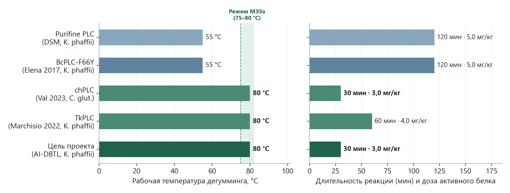
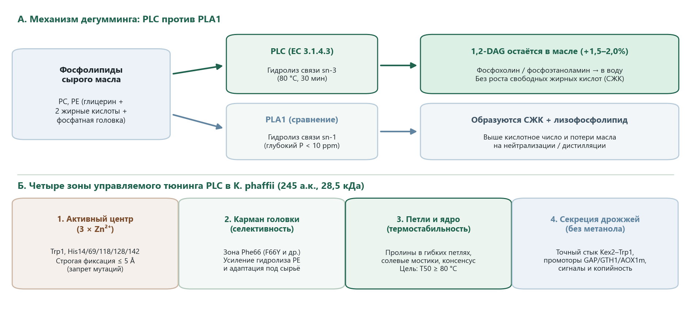
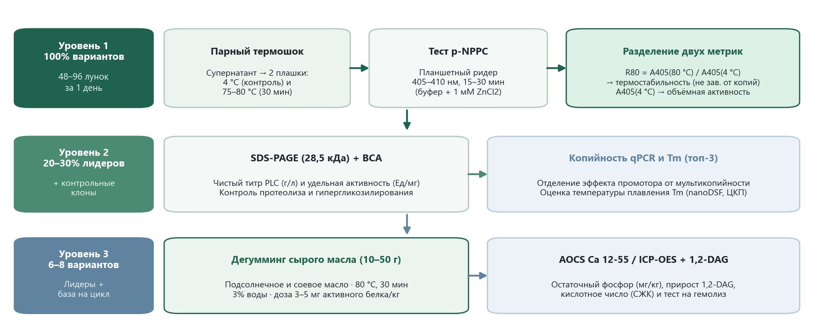
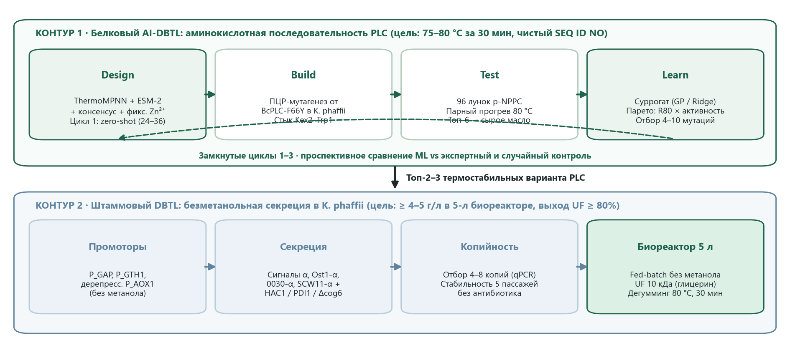
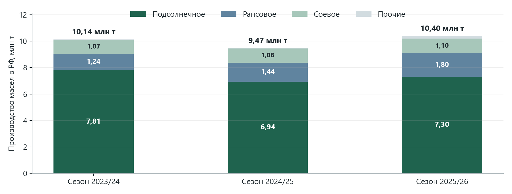
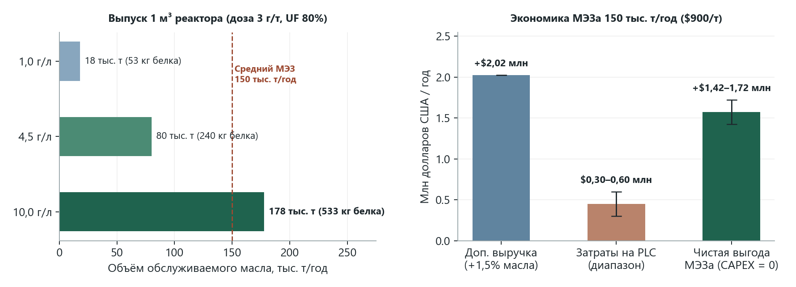

# Фосфолипаза C в дрожжах: от воспроизведения секреции к AI-DBTL для рафинации масел

Аналитический отчёт и план экспериментальных работ · Ноябрь 2026

Цель проекта — воспроизвести в дрожжах *Komagataella phaffii* (*Pichia pastoris*) опубликованный процесс секреции фосфолипазы C (PLC) и подтвердить её активность на модельном субстрате и сыром растительном масле, затем с помощью циклов Design–Build–Test–Learn (DBTL) с элементами белкового машинного обучения повысить термостабильность фермента до рабочих режимов маслозаводов (75–80 °C за 30 мин), перевести экспрессию на безметанольный режим и подтвердить лучшие штаммы в 5-литровом биореакторе. Дальнейшее развитие платформы строится внутри масложировой отрасли: адаптация под состав российских масел (подсолнечное, рапсовое, соевое) и расширение на смежные фосфолипазы (PI-PLC, PLA1) и 1,3-липазы.

Приоритетный продуцент — стандартные доступные дрожжи *Komagataella phaffii* (линии X-33 и протеазодефицитная SMD1168), на которых в мире уже реализовано промышленное производство коммерческой PLC (*Purifine*) и описаны протоколы достижения титра 4,5 г/л в режиме fed-batch [2, 3]. В отличие от маломолекулярных витаминных проектов, где разрыв между модельным дрожжевым штаммом и индустрией достигает 1000-кратной величины, секреция одного целевого фермента в *K. phaffii* позволяет начать с воспроизводимого рабочего прототипа и выйти на прикладные показатели за ограниченное число циклов DBTL.

## 1. Цель и этапы проекта

Проект разбит на три последовательных этапа:

1. **Воспроизведение базового процесса (Этап 0).** Получить в лаборатории подтверждённую секрецию референсной фосфолипазы C (*Bacillus cereus* PLC-F66Y [3, 4]) в *K. phaffii*, измерить её активность по модельному хромогенному субстрату p-NPPC (405–410 нм), оценить концентрацию белка в супернатанте и подтвердить снижение фосфора в пробе сырого растительного масла при 55 °C.
2. **Оптимизация в циклах AI-DBTL (Этап 1).** В двух согласованных контурах — белковом (аминокислотная последовательность PLC) и штаммовом (безметанольный промотор, сигнальный пептид, копийность и факторы фолдинга ЭПР) — получить патентно-чистые термостабильные варианты фермента, сохраняющие активность при 75–80 °C в течение 30 мин, и поднять секретируемый титр относительно базового штамма. Начиная со второго раунда, алгоритмический отбор сравнивается при равном бюджете с рациональным экспертным и случайным контролем.
3. **Проверка в биореакторе и испытания на сыром масле (Этап 2).** Подтвердить 1–2 лучших штамма в управляемом 5-литровом биореакторе в режиме fed-batch без метанола, получить концентрированный жидкий препарат методом ультрафильтрации и провести сравнительные испытания дегумминга сырого подсолнечного и соевого масла при 80 °C за 30 мин.

Процесс оценивается по четырём независимым метрикам:

- **Титр секретируемого фермента** — концентрация целевой PLC в осветлённом супернатанте (г/л по денситометрии SDS-PAGE / BCA) и объёмная активность (Ед/мл по p-NPPC).
- **Термостабильность и кинетика** — температура полуинактивации за 30 мин (T50 (30 мин)), доля остаточной активности после прогрева при 80 °C в течение 30 мин и удельная активность (Ед/мг белка).
- **Эффективность дегумминга на реальном масле** — снижение остаточного фосфора (мг/кг, метод AOCS Ca 12-55) и прирост 1,2-диацилглицеринов (1,2-DAG, масс. %) при фиксированной дозе фермента (цель ≤3–5 мг активного белка на 1 кг масла при 80 °C за 30 мин).
- **Производительность и стабильность штамма** — средняя объёмная производительность в биореакторе (г/(л·ч)) и сохранение титра после серии пассажей без антибиотика.

## 2. Критерии выбора и сравнение альтернатив

### Критерии отбора

Выбор целевого продукта опирается на те же пять проектных критериев, которые применялись при оценке платформы рибофлавина и альтернативных направлений:

- **К1. Опорный референс и промышленная база.** Существуют опубликованный дрожжевой процесс с описанными генами, условиями и измеримыми показателями, а также действующее промышленное производство, задающее ориентир производительности.
- **К2. Быстрый лабораторный скрининг.** Первичный отбор вариантов выполняется доступным оптическим методом в 96-луночном формате без хромато-масс-спектрометрии каждой пробы. Инструментальная проверка на реальном субстрате применяется для валидации лидеров и контрольной выборки.
- **К3. Подтверждённый рынок и преимущество дрожжевого биосинтеза.** Учитываются реальные объёмы потребления в РФ, товарная форма продукта и конкурентоспособность дрожжевого процесса относительно бактерий, мицелиальных грибов и химической технологии.
- **К4. Развитие платформы.** Модификация последовательности фермента или замена одной экспрессионной кассеты в том же штамме открывает выход к смежным продуктам в рамках масложировой рафинации.
- **К5. Государственные приоритеты РФ.** Целевая субстанция напрямую включена в действующие перечни критически важной продукции.

Патентная чистота, технологическая специфика и доступность штаммов в РФ оцениваются отдельно наряду с пятью базовыми критериями.

| Критерий | Подтверждено для фосфолипазы C (PLC) | Требует проверки |
| --- | --- | --- |
| К1. Старт и индустрия | Промышленный *Purifine* PLC выпускается в *K. phaffii* [2]; опубликованы штаммы с титром 4,5 г/л и термостабильные варианты 80–90 °C [1, 3, 10, 11] | Воспроизведение базового титра на локальной линии X-33 / SMD1168 и переход на безметанольный промотор |
| К2. Быстрое измерение | Хромогенный тест p-NPPC (405–410 нм) в 96-лунках за 15–30 мин, включая парный прогрев при 80 °C [16, 17] | Калибровка корреляции между активностью по p-NPPC и глубиной дегумминга реального сырого подсолнечного масла |
| К3. Рынок и дрожжевой ров | Выпуск растительных масел в РФ 9,5–10,4 млн т/год [23–25]; PLC даёт +1,5–2% выхода масла без СЖК [4, 8]; в РФ нет локальной PLC (у «ЭФКО» — PLA1/PLA2) [27, 28] | Реальная готовность независимых МЭЗов РФ (Русагро, Благо, Астон, Содружество) к испытаниям и целевая контрактная цена |
| К4. Развитие платформы | На том же шасси *K. phaffii* реализуются PI-PLC, PLA1 и 1,3-специфические липазы (п. 6 Приказа № 392) для рафинации и переэтерификации масел [15, 30] | Экономика коктейлей PLC + PI-PLC/PLA1 именно на подсолнечном и рапсовом сырье с учётом доли негидратируемых фосфолипидов |
| К5. Приоритеты РФ | Фосфолипазы прямо включены в п. 10 (а липазы — в п. 6) Приказа Минсельхоза России от 06.06.2025 № 392 [30]; ферменты входят в Стратегию биоэкономики № 2777-р [31] | Соответствие конкретным требованиям программ субсидирования НИОКР и CAPEX (ПП РФ № 717) на этапе пилотирования |

Фосфолипаза C закрывает главную уязвимость маломолекулярных дрожжевых проектов: здесь *K. phaffii* изначально выступает промышленным стандартом, стартовая конструкция состоит из одного короткого гена (735 п.о.), а цель оптимизации (термостабильность 80 °C + безметанольный титр) непосредственно решает технологическую проблему действующих маслозаводов.

### Сравнение альтернативных направлений

В таблице 18 альтернативных направлений (включая ранее проработанную платформу рибофлавина и сильные дрожжевые кандидаты, выявленные при аудите госперечней РФ) сопоставлены с термостабильной PLC по условиям запуска DBTL и коммерческой реализуемости в РФ.

| Направление | К1 и дрожжевой ров (vs бактерии и химия) | К2–К5: аналитика, рынок РФ и главные ограничения |
| --- | --- | --- |
| Фосфолипаза C (PLC 80 °C) — основной вариант | 1 ген в *K. phaffii* (X-33/SMD1168); мировой промстандарт (*Purifine*) [2, 3]; без ЛПС и без метанола на этапе оптимизации | 96-луночный тест p-NPPC (405–410 нм) + тест на масле; п. 10 Приказа № 392; 10 млн т масел в РФ; нет локальной PLC [23, 28, 30] |
| 1. Рибофлавин (B2) → FMN → FAD | В промышленности B2 доминируют *B. subtilis* (26–35 г/л) и *A. gossypii*; в *K. phaffii* старт 20 мг/л (разрыв 1000×); по FMN/FAD *E. coli* достигла 3,46/2,31 г/л | Простой тест 445 нм (ломается кристаллами >0,1 г/л); п. 32 Приказа № 392; кормовой B2 $10–11/кг FOB КНР; рынок АФС FMN в РФ невелик (~1–3 т/год) |
| 2. Тройноспиральный коллаген III (rhCol III + P4H) | Абсолютный дрожжевой ров в *K. phaffii* (у *E. coli* нет P4H-гидроксилирования и есть ЛПС); 2 гена, титр 2,54 г/л (2025) [33] | Сложнее аналитика (гидроксипролин + CD-спектр); нет в Приказе № 392; сильный коммерческий резерв на том же шасси *K. phaffii* |
| 3. 1,3-Специфические липазы и нейтр. лактаза | Сильный дрожжевой ров (*K. phaffii*, *K. lactis*) для чистых пищевых липаз (OPO/сыр) и нейтральной молочной лактазы | Быстрые тесты p-NPP / ONPG; п. 5 и п. 6 Приказа № 392 [30]; для 1,3-липаз нужна стадия иммобилизации — оптимально как Шаг 2 после PLC |
| 4. Церамиды / фитосфингозин (TAPS) | Монополия дрожжей (*W. ciferrii* 17–22 г/л; *Y. lipolytica* 0,65 г/л); бактерии не синтезируют | Нужна ВЭЖХ-ELSD и химцех деацетилирования/ацилирования; нет в Приказе № 392; в мире сильны Evonik/Doosan/Bloomage |
| 5. Эрготионеин | 2 грибных гена в *S. cerevisiae* / *Y. lipolytica* (1,63–8,0 г/л); 74% внутри клеток | УФ/ВЭЖХ с экстракцией; малый физический тоннаж РФ (единицы–десятки кг/год); профицит *E. coli* в КНР; нет прямого каскада к SAMe |
| 6. S-Аденозилметионин (SAMe) | Уникальный дрожжевой ров (кислая вакуоль, 10–14 г/л в *S. cerevisiae*); включён в СЗЛС II (июль 2026) | Внутриклеточная экстракция, сложная стабилизация соли, фарм-GMP 2–4 года, зависимость от L-метионина; «Промомед» вывел препарат в 2026 г. |
| 7. Глутатион (GSH) | Дрожжевой стандарт (*S. cerevisiae* / *C. utilis*, 2,8–10 г/л, GRAS) | Быстрый тест Эллмана (412 нм); нет в Приказе № 392 и СЗЛС; плотное старое патентное поле |
| 8. Каротиноиды (ликопин, β-каротин, астаксантин) | Зрелая платформа *Y. lipolytica* (до 39,5 г/л β-каротина); плотно закрыта работами по DBTL | Внутриклеточный лизис, экстракция, ВЭЖХ изомеров; жёсткая конкуренция с химсинтезом и *Blakeslea trispora* |
| 9. Кроцетин, биксин и редкие полифенолы | Длинные многогенные каскады, низкие титры, компартментализация | Сложная ВЭЖХ/ЖХ-МС и дорогие стандарты; дешёвые растительные экстракты |
| 10. п-Кумаровая кислота → ресвератрол | Методологический эталон DBTL (Nature Commun. 2024), научная новизна во многом исчерпана | УФ-фон среды, ВЭЖХ; химсинтез и дигидрокверцетин в РФ; банкротство/продажа *Evolva* |
| 11. Пуллулан (E1204) | Промышленный полисахарид *Aureobasidium* (140 г/л) | Контроль молекулярной массы (ГПХ), вязкость бульона, низкая цена КНР ($15–30/кг) |
| 12. Витамин B7 (биотин) | Лимитируется Fe–S-ферментом биотинсинтазой (единицы мг/л в дрожжах) | Нет оптического теста; п. 38 Приказа № 392, но экономика дрожжей не доказана против химии |
| 13. Рекомбинантный химозин | Зрелая секреция в *K. lactis* / *K. phaffii*; п. 12 Приказа № 392 | Рынок РФ (~25–35 т/год) уже плотно закрывается разработками «ЭФКО» и ФИЦ Биотехнологии РАН |
| 14. Таурин и фолинат | Таурин — нефтехимия ($2–3/кг); фолинат — следовые титры в дрожжах (0,36 мг/л) | Нет простого оптического теста; для фолината — строгий стереохимический фарм-контроль |
| 15. 7-DHC → витамин D3 / 25-OH-D3 | Дрожжевой стерольный путь (ERG5Δ ERG6Δ, 3,5–5,1 г/л); п. 29 Приказа № 392 | Плотный активный патентный забор DSM до 2036–2040 гг.; нужен цех УФ-фотолиза и ВЭЖХ |
| 16. 2′-Фукозиллактоза (2′-FL) | До 26 г/л в дрожжах; спрос детского питания (АО «Инфаприм») | Нет оптического теста (хроматография сахаров); плотный патентный блок *dsm-firmenich* |
| 17. Омега-3 (EPA/DHA), OPO и аналоги пальмы | В дрожжах проигрывают микроводорослям *Schizochytrium* (DHA), 1,3-липазам (OPO) и растительным маслам | Сложная липидная аналитика (ГХ-ПИД, *sn*-2 липолиз); нет в Приказе № 392 |
| 18. Лимонная, янтарная, молочная кислоты и эритрит | Высокие титры в *Y. lipolytica* / *P. kudriavzevii* | Лимонную закрывают 3 строящихся завода РФ (~170 тыс. т), янтарную — завод МАН СИБУРа (45 тыс. т), эритрит — демпинг КНР; низко-pH молочная годится только под лицензирование штамма |

### Анализ выбора и условия пересмотра

Сравнение показывает три ключевых преимущества фосфолипазы C над рибофлавином и прочими альтернативами. Во-первых, для PLC *K. phaffii* является не «учебной заменой» промышленной бактерии, а полноценной промышленной платформой без разрыва в три порядка по стартовому титру [2, 3]. Во-вторых, задача белковой термостабилизации (перенос оптимума с 55 до 80 °C) позволяет получить новую аминокислотную последовательность с чистым патентным статусом и прямой экономической ценностью для маслозавода. В-третьих, продукт напрямую включён в п. 10 Приказа Минсельхоза № 392 [30], не требует многолетних клинических испытаний (в отличие от фармацевтических субстанций SAMe или инъекционного FMN) и проверяется на реальном сыром масле уже на лабораторной стадии.

| Вариант | Условия рационального выбора | Основания для пересмотра |
| --- | --- | --- |
| Фосфолипаза C (PLC 80 °C) — основной | Нужны надёжный 1-генный старт, быстрый 96-луночный скрининг, патентная уникальность и прямой госприоритет РФ | Отсутствие интереса масложировых компаний РФ к испытаниям; неспособность выйти на безметанольный титр >2–3 г/л |
| 1,3-Липазы (п. 6 Приказа № 392) — смежный резерв | Появился якорный запрос на ферментативную переэтерификацию масел и спецжиров | Готовность заказчика софинансировать стадию иммобилизации фермента |
| Тройноспиральный коллаген III — резерв на том же шасси *K. phaffii* | Фокус команды смещается с АПК на косметический/медицинский рынок | Готовность обеспечить аналитику тройной спирали (CD-спектроскопия) и регистрацию косметики/медизделий |
| Рибофлавин (B2 → FMN/FAD) — альтернатива для метаболического инжиниринга | Приоритет команды — классический метаболический инжиниринг (настройка «ферментативных кранов», промоторов пути и условий среды) под низкомолекулярный продукт | Осознанное принятие роли Шага 1 (B2) как полигона DBTL (без конкуренции с *B. subtilis* на кормовом B2), решение вопроса доступности *C. famata* и фокус коммерциализации на Шаге 2 (FMN/FAD) |

## 3. Выбор продуцента и обзор литературы по дегуммингу масел

### Дрожжи, бактерии и грибы для производства PLC

В мировой практике фосфолипазы C экспрессируют как в дрожжах *Komagataella phaffii*, так и в грамположительной бактерии *Corynebacterium glutamicum* [1, 2, 6, 8]. Выбор класса продуцента определяется сочетанием секреторной чистоты, биобезопасности, стоимости очистки и доступности генетического инструментария.

| Класс продуцента | Опорные результаты по PLC | Сильные стороны и ограничения для DBTL и производства |
| --- | --- | --- |
| Дрожжи *Komagataella phaffii* (X-33, SMD1168, GS115) | Коммерческий *Purifine* PLC (DSM) [2]; BcPLC-F66Y **4,5 г/л** в fed-batch (7 копий + HAC1) [3]; TkPLC 80–100 °C [10]; TiPLC [12]; безметанольная подача [5] | Статус GRAS/QPS, 0 эндотоксинов (ЛПС), отсутствие риска бактериофагов, крайне низкий фон собственных секретируемых белков (простая ультрафильтрация), зрелая база ML по секреции (*MaLPHAS*, *Presep*) [18, 19]. Ограничения: стандартный промотор AOX1 требует метанола (решается переходом на безметанольные промоторы), необходим контроль копийности и сайтов N-гликозилирования |
| Бактерия *Corynebacterium glutamicum* (ATCC 13869) | Секреция BcPLC (Ravasi et al., 2015 [6]) и консенсусной термостабильной **chPLC** (Val et al., 2023–2024 [8, 9]) | Грамположительная (0 ЛПС), высокая скорость роста, доказана работа для chPLC в соевом масле. Ограничения: ниже локальная доступность библиотек секреции в РФ, риск фагового лизиса при масштабировании, в мировой пищевой индустрии *Purifine* PLC закреплён за *K. phaffii* |
| Бактерии *Escherichia coli* и *Bacillus subtilis* | Первичное клонирование BcPLC [1] и мутанта F96R/Q153P (90 °C, Zhang et al., 2022 [11]) | Удобны для быстрой наработки миллиграммов белка в академических тестах, но *E. coli* содержит эндотоксины (ЛПС) и плохо секретирует в среду, а *B. subtilis* обладает сильными внеклеточными протеазами и рисками фагов |
| Мицелиальные грибы (*Aspergillus*, *Trichoderma*) | Промышленный выпуск фосфолипазы A1 (*Lecitase Ultra*, *Quara LowP*) и кормовых ферментов | Высокие титры белка, но сложная мицелиальная морфология тормозит 96-луночный DBTL, а культуральная жидкость содержит сопутствующие эстеразы, протеазы и пигменты |

Для проекта выбраны дрожжи *Komagataella phaffii*: они сочетают промышленный прецедент *Purifine* PLC, отсутствие ЛПС и фагов, чистый супернатант для прямого 96-луночного скрининга и возможность перенести найденные безметанольные промоторы и сигнальные пептиды на другие ферменты масложировой отрасли.

### Обзор литературы: что уже сделано для соевого и других масел

Подавляющая часть мировой литературы и промышленной практики по ферментативному дегуммингу с помощью PLC создана для **сырого соевого масла** (содержит 1,5–3,0% фосфолипидов, или 600–1200 мг/кг фосфора [7, 8, 16]). Этот массив данных задаёт точные технологические ориентиры и показывает нерешённое узкое место индустрии:

1. **Промышленный стандарт первого поколения (*Purifine* PLC, Verenium / DSM-Firmenich).** В досье JECFA [2] описан штамм *P. pastoris* SMD1168 (his4, pep4 — без антибиотического маркера и без протеиназы A) с 12 копиями гена BD16449 (82% идентичности с *B. cereus* PLC, длина 245 а.к., без гемолитического C-концевого домена и с тремя аминокислотными заменами) под метанольным промотором AOX1 и сигналом α-factor. При обработке сырого соевого или кукурузного масла дозой **200 мг препарата на 1 кг масла** (~5 мг чистого фермента/кг) при **55–60 °C в течение 120 мин** фермент переводит фосфатидилхолин (PC) и частично фосфатидилэтаноламин (PE) в 1,2-диацилглицерины (DAG), давая **+1–2% дополнительного выхода масла** [1, 13]. При этом *Purifine* PLC практически не гидролизует фосфатидилинозитол (PI) и фосфатидную кислоту (PA) [13], а для глубокой очистки масла до <10 ppm фосфора его комбинируют с PLA1 или PI-PLC (*Purifine 3G*) [15].
2. **Оптимизация секреции и активности *BcPLC* в *K. phaffii* (Elena et al., 2016–2017; Capone et al., 2015).** Замена одной аминокислоты в кармане связывания головки (**F66Y**, вариант PLC-Y) резко усилила гидролиз PE (>90% PE при сохранении полной активности по PC) и обеспечила **дополнительный выход соевого масла +1,84%** [4]. Интеграция **7 копий** кассеты PLC-Y в *P. pastoris* совместно с ко-экспрессией транскрипционного фактора ответа на несвёрнутые белки **HAC1** под ослабленным промотором AOX1 повысила титр в **6,2 раза** относительно однокопийного штамма и дала **4,5 г/л** в режиме fed-batch [3]. Параллельно Capone с соавторами [5] показали работоспособность безметанольной смешанной подачи глицерина и сорбитола на дерепрессируемом мутантном промоторе AOX1 для секреции PLC в *P. pastoris*.
3. **Технологический барьер 55 °C vs 80 °C на маслозаводах.** Обычная водная гидратация на действующих МЭЗах идёт при **75–80 °C в течение 30 мин** — при этой температуре вязкость масла минимальна и гидратационный осадок эффективно отделяется на сепараторах [1]. Поскольку коммерческие мезофильные PLC инактивируются выше 60 °C и требуют 2 ч реакции, внедрение *Purifine* вынуждает завод устанавливать теплообменники и дополнительные ёмкости-реакторы. Из-за капитальных затрат даже в Аргентине (ведущем мировом экспортёре соевого масла) ферментами рафинируют лишь около **10% соевого масла** [1].
4. **Прорыв к термостабильным PLC 80–90 °C (2022–2025 гг.):**
   - **Консенсусный дизайн chPLC (Val et al., *JAOCS* 2025, *Biochemistry* 2024, *JAFC* 2023 [1, 8, 9]).** Из выравнивания более 1000 природных Zn-зависимых PLC авторы сконструировали синтетическую последовательность chPLC (отличается на 16% аминокислот от ближайшего природного гомолога) и экспрессировали её в *C. glutamicum*. Белок сохраняет структуру выше 90 °C и полностью гидролизует **100% PC и 93–95% PE в сыром соевом масле при 80 °C всего за 30 мин** при дозе **3 мг/кг масла** (на 40% ниже коммерческой дозы 5 мг/кг). Дополнительный выход масла составил **2%**, потребность в переоборудовании маслозавода отпала, а техно-экономическая оценка показала **снижение общих затрат ферментативного дегумминга на 58%** [8].
   - **Архейная гипертермостабильная TkPLC (Marchisio et al., 2022 [10]).** Через HMM-поиск по 107 геномам термофилов выявлена PLC из *Thermococcus kodakarensis* KOD1, экспрессированная в *P. pastoris* (pD912/AOX1). Фермент стабилен при 80 °C в буфере, полностью удаляет PC и PE из сырого соевого масла при 80 °C и сохраняет **80% активности в водно-масляной эмульсии при 100 °C** за счёт встроенного CUB-подобного β-сэндвич домена (~160–180 а.к.) [1, 10].
   - **Рациональный мутагенез BcPLC и грибной TiPLC (Zhang et al., 2022 [11]; Tang et al., 2025 [12]).** На основе анализа B-фактора и молекулярной динамики создан двойной мутант F96R/Q153P *B. cereus* HSL3 с температурным оптимумом **90 °C** и ростом kcat в **4,94 раза** [11]. В мае 2025 года грибная PLC *Talaromyces islandicus* (TiPLC) впервые экспрессирована в *P. pastoris*; введение всего двух пролиновых замен (E92P/A375P, отобранных из 7 расчётных вариантов) повысило термостабильность в **2,43 раза** и снизило остаточный фосфор в масле со 131 до **78 ppm** [12].
5. **Сравнение с PLA1 и место подсолнечного масла.** Коммерческие фосфолипазы A1 (*Lecitase Ultra*, *Quara LowP*) снимают фосфор ниже 10 ppm [14], но расщепляют сложноэфирную связь с образованием **свободных жирных кислот (СЖК)**, которые повышают кислотное число и уходят в отходы при нейтрализации/дезодорации. В РФ ГК «ЭФКО» локализовала выпуск PLA2 (для яичного желтка в майонезах) и PLA1 [27, 28], но термостабильной PLC на российском рынке нет. При этом подавляющее число работ по термостабильной PLC выполнено на соевом масле, тогда как **для РФ базовым сырьём является подсолнечное (7,3–8,0 млн т/год) и быстрорастущее рапсовое (1,4–1,8 млн т/год) масло** [23–25], где выше доля негидратируемых фосфолипидов и иная структура примесей.

Рисунок 3.1. Сопоставление опубликованных вариантов PLC по рабочей температуре, времени дегумминга и дозировке активного белка в сыром масле [1, 2, 4, 8, 10]. Выход в зону 75–80 °C за 30 мин позволяет встраивать фермент в действующие линии водной гидратации МЭЗов без установки теплообменников и дополнительных реакторов.

| Вариант PLC и источник | Продуцент | Рабочая Т и время | Доза и эффект на масле | Роль в проекте |
| --- | --- | --- | --- | --- |
| *Purifine* PLC (BD16449) [2, 13] | *K. phaffii* SMD1168 (AOX1, 12 копий) | 55–60 °C, 120 мин | ~5 мг/кг; +1–2% выхода масла (PC/PE → DAG) | Промышленный ориентир 1-го поколения |
| BcPLC-F66Y (PLC-Y) [3, 4] | *K. phaffii* (AOX1, 7 копий + HAC1) | 55 °C, 120 мин | **4,5 г/л** в fed-batch; >90% PE + PC, **+1,84% масла** | **Стартовый референс Этапа 0** |
| BcPLC F96R/Q153P [11] | *E. coli* (академический тест) | Оптимум **90 °C** | kcat ×4,94, kcat/Km ×2,37 | Позитивный контроль мутаций термостабильности |
| TkPLC (*T. kodakarensis*) [10] | *K. phaffii* (AOX1) | **80–100 °C** | Полное удаление PC и PE из соевого масла при 80 °C | Альтернативный термостабильный скаффолд |
| TiPLC E92P/A375P [12] | *K. phaffii* (AOX1) | Повыш. t1/2 ×2,43 | Снижение P со 131 до 78 ppm | Пример быстрой пролиновой стабилизации в *K. phaffii* |
| chPLC (консенсус, Keclon) [8, 9] | *C. glutamicum* | **80 °C, 30 мин** | **3 мг/кг**; 100% PC, 93–95% PE, **+2% масла**, −58% затрат | Главный внешний технологический бенчмарк |
| **Целевой вариант проекта** | *K. phaffii* (X-33/SMD1168, без метанола) | **75–80 °C, 30 мин** | Титр **≥4–5 г/л** без метанола; доза **≤3 мг/кг** на подсолнечном масле | Патентно-чистый продукт AI-DBTL для МЭЗов РФ |

## 4. Механизм действия, структура белка и пространство тюнинга

### Биохимия дегумминга и состав российских масел

Сырое растительное масло после прессования и экстракции содержит фосфолипиды (ФЛ), которые делятся на гидратируемые (преимущественно фосфатидилхолин PC и часть фосфатидилинозитола PI) и негидратируемые (NHP — преимущественно кальциевые и магниевые соли фосфатидной кислоты PA и часть фосфатидилэтаноламина PE) [16].

При обработке **фосфолипазой C (EC 3.1.4.3)** гидролизуется фосфодиэфирная связь в положении *sn*-3 глицеринового остова:
- полярная фосфатная головка (фосфохолин, фосфоэтаноламин, фосфоинозитол) переходит в водную фазу (2–3% воды) и удаляется на сепараторе;
- неполярный **1,2-диацилглицерин (1,2-DAG)** полностью растворим в масле и остаётся в товарном продукте, высвобождая дополнительно нейтральные триглицериды (TAG), ранее захваченные мицеллами слизи [1, 4, 8].

В отличие от PLC, **фосфолипаза A1 (PLA1)** отщепляет жирную кислоту в положении *sn*-1, образуя водорастворимый лизофосфолипид и свободную жирную кислоту (СЖК), которая увеличивает кислотное число и потери на щелочной нейтрализации или физической дистилляции [14].

| Тип сырого масла | Типичный фосфор, мг/кг | Основные фосфолипиды (ориентир долей) | Технологическая особенность для PLC |
| --- | --- | --- | --- |
| Соевое (основной объект литературы) | 600–1200 [8, 16] | PC (~40–47%), PE (~21–25%), PI (~15–21%), PA (~8–12%) [16] | Высокий выход дополнительного масла (+1,8–2,0%) при гидролизе PC + PE [4, 8] |
| Подсолнечное (главное масло РФ) | 150–450 | PC (~40–50%), PI (~20–28%), PE (~15–22%), PA (~5–15%) | Выше относительная доля PI и NHP; требуется высокая активность по PE и адаптация под кислотное кондиционирование (pH 5,0–6,0) |
| Рапсовое (быстрорастущее масло РФ) | 250–700 | PC (~40–50%), PE (~20–25%), PI (~15–20%), PA (~10–15%) | Высокий потенциал для физического рафинирования и снижения P <10 мг/кг (PLC или PLC + PLA1) |

Рисунок 4.1. Принципиальное отличие ферментативного дегумминга с помощью PLC от PLA1 (сохранение 1,2-DAG в масле без образования свободных жирных кислот) и четыре уровня управляемого тюнинга в циклах AI-DBTL.

### Структура *BcPLC* и точки инженерии последовательности

Зрелая *Bacillus cereus* PLC (245 а.к., ~28,5 кДа) представляет собой компактный однодоменный α-спиральный белок (10 α-спиралей), что делает его исключительно удобным объектом для вычислительного дизайна стабильности [1, 2, 11]. В пространстве последовательностей выделяются четыре структурные зоны:

1. **Триядерный цинковый активный центр (зона строгого запрета мутаций).** Три иона Zn²⁺ координируются консервативными остатками Trp1, His14, Asp55, His69, His118, Asp122, His128, His142 и Glu146 [1, 9]. При генерации библиотек эти позиции и их ближайшая координационная сфера (радиус ≤5 Å) **жёстко фиксируются**, чтобы не потерять каталитическую активность.
2. **Карман распознавания полярной головки (субстратная специфичность).** Остатки вокруг **Phe66** (включая замену F66Y [4], а также Tyr56, Glu4, Asp150) задают селективность между холиновой (PC) и этаноламиновой (PE) головками; варьирование второй сферы кармана позволяет усиливать активность по PE и тестировать расширение на PI/PA.
3. **Поверхностные гибкие петли и межспиральные контакты (главный рычаг термостабильности).** Участки с повышенной подвижностью (высокий B-factor по данным кристаллографии и МД) — приоритетные мишени для: (а) введения жёстких **пролиновых замен** (как Q153P в [11] и E92P/A375P в [12]); (б) создания **поверхностных солевых мостиков** (как F96R [11]); (в) уплотнения гидрофобного ядра и консенсусной стабилизации апо-формы белка (эффект, обеспечивший Tm > 90 °C у chPLC [9]).
4. **Совместимость с секрецией в *K. phaffii*.** Исключение скрытых сайтов расщепления протеазой Kex2 (дибазические пары KR/RR на поверхности), контроль нежелательных мотивов N-гликозилирования (N-X-S/T) рядом с активным центром и оптимизация N-конца зрелого белка (с сохранением критического N-концевого Trp1 для координации Zn²⁺ — это требует точного отщепления сигнального пептида).

> **Критическая молекулярная деталь для *K. phaffii*:** N-концевой **Trp1** в *BcPLC* напрямую участвует в координации цинка в активном центре. Если сигнальный пептид α-factor отщепляется с остаточными спейсерными остатками (EAEA), активность фермента резко падает. Поэтому при сборке плазмиды необходимо проектировать прямой сайт расщепления Kex2 строго перед Trp1 (без лишних N-концевых остатков) и верифицировать активность на Этапе 0 [3].

### Рычаги штаммовой инженерии *K. phaffii* (секреторный конвейер)

В отличие от маломолекулярных путей, где оптимизируется поток углерода по цепочке метаболитов, в производстве ферментов дрожжами узким местом выступает **секреторный конвейер клетки** (транскрипция → транслокация в ЭПР → фолдинг → везикулярный транспорт ЭПР–Гольджи → экспорт наружу) [19, 35]. Простое наращивание силы промотора и числа копий гена часто **снижает** титр: избыток несвёрнутого белка перегружает ЭПР, запускает стресс UPR и деградацию целевого продукта через ERAD [19, 35]. Именно нелинейный баланс между пятью «кранами» конвейера формирует предмет штаммового DBTL:
- **Вход (безметанольные промоторы и копийность):** конститутивный P_GAP, глюкозо-регулируемый P_GTH1 и дерепрессируемые варианты P_AOX1 (смесь глицерин/сорбитол [5]) в сочетании с оптимальной копийностью (обычно 4–8 копий по qPCR; в работе [3] 7 копий дали максимум).
- **Транслокация в ЭПР (сигнальные пептиды):** замена стандартного пост-трансляционного α-factor (*S. cerevisiae*) на ко-трансляционные или гибридные сигналы (Ost1-pro-α, 0030-α, SCW11-α, SWP1-α) устраняет преждевременное сворачивание цепи в цитозоле [19].
- **Фолдинг в ЭПР (шапероны и UPR):** дозированная ко-экспрессия регулятора HAC1 (повышает секрецию в ~73% опубликованных случаев [35], включая ×6,2 для PLC в связке с 7 копиями [3]) и пары Kar2 (BiP) / PDI1 / ERO1 (рост выхода в 2–4 раза [19]).
- **Везикулярный транспорт и защита от протеолиза:** усиление экспорта COPII/Гольджи (Sec1, Sec4, Sec23 — рост выхода в 1,3–2,5 раза [19]), ML-нокауты секреторного пути (Δcog6 из работы *MaLPHAS* — удвоение секреции [18]) и протеазодефицитный фон pep4Δ линии SMD1168 [2].

## 5. Этап 0: воспроизведение базового результата

### Критерии успешного воспроизведения

До запуска серийного AI-DBTL утверждается локальный СОП, фиксирующий штамм, плазмиду, стык Kex2–Trp1, состав среды, дозу Zn²⁺ и протокол анализа. Контрольный дизайн Этапа 0 включает:
- пустой вектор (pPICZαA / pGAPZαA) как отрицательный контроль и однокопийный референс BcPLC-F66Y [3, 4] (при наличии бюджета — также термостабильный контроль BcPLC-F66Y-F96R-Q153P [11] или TkPLC [10]);
- 6–8 независимых трансформантов при первичном отборе (отсечение случайной мультикопийности) и 3 биологических повтора для подтверждённого клона;
- бланк буфера с p-NPPC без фермента и калибровочный стандарт п-нитрофенола (p-NP) для пересчёта в Ед/мл.

### Стартовая методика для *Komagataella phaffii*

1. **Модификация и сборка (Build).** Используют *K. phaffii* X-33 (прототроф, доступен в РФ) и/или протеазодефицитный SMD1168 (his4, pep4). Кодон-оптимизированный зрелый BcPLC-F66Y (735 п.о., без нативного сигнала и гемолитического хвоста) клонируют в pPICZαA (эталон [3]) и безметанольный pGAPZαA строго за сайтом Kex2 (...Lys-Arg / Trp1-Ser-Ala... без спейсера Glu-Ala-Glu-Ala, мешающего Zn²⁺-центру [3]). В циклах DBTL 1–4 точечные замены вносят ПЦР-мутагенезом / сборкой Гибсона (в 5–10× дешевле полного синтеза); при >5 заменах синтезируют фрагмент 735 п.о.
2. **Трансформация и копийность.** Плазмиду линеаризуют (SacI для AOX1; BspHI/AvrII для GAP), вводят электропорацией (1,5 кВ, 25 мкФ, 200 Ом; 1 М сорбитол 1–2 ч) и отбирают на YPDS + зеоцин (100 мкг/мл, 30 °C, 3 сут). Вставку подтверждают ПЦР и секвенированием; копийность фиксируют qPCR (1 копия для старта; 4–8 копий на зеоцине 500–1000 мкг/мл для масштабирования).
3. **Культивирование (плашки, колбы и 5-л fed-batch).**
   - *96-well deep-well (скрининг DBTL):* предкультура 300 мкл YPD/BMGY (24 ч) → пересев 1:20 в 600 мкл безметанольной среды (pH 6,0, 0,2 мМ ZnSO4) под газопроницаемой плёнкой (влажность >80%, 28 °C, 900 об/мин, 72 ч; целевой CV ≤15%).
   - *Колбы 250 мл (25–50 мл среды):* рост в BMGY (1% дрожжевой экстракт, 2% пептон, 100 мМ К-фосфат pH 6,0, 1,34% YNB, 1% глицерин, 0,4 мг/л биотин, 28–30 °C, 220 об/мин) до OD600 ≈ 2–6 → BMMY (0,5–1% метанола/24 ч, 72–96 ч) либо безметанольная среда на глюкозе или глицерин/сорбитоле с **0,1–0,5 мМ ZnSO4** [2, 3, 5].
   - *5-л биореактор (fed-batch без метанола):* среда BSM + PTM1 + ZnSO4, батч на глицерине (40 г/л, 20–24 ч, 28 °C, pH 5,5, DO >25%) до пика DO → экспоненциальная лимитирующая подпитка глюкозой (P_GAP/P_GTH1) или смесью глицерин/сорбитол (дерепресс. P_AOX1 [5]) 72–96 ч.
4. **Базовый ориентир Этапа 0.** Полоса ~28,5 кДа на SDS-PAGE, активность по p-NPPC >10× фона, титр в колбах ~0,1–0,5 г/л (ориентир fed-batch с 7 копиями + HAC1 — 4,5 г/л [3]), подтверждённое снижение фосфора в сыром масле при 55 °C.

### Параметры, фиксируемые в каждом опыте

- Код последовательности, промотора, сигнала, номер клона и число копий (qPCR); режим, OD600, pH и доза Zn²⁺.
- Активность p-NPPC (без прогрева и после 75/80 °C за 30 мин), титр белка, удельная активность (Ед/мг); для масла — партия, исходный и остаточный P, кислотное число, доза фермента/воды, прирост 1,2-DAG.

## 6. Аналитический контроль

### Трёхуровневая аналитическая воронка

Аналитика построена так, чтобы первичный скрининг 48–96 вариантов в каждом цикле DBTL занимал часы на обычном планшетном спектрофотометре, а ресурсоёмкие масляные испытания применялись к отобранным лидерам и контрольной выборке.

Рисунок 6.1. Трёхуровневая аналитическая схема стадии Test: парный 96-луночный термошок на p-NPPC разделяет рост термостабильности и рост титра, а проверка на сыром масле подтверждает прикладную эффективность в реальной эмульсии.

### Уровень 1: экспресс-тест p-NPPC и парный термошок (96 лунок)

Стандартный хромогенный субстрат PLC — **п-нитрофенилфосфохолин (p-NPPC)**, при расщеплении которого выделяется жёлтый п-нитрофенол с максимумом поглощения при **405–410 нм** [16, 17]:
- **Реакционная смесь (200 мкл в лунке):** 180 мкл буфера (50 мМ HEPES pH 6,8–7,2 или 250 мМ Tris-HCl pH 7,2, **1 мМ ZnCl2**, 10 мМ p-NPPC; при необходимости 60% сорбитола для стабилизации [16]) + 20 мкл осветлённого разведённого супернатанта. Инкубация 15–30 мин при 37 °C (или 55 °C), измерение A405 (или A410) в планшетном ридере. Объёмную активность (Ед/мл) рассчитывают по линейной калибровке стандарта п-нитрофенола в том же буфере (ориентировочный коэффициент экстинкции при pH 7,2 — 11 000–12 000 М⁻¹·см⁻¹) с учётом разведения и времени реакции; за 1 Ед принимают образование 1 нмоль (или 1 мкмоль — шкала фиксируется в СОП) п-нитрофенола в минуту.
- **Парный тест термостабильности и «температурная лестница» (ключевой для AI-DBTL):** супернатант каждого варианта разливают в две ПЦР-плашки. Контрольную плашку держат при 4 °C (измерение базовой объёмной активности Ybase), тестовую — прогревают ровно **30 мин при заданной температуре T** в термоциклере (измерение целевой активности после прогрева YT), охлаждают на льду 5 мин и синхронно запускают реакцию с p-NPPC. Чтобы на старте не получать нулевой сигнал от мезофильного родителя, температура термошока повышается по циклам ступенчато (**«температурная лестница»**): **62–65 °C в Цикле 1** (где базовый BcPLC-F66Y сохраняет ~15–25% активности и виден градиент улучшений) → **72–75 °C в Цикле 2** → **80 °C в Цикле 3**.
- **Итоговая единая метрика продукта и диагностика в четырёх квадрантах [34]:**
  - **Итоговая целевая функция YT (Ед/мл супернатанта после прогрева при T, или Ед/(л·ч)):** прямой аналог производительности г/(л·ч) для малых молекул. В одном быстром измерении A405 перемножены все три коммерческих свойства фермента: титр секреции (г/л) × удельная активность (Ед/мг) × выживаемость при температуре T (RT). Именно активные при 80 °C единицы фермента (а не масса денатурированного белка) покупает маслозавод.
  - **Индекс термостабильности RT = YT / Ybase (остаточная активность, %):** не зависит от титра, плотности культуры и числа копий и служит чистой целевой переменной для белковой ML-модели (в работе Yoshida et al. [34] переход от сырой активности к отношению RT поднял точность модели классификации мутантов липазы с <75% до 94,5% и увеличил остаточную активность с 5% до 66% за один цикл ML).
  - **Базовая активность Ybase (4 °C):** в паре с RT раскладывает варианты по четырём квадрантам и позволяет отбирать лидеров из первого квадранта (рост и термостабильности, и выхода секреции).

### Уровень 2: титр белка и контроль качества секреции

Для 20–30% лучших вариантов и контрольной выборки средних клонов проводят определение общего белка в супернатанте (BCA / Брэдфорд, после обессоливания при наличии пептона) и **SDS-PAGE (12–15% гель)** с калибровкой по стандарту BSA. По доле полосы ~28,5 кДа вычисляют чистый титр PLC (г/л) и удельную активность (Ед/мг), а также выявляют протеолиз или гипергликозилирование (размывание полосы вверх). Для топ-3 мутантов при наличии доступа к ЦКП измеряют температуру плавления Tm методом дифференциальной сканирующей флуориметрии (nanoDSF / SYPRO Orange).

### Уровень 3: валидация на реальном сыром масле (подсолнечном и соевом)

Субстрат p-NPPC водорастворим и не воспроизводит границу раздела фаз «масло–вода» [17]; кроме того, часть термостабильных PLC (включая TkPLC [10]) ведут себя в водно-масляной эмульсии стабильнее, чем в водном буфере. Поэтому 15–20% вариантов каждого цикла (лидеры + 2–3 средних варианта + родительский контроль) проходят лабораторный дегумминг:
- **Протокол модельного дегумминга [4, 8, 13]:** 10–50 г сырого нерафинированного масла (подсолнечного или соевого, с известным исходным фосфором) предварительно нагревают до **80 °C** (и параллельно 55 °C для сравнения с контролем), при необходимости проводят мягкое кислотное кондиционирование (лимонная кислота, pH водной фазы 5,0–6,0), вносят **3% (масс.)** водного раствора фермента в пересчёте на **3–5 мг активного белка / кг масла**, интенсивно эмульгируют (высокосдвиговое перемешивание / вортекс) и выдерживают **30 мин** (и контрольную точку 120 мин) при 80 °C. Фазы разделяют центрифугированием (4000–6000 g, 10–15 мин).
- **Измерение остаточного фосфора в масле:** стандартный колориметрический метод **AOCS Ca 12-55** (озоление 3 г масла с 0,5 г ZnO при 550–600 °C, растворение в HCl, реакция с молибдатом натрия и сульфатом гидразина, A650 по калибровке KH2PO4) [16] либо ICP-OES в ЦКП.
- **Быстрый контроль высвобождённого фосфата в водной фазе и 1,2-DAG:** измерение органического/неорганического фосфора в отделённой водной фазе прямо коррелирует с долей расщеплённых фосфолипидов и приростом масла [8]; для финальных лидеров подтверждают прирост **1,2-DAG** (ВЭЖХ-ELSD или ГХ) и отсутствие роста свободных жирных кислот (кислотное число).

### Контроль качества измерений

- Бланк субстрата (p-NPPC без фермента) и пустой вектор *K. phaffii* в каждой плашке; калибровка по стандарту п-нитрофенола.
- Рабочие пороги исследовательской стадии: CV технических повторов ≤10%, CV биологических повторов ≤15%, линейный диапазон кинетики p-NPPC (не доводить A405 выше 1,2 без разведения).
- Проверка отсутствия гемолитической активности у новых мутантных последовательностей (стандартный тест на кровяном агаре, как в досье JECFA [2]) перед пилотными испытаниями.

## 7. Выделение и приготовление товарной формы фермента

В отличие от внутриклеточных метаболитов или плохо растворимых кристаллов, внеклеточная секреция PLC в *K. phaffii* радикально упрощает узел выделения: **не требуются разрушение клеток, органические растворители и хроматографическая очистка** для получения промышленного технического/пищевого препарата.

### Промышленная схема выделения (ориентир JECFA / *Purifine*)

В открытом техническом досье *Purifine* PLC [2] и работах по масштабированию PLC [8] закреплена четырёхстадийная мембранная схема:
1. **Отделение биомассы:** центрифугирование и/или тангенциальная микрофильтрация (0,2–0,45 мкм) при 4–15 °C для полного удаления клеток *K. phaffii*.
2. **Ультрафильтрация и диафильтрация (UF/DF):** концентрирование супернатанта в 5–15 раз на мембранах с отсечкой **10 кДа** (PLC имеет массу ~28,5 кДа и полностью задерживается мембраной, тогда как соли, остаточный глицерин и низкомолекулярные метаболиты среды уходят в пермеат).
3. **Стерилизующая фильтрация и контроль чистоты:** фильтрация через 0,22 мкм (при необходимости — удаление следовой ДНК на мембранном адсорбере) с контролем отсутствия жизнеспособных клеток и рекомбинантной ДНК (предел детекции ≤0,01 пг в досье JECFA [2]).
4. **Формуляция жидкого концентрата:** стабилизация фермента добавлением **35% глицерина**, буфера (ацетат натрия ~0,15%), кофактора **ZnSO4 (~0,03%)** и разрешённых пищевых консервантов (сорбат калия) [2]. Такой препарат стабилен при хранении и легко дозируется насосом в водяной поток МЭЗа.

### Лабораторный регламент выделения и сводка сквозного протокола

На лабораторной стадии (500 мл – 5 л) применяется пошаговый мембранный протокол без хроматографии: (1) охлаждение культуральной жидкости до 4–8 °C и центрифугирование (4000 g, 15 мин, 4 °C); (2) осветляющая фильтрация через мембрану 0,22 мкм (PES, с низким связыванием белка); (3) тангенциальная ультрафильтрация на кассете PES с отсечкой **10 кДа** (трансмембранное давление 1,0–1,5 бар) — концентрирование в 5–10 раз с диафильтрацией 3–5 диаобъёмами буфера (20 мМ ацетат натрия pH 5,8, 0,2 мМ ZnSO4); (4) стерилизующая фильтрация 0,22 мкм и добавление стерильного глицерина до **35% (масс.)** с контролем активности до и после каждой стадии. Ключевые метрики узла: **выход по активности** (цель ≥80–85%), **активность концентрата** (Ед/г, ориентир коммерческого препарата ≥17 000–27 500 Ед/г [2, 16]) и **стабильность при хранении** (потеря <10% активности за 3 месяца при 4 °C, ускоренный контроль при 25 °C и 37 °C).

| Стадия цикла | Конкретное действие и параметры | Обоснование и контроль качества |
| --- | --- | --- |
| 1. Модификация (Build) | ПЦР-мутагенез / Gibson на базе BcPLC-F66Y (735 п.о.), стык Kex2 / Trp1 без спейсера, линеаризация SacI/BspHI, электропорация в *K. phaffii* X-33 / SMD1168 | Дешевле синтеза в 5–10×; сохранение N-концевого Trp1 критично для Zn²⁺ [3]; проверка ПЦР, секвенированием и qPCR копийности |
| 2. Выращивание (Grow) | 96-well deep-well (600 мкл, 28 °C, 900 об/мин, 72 ч, 0,2 мМ ZnSO4) → колбы 250 мл → 5-л fed-batch (BSM + PTM1, pH 5,5, DO >25%, подпитка без метанола) | 96-луночный формат даёт 48–96 вариантов за цикл (CV ≤15%); ZnSO4 насыщает активный центр; безметанольный режим снимает Ex-ограничения |
| 3. Выделение (Purify) | 4000 g (4 °C) → фильтр 0,22 мкм → UF/DF кассета PES 10 кДа (1–1,5 бар, 20 мМ ацетат + ZnSO4) → формуляция в 35% глицерине | Внеклеточная секреция без лизиса клеток и хроматографии; выход по активности ≥80–85%, контроль ДНК ≤0,01 пг [2] |
| 4. Оценка (Test) | Парный термошок (4 °C vs 75–80 °C, 30 мин) + p-NPPC (405 нм) → SDS-PAGE/BCA → дегумминг сырого масла (80 °C, 30 мин, 3–5 мг/кг) + AOCS Ca 12-55 / 1,2-DAG | Индекс R80 отделяет термостабильность от копийности; масляный тест проверяет границу фаз, остаточный P, рост 1,2-DAG и отсутствие гемолиза |

## 8. Цикл AI-DBTL: белковый дизайн и оптимизация секреции

Главная особенность данного проекта — **разделение белкового и штаммового контуров DBTL** на одной аналитической базе. В отличие от классического метаболического DBTL, где сигнал от 6 промоторов легко тонет в вариабельности клонов, индекс термостабильности R80 нормируется на собственную базовую активность каждого клона и практически не зависит от копийности и плотности культуры.

Рисунок 8.1. Двухконтурный цикл AI-DBTL. В Контуре 1 алгоритмы белкового дизайна подбирают термостабильную и патентно-чистую последовательность PLC (80 °C); в Контуре 2 оптимизируются безметанольный промотор, сигнальный пептид и факторы секреции *K. phaffii*.

### Контур 1 (Белковый DBTL): как тюнингуется последовательность PLC

- **Цикл 1 (Zero-shot дизайн, 24–36 вариантов от базового BcPLC-F66Y):**
  1. По кристаллографической/AlphaFold-структуре BcPLC фиксируются каталитическая триада Zn²⁺ и ближайшие остатки активного центра (радиус ≤5 Å).
  2. С помощью **ThermoMPNN** и **ProteinMPNN** (графовые нейросети белкового дизайна; ThermoMPNN показала прогностическую точность PPV 46–56% на стабилизирующих мутациях при ΔΔG < −0,5 ккал/моль [20, 21]) выполняется полное сканирование всех возможных одиночных замен вне активного центра.
  3. Кандидаты фильтруются белковой языковой моделью **ESM-2** (отсев эволюционно запрещённых замен, ломающих фолдинг) и структурными правилами: введение пролинов в петли с высоким B-factor, формирование солевых мостиков и консенсусные остатки выравнивания >1000 гомологов [9, 11, 12], при **исключении точного копирования известных патентованных комбинаций**.
  4. В мокрую лабораторию уходит компактная серия из **24–36 вариантов** (одиночные и 2–3-точечные замены, собираемые дешёвым сайт-направленным ПЦР-мутагенезом), измеряемая на парной плашке 50 °C / 80 °C (p-NPPC).
- **Циклы 2–3 (Few-shot Active Learning и комбинаторный эпистаз, 24–48 вариантов на цикл):**
  1. На собственных экспериментальных данных Цикла 1 обучается суррогатная модель — регуляризованная регрессия (Ridge / Gaussian Process с оценкой неопределённости, методическая рамка ART [22]) поверх эмбеддингов **ESM-2** и скоров **ThermoMPNN**.
  2. Модель решает **многокритериальную задачу** (Upper Confidence Bound / Expected Hypervolume Improvement): максимизировать одновременно остаточную активность после **80 °C (30 мин)** и удельную активность, отбирая **комбинации из 4–10 мутаций** с положительным эпистазом (пример: двойной мутант F96R/Q153P поднял Topt до 90 °C [11], а в chPLC отличия от природных аналогов составляют 16% последовательности [8]).
  3. Лучшие 5–8 вариантов каждого цикла проходят проверку на **сыром подсолнечном и соевом масле при 80 °C за 30 мин**; при наличии расхождения между p-NPPC и реальным маслом модель дообучается на масляных данных.

### Контур 2 (Штаммовый DBTL): безметанольная секреция в *K. phaffii*

После получения 2–3 термостабильных лидеров (или параллельно во 2–3-м раунде) оптимизируется клеточная фабрика *K. phaffii* с целью **полного отказа от взрывоопасного метанола** и выхода на промышленный титр:
- **Пространство конструкций (16–32 комбинации):** 3–4 безметанольных промотора (P_GAP, P_GTH1, дерепрессируемый мутант P_AOX1 [5]) × 4–6 сигнальных пептидов (α-factor, Ost1-α, 0030-α, SCW11-α) × 2–3 фактора секреции (HAC1 [3], PDI1/ERO1, нокаут Δcog6 [18]).
- Обязательная верификация числа копий (qPCR) для отделения эффекта промотора и сигнального пептида от случайной мультикопийности; на финальном шаге выполняется целенаправленный отбор стабильных мультикопийных клонов (4–8 копий) лучшей комбинации.

### Валидация моделей и статистический контроль

- **Исключение утечки данных:** при кросс-валидации технические повторы и независимые клоны одного варианта строго группируются (GroupKFold по последовательности/конструкции); положение лунок в 96-луночной плашке и термоциклере рандомизируется, а базовый контроль (BcPLC-F66Y) включается в каждую плашку для нормализации межсерийного сдвига.
- **Проспективное сравнение стратегий:** во 2–3-м раундах бюджет вариантов делится между **рекомендациями AI/ML**, **рациональным экспертным выбором** и **контрольной базой**; оцениваются максимальный подтверждённый T50 (30 мин), доля вариантов с улучшением >20% и число опытов до достижения порога 80 °C.
- **Технологическая и патентная новизна:** термостабильный дегумминг соевого масла при 80 °C в мире уже продемонстрирован (в частности, консенсусная chPLC в бактерии *C. glutamicum* [8, 9]), поэтому новизна данного проекта носит не фундаментальный, а инженерно-прикладной и патентный характер. Она строится на трёх элементах: (1) совместная оптимизация стабильности последовательности PLC и её безметанольной секреции в *K. phaffii* (с преодолением конфликта между стабилизацией белка и эффективностью фолдинга в ЭПР); (2) адаптация фермента к составу сырого подсолнечного и рапсового масла; (3) собственная аминокислотная последовательность (уникальный SEQ ID NO) в сочетании с безметанольным штаммом *K. phaffii* как охраноспособный объект для патентной заявки РФ/ЕАПВ (после проведения профильного патентного поиска по реестрам ФИПС и ЕАПВ).

## 9. Масштабирование, биореактор и критерии перехода

Переход от колбовых опытов (0,1–0,5 г/л) к управляемому **5-литровому биореактору** является обязательным условием оценки промышленной пригодности, так как у *K. phaffii* плотность сухой биомассы в режиме fed-batch достигает **80–120 г/л** против 3–8 г/л в колбах, что кратно поднимает объёмный титр (до 4,5 г/л в работе [3] и 5–15 г/л в промышленных безметанольных процессах).

Отказ от метанольной индукции (AOX1 на метаноле) в пользу лимитирующей подачи **глицерина/сорбитола** [5] или **глюкозы** (P_GTH1 / P_GAP) даёт три технологических преимущества при масштабировании: (1) исключаются требования взрывозащиты Ex-класса и хранение токсичного метанола; (2) снижается тепловыделение и нагрузка на систему охлаждения реактора; (3) уменьшается потребность в кислороде (kLa). В 5-л аппарате контролируют pH 5,0–6,0, DO >20–30%, температуру 28–30 °C, профиль экспоненциальной подпитки, концентрацию Zn²⁺ и отсутствие деградации целевого белка на SDS-PAGE.

### Этапы и жёсткие критерии перехода (Go / No-Go)

| Переход между этапами | Числовой критерий прохождения | Действия при отклонении |
| --- | --- | --- |
| Аналитика → воспроизведение | Линейность p-NPPC (R² ≥ 0,99), CV повторов ≤10%, отработан метод AOCS Ca 12-55 на сыром масле (recovery 85–115%) | Корректировка буфера, дозы Zn²⁺ и разведений до начала серийных опытов |
| Воспроизведение → AI-DBTL | Подтверждена полоса ~28,5 кДа, активность p-NPPC >10× фона, снижение P в сыром масле при 55 °C (120 мин) | Проверка стыка Kex2–Trp1, секвенирование вставки, переход на SMD1168 (pep4Δ) при протеолизе |
| Белковый DBTL → штаммовый DBTL | Получены ≥2 патентно-чистых мутанта с остаточной активностью ≥70% после 30 мин при 75–80 °C и подтверждённым гидролизом PC/PE в масле за 30 мин | Расширение библиотеки на термостабильный скаффолд TkPLC [10] или дополнительный раунд мутагенеза петель |
| DBTL → 5-л биореактор | Безметанольный штамм даёт воспроизводимый титр в колбах ≥ контроля, стабилен на 5 пассажах без антибиотика | Подбор копийности (4–8 копий) и ко-экспрессии HAC1/PDI1 [3] |
| Биореактор → опытные испытания на МЭЗе | Титр ≥3–5 г/л в 5-л fed-batch, выход UF ≥80%, в пробе сырого подсолнечного масла при 80 °C за 30 мин (доза ≤3–5 мг/кг) подтверждены удаление PC/PE и прирост 1,2-DAG, гемолиз отсутствует | Оптимизация режима питания/DO, проверка стабильности жидкого концентрата и доработка рецептуры кондиционирования масла |

## 10. Развитие платформы в рамках рафинации масел

После закрепления базовой термостабильной PLC на 80 °C и отработки безметанольного шасси *K. phaffii* дальнейшее развитие платформы остаётся сфокусированным на **технологиях переработки растительных масел** и не требует смены организма или аналитической базы:

1. **Тюнинг под конкретные виды российского сырья и режимы МЭЗов.** Подсолнечное, рапсовое, соевое и кукурузное масла различаются по доле негидратируемых фосфолипидов (NHP), содержанию ионов Ca²⁺/Mg²⁺ и кислотности водной фазы (pH 4,5–6,5 после обработки лимонной или фосфорной кислотой). Накопленная в Циклах 1–3 суррогатная модель позволяет точечно донастраивать фермент под pH-оптимум, устойчивость к хелаторам и повышенную активность по PE в конкретном сырье заказчика.
2. **Расширение на смежные фосфолипазы (PI-PLC, NPC, PLA1).** Базовая PC-PLC удаляет PC и PE (основной вклад в прирост масла +1,5–2% [4, 8]), но оставляет фосфатидилинозитол (PI) и фосфатидную кислоту (PA), доля которых в подсолнечном масле существенна. Следующий шаг — разработка на том же шасси *K. phaffii* термостабильной **PI-специфичной PLC** (или широкоспецифичной неспецифической PLC, гидролизующей PC, PE, PI и PA [15]) либо **фосфолипазы A1 (PLA1)** для создания комплексных ферментных препаратов глубокой очистки масла до <5–10 мг/кг фосфора под физическую рафинацию.
3. **1,3-Специфические липазы для масложировой переработки (п. 6 Приказа № 392).** На том же безметанольном *K. phaffii* и аналогичном хромогенном скрининге (p-NPP, 405 нм) возможно расширение линейки на термостабильные 1,3-липазы для ферментативной переэтерификации масел (производство специализированных пищевых жиров без транс-изомеров и структурированных OPO-жиров для детского питания).
4. **Ферментативный апсайклинг лецитина с помощью фосфолипазы D (PLD).** На той же сырьевой базе маслозаводов дешёвый подсолнечный или соевый лецитин ($1–3/кг) может перерабатываться рекомбинантной фосфолипазой D (секретируемой в том же шасси *K. phaffii*) в реакции трансфосфатидилирования с L-серином в высокомаржинальный **фосфатидилсерин (PS)** или специализированные фосфолипиды для нутрицевтики и липосомальных систем (ценовой сегмент кратно выше базового лецитина).

## 11. Рынок и экономическая оценка (РФ)

### 11.1. Сырьевая база: производство растительных масел в РФ

Россия входит в число крупнейших мировых производителей и переработчиков масличных культур. По данным Масложирового союза России, OleoScope и Росстата [23–25], совокупный выпуск основных растительных масел держится в диапазоне **9,5–10,4 млн т/год** при перерабатывающих мощностях **31,7–35 млн т масличных/год**:
- **Сезон 2023/24:** **10,142 млн т** (подсолнечное — 7,806 млн т; рапсовое — 1,240 млн т; соевое — 1,075 млн т; календарный 2024 г. — 10,4 млн т, включая 8,0 млн т подсолнечного) [23, 24].
- **Сезон 2024/25:** **9,471 млн т** (подсолнечное — 6,940 млн т; рапсовое — 1,435 млн т, +16%; соевое — 1,078 млн т) [23].
- **Сезон 2025/26:** **10,400 млн т** (+6,1%; подсолнечное — 7,300 млн т; **рапсовое — 1,800 млн т**, +26,9%; соевое — 1,100 млн т; льняное и прочие — ~0,2 млн т) [25].

Рисунок 11.1. Объём и структура производства основных растительных масел в РФ за сезоны 2023/24–2025/26 (данные OleoScope / Масложирового союза России [23, 25]). Подсолнечное и рапсовое масла формируют ~88% сырьевой базы, что задаёт прямой приоритет адаптации PLC именно под эти виды масел.

Критически важный экономический драйвер отрасли — **сжатие перерабатывающей (краш-) маржи**: в сезоне 2024/25 рост цен на семена на 15–25% при стабильных ценах на масло резко обострил борьбу МЭЗов за каждую десятую долю процента выхода масла [23]. В таких условиях технология, дающая **+1,5–2,0% дополнительного выхода масла без переделки цеха**, напрямую решает главную финансовую задачу переработчика.

### 11.2. Ключевые потребители и конкурентная ситуация в РФ

По данным Масложирового союза и годового отчёта ПАО «Группа Русагро» [24, 26], около 41% выпуска сырого подсолнечного масла в РФ приходится на пять крупнейших групп: **ГК «Русагро»** (с учётом НМЖК — 13,0%, № 1), **ГК «ЭФКО»** (8,9%), **ГК «Юг Руси»** (7,8%), **ГК «Содружество»** и **ГК «Благо»**; среди крупнейших независимых переработчиков также работает **ГК «Астон»** (выручка 246,8 млрд ₽ в 2024 г.) [24, 26].

На российском рынке промышленных ферментов (общий импорт порядка **12–12,5 тыс. т/год на ~$140–150 млн**) историческая импортозависимость составляет **85–93%** [29]. Ключевой отечественный биотехнологический игрок в масложировой отрасли — **ГК «ЭФКО»** (ИЦ «Бирюч») — с 2018–2019 гг. запустил производство пищевой **фосфолипазы A2** (для стабилизации яичных желтков в майонезах) и **фосфолипазы A1** (первая очередь в Малобыково: 7,8 т фосфолипазы, 21 т иммобилизованной липазы, 25 т химозина), а также строит крупный завод кормовых ферментов (фитаза, протеаза, амилаза — 2,4 тыс. т/год за 9,42 млрд ₽) [27, 28]. При этом **промышленного отечественного выпуска термостабильной фосфолипазы C (PLC)** для открытого рынка независимых МЭЗов (Русагро, Благо, Астон, Содружество, Юг Руси) в РФ не зафиксировано.

### 11.3. Государственные приоритеты и регулирование

- **Пункт 10 Приказа Минсельхоза России от 06.06.2025 № 392** (зарег. Минюстом РФ 12.09.2025 № 83535) прямо относит **фосфолипазы** (а пункт 6 — **липазы**) к перечню критически важных ферментных препаратов для локализации и мер господдержки АПК (субсидирование части НИОКР и CAPEX по Госпрограмме № 717) [30].
- **Распоряжение Правительства РФ от 05.10.2026 № 2777-р** (Стратегия развития биоэкономики до 2036/2050 гг.) закрепляет ферментные препараты и дрожжевые биофабрики в числе базовых приоритетов [31].
- Для применения в пищевой рафинации масел ферментный препарат проходит оценку соответствия по **ТР ТС 029/2012** (безопасность пищевых добавок и технологических вспомогательных средств), включая подтверждение отсутствия жизнеспособных клеток ГМ-продуцента, остаточной рекомбинантной ДНК и гемолитической активности [2, 32].

### 11.4. Сценарная оценка потребности, экономики МЭЗа и выпуска 1 м³ реактора

Поскольку точные объёмы текущего внедрения ферментативного дегумминга на отдельных российских МЭЗах и контрактные цены ферментов в открытых базах не раскрываются, ниже приведён прозрачный сценарный расчёт на основе опубликованных дозировок (**3 г чистого активного белка PLC на 1 т сырого масла** для термостабильной PLC при 80 °C [8], что соответствует ~150 г 2%-ного жидкого концентрата на тонну масла):

1. **Расчётная потребность в РФ.** Обработка 20–50% выпускаемых в РФ растительных масел (2–5 млн т/год) требует **6–15 т чистого белка PLC в год** (или **300–750 т жидкого товарного концентрата в год**; при дозе 5 г/т — до 10–25 т белка / 500–1250 т препарата).
2. **Экономический эффект для одного среднего МЭЗа (500 т масла/сут = 150 тыс. т/год).** При консервативной оценке дополнительного выхода масла **+1,5%** (ниже опубликованных +1,84–2,0% [4, 8]) и цене сырого масла **$900/т** завод получает **+2 250 т дополнительного масла в год**, или **+$2,025 млн (~190 млн ₽) дополнительной выручки**. Потребность такого завода в термостабильной PLC составляет **450 кг активного белка/год** (~22,5 т жидкого препарата). Даже при ориентировочной стоимости фермента **$0,30–0,60 млн/год** и нулевом CAPEX на переделку цеха (работа при 80 °C за 30 мин) **чистая годовая выгода одного МЭЗа составляет $1,4–1,7 млн (~130–160 млн ₽/год)**.
3. **Годовой выпуск одного пилотного биореактора 1 м³** (фонд 8 000 ч/год, цикл 96 ч + 24 ч на мойку и стерилизацию = **66,7 циклов/год**, выход на стадии UF/DF — **80%**):

| Сценарий титра PLC в 1 м³ | Выход белка за цикл | Годовой выпуск активного белка | Эквивалент жидкого препарата (2%) | Объём обслуживаемого масла (при 3 г/т) |
| --- | --- | --- | --- | --- |
| 1,0 г/л (ранний пилот) | 0,8 кг | 53 кг | 2,7 т | ~18 тыс. т/год |
| 4,5 г/л (уровень [3]) | 3,6 кг | 240 кг | 12,0 т | ~80 тыс. т/год |
| 10,0 г/л (оптимизированный) | 8,0 кг | 533 кг | 26,7 т | ~178 тыс. т/год (целый крупный МЭЗ) |

Рисунок 11.2. Слева — годовой объём сырого растительного масла, который способен обработать один пилотный биореактор 1 м³ при разных титрах PLC (доза 3 г белка/т, извлечение 80%). Справа — сценарный экономический баланс внедрения термостабильной PLC (80 °C, 30 мин) на среднем МЭЗе мощностью 150 тыс. т масла/год (+1,5% выхода масла при $900/т).

В отличие от крупнотоннажного кормового витамина B2, где одиночный кубовый биореактор даёт лишь $8–26 тыс. валовой выручки в год, **на фосфолипазе C даже один биореактор 1 м³ при титре 4,5–10 г/л полностью обеспечивает ферментом крупный маслоэкстракционный завод** и формирует коммерчески состоятельную экономику на компактном масштабе.

| Сегмент проверки | Вопросы к потенциальным заказчикам (МЭЗы РФ) | Влияние на стратегию |
| --- | --- | --- |
| Крупные МЭЗы (Русагро, Благо, Астон, Содружество, Юг Руси) | Текущая схема гидратации (температура, время, кислотность), доля рафинируемого масла, целевой остаточный фосфор, стоимость текущих потерь в фузе/соапстоке | Фиксация точного ТЗ на термостабильность (75 vs 80 °C), pH-оптимум и формат пилотных испытаний |
| Потребители рапсового и соевого масел | Потребность в глубоком удалении фосфора (<10 ppm) и отношении к коктейлям PLC + PI-PLC/PLA1 | Приоритетность Шага 2 (PI-PLC / PLA1) |
| Индустриальные партнёры / ЦКП / CDMO | Тарифы контрактной наработки *K. phaffii* в 5–1000 л и требования к пакету документов по ТР ТС 029/2012 | Уточнение себестоимости без строительства собственного завода на старте |

## 12. Итоговый план, бюджет и требуемые ресурсы

### Ожидаемые результаты по этапам

1. **Этап 1 (Цикл 0, ~1,5–2 мес.) — воспроизведение базовой PLC.** Получить в *K. phaffii* X-33 / SMD1168 воспроизводимую секрецию референсной BcPLC-F66Y, подтвердить полосу ~28,5 кДа на SDS-PAGE, активность по p-NPPC (>10× фона) и снижение фосфора в пробе сырого подсолнечного масла при 55 °C; закрепить рабочий банк и СОП.
2. **Этап 2 (Циклы DBTL 1–3, ~4–6 мес.) — термостабильность 80 °C, безметанольная секреция и патент.** Выполнить 2–3 цикла AI-DBTL (ThermoMPNN / ESM-2 + байесовская оптимизация), получить патентно-чистую мутантную последовательность PLC с остаточной активностью ≥70% после 30 мин при 75–80 °C, перевести штамм на безметанольный промотор, сравнить ML с контрольными стратегиями и подать заявку на патент РФ/ЕАПВ.
3. **Этап 3 (~2–3 мес.) — 5-л биореактор и испытания на масле.** Подтвердить 1–2 штамма-лидера в 5-литровом fed-batch без метанола (цель ≥3–5 г/л), получить 1–2 л жидкого концентрата ультрафильтрацией (10 кДа), подтвердить отсутствие гемолиза и провести опытные испытания на образцах сырого подсолнечного и соевого масла (80 °C, 30 мин) с независимым контролем фосфора и 1,2-DAG.
4. **Этап 4 (развитие линейки масел, опционально).** После подтверждения спроса МЭЗов — тюнинг под рапсовое/высококислотное сырьё и расширение на PI-PLC / PLA1 / 1,3-липазы (п. 6 и п. 10 Приказа № 392).

### Оборудование и материалы

| Категория | Этап воспроизведения (Этап 0) | Этап AI-DBTL и 5-л биореактор |
| --- | --- | --- |
| Штаммы и векторы | *K. phaffii* X-33 / SMD1168, векторы pPICZαA и pGAPZαA | Криобанк подтверждённых мутантов и безметанольных конструкций |
| Культивирование | Ламинар, автоклав, шейкер-инкубатор, колбы 250 мл, pH-метр | Шейкер под 96-луночные deep-well плашки; 5-л биореактор (ЦКП) с контролем pH, DO, подпитки |
| Молекулярная биология | ПЦР-термоциклер, электропоратор, электрофорез ДНК, секвенирование | Сайт-направленный мутагенез / синтез вариантов, qPCR копийности |
| Аналитика | Планшетный ридер (405–410 нм), SDS-PAGE, субстрат p-NPPC, стандарт p-NP | Градиентный термоциклер (термошок 75–85 °C), набор AOCS Ca 12-55 / ICP-OES (ЦКП), ВЭЖХ/ТСХ для 1,2-DAG |
| Выделение | Настольная центрифуга, фильтры 0,22 мкм | Тангенциальная ультрафильтрация (кассета 10 кДа), формуляция в глицерине |
| Вычисления | Python, ESM-2, ThermoMPNN, ProteinMPNN, AlphaFold/Boltz-2 | Облачный GPU (аренда), система учёта последовательностей, замеров и версий моделей |

### Аналитическая нагрузка и ориентировочная структура бюджета

В типовом раунде белкового DBTL на **32 варианта + 2 контроля** (3 биологических повтора × 2 температуры 50 °C / 80 °C) получается **204 луночных измерения** — это всего **2–3 стандартные 96-луночные плашки**, которые полностью промеряются на p-NPPC за **1 рабочий день** без очереди на ВЭЖХ. Проверку на реальном сыром масле (AOCS Ca 12-55) проходят 6–8 вариантов на раунд (лидеры + контроли), что укладывается в 1–2 дня работы аналитика.

Ниже приведены **сценарные ориентиры прямых затрат** в ценах РФ 2026 года при наличии доступа к базовой мокрой лаборатории (итоговая смета уточняется по коммерческим предложениям):

| Статья бюджета | Этап 0 (1,5–2 мес.) | Этапы 1–2 (AI-DBTL + 5-л реактор + патент, 4–6 мес.) |
| --- | --- | --- |
| Штаммы, векторы и синтез ДНК / мутагенез | 55–130 тыс. ₽ (штамм + 1–2 гена 735 п.о.) | 150–300 тыс. ₽ (ПЦР-мутагенез 80–100 вариантов) либо 350–700 тыс. ₽ (синтез генов) |
| Среды, антибиотики, клонирование, пластик | 80–150 тыс. ₽ | 200–350 тыс. ₽ |
| Субстрат p-NPPC, SDS-PAGE, аналитика масла (ЦКП) | 40–80 тыс. ₽ | 150–250 тыс. ₽ |
| Вычисления (облачные GPU) | 0–10 тыс. ₽ | 20–50 тыс. ₽ |
| 5-л биореактор (3–5 прогонов в ЦКП) и UF 10 кДа | — | 300–600 тыс. ₽ |
| Патентный поверенный и пошлины (заявка РФ/ЕАПВ) | — | 150–300 тыс. ₽ |
| **Итого прямые расходы (без ФОТ)** | **~200–350 тыс. ₽** | **~1,0–2,0 млн ₽** |

Фонд оплаты труда команды (3–4 специалиста на 6–8 мес. — ориентировочно 1,8–3,5 млн ₽) и последующее пилотное масштабирование (100–1000 л на контрактной площадке CDMO + регистрация ТР ТС 029/2012, ориентировочно 5–15 млн ₽) выделяются в отдельные этапы финансирования после подтверждения рабочих показателей на реальном масле.

### Необходимые компетенции и условия запуска

Для выполнения проекта требуются четыре роли: (1) **молекулярный биолог / генетик дрожжей** (клонирование, мутагенез, трансформация *K. phaffii*, qPCR); (2) **биотехнолог / аналитик** (культивирование в плашках/колбах, p-NPPC, SDS-PAGE, модельный дегумминг и анализ фосфора в масле); (3) **вычислительный биолог / ML-инженер** (структурный белковый дизайн ThermoMPNN/ESM-2, активное обучение, статистика экспериментов); (4) **индустриальный координатор** (коммуникация с МЭЗами, доступ к образцам сырого масла, патентная стратегия и гранты по Приказу № 392).

Перед стартом лабораторной фазы согласуются шесть пунктов:
1. подтверждение доступа к базовой мокрой лаборатории и штамму *K. phaffii* X-33 / SMD1168;
2. получение образцов сырого нерафинированного подсолнечного и соевого масла с известным содержанием фосфора;
3. утверждение СОП по p-NPPC (с парным термошоком 80 °C) и методу AOCS Ca 12-55;
4. проведение предварительного патентного поиска по реестрам ФИПС/ЕАПВ в отношении выбранного стартового скаффолда;
5. фиксация числовых порогов Go / No-Go для переходов между этапами;
6. утверждение бюджета прямых расходов Этапа 0 (~200–350 тыс. ₽) и плана финансирования Этапа 1.

## 13. Список источников

В перечне указана глубина проверки каждого источника: «Полный текст» означает сверку методических деталей по тексту публикации; «Аннотация и результаты» — проверку по открытым разделам; «Аннотация» — необходимость запросить полный текст до утверждения СОП.

[1] Val D. S., Di Nardo L., Marchisio F., Lacava F. E., Aguirre A., Peirú S. et al. Thermostable phospholipase C: A key to efficient and sustainable enzymatic oil degumming processes. Journal of the American Oil Chemists' Society, 2025. Обзор (фрагменты полного текста). https://doi.org/10.1002/aocs.12934

[2] Olempska-Beer Z. Phospholipase C expressed in *Pichia pastoris*: Chemical and Technical Assessment (CTA) for the 69th JECFA (Purifine PLC, Verenium Corp.). FAO / WHO, 2008. Полный текст. https://www.fao.org/fileadmin/templates/agns/pdf/jecfa/cta/69/Phospholipase_C.pdf

[3] Elena C., Ravasi P., Cerminati S., Peirú S., Castelli M. E., Menzella H. G. *Pichia pastoris* engineering for the production of a modified phospholipase C. Process Biochemistry, 2016, 51(12):1935–1944. Аннотация и ключевые показатели. https://doi.org/10.1016/j.procbio.2016.08.022

[4] Elena C., Cerminati S., Ravasi P., Rasia R. M., Peirú S., Menzella H. G. et al. *B. cereus* phospholipase C engineering for efficient degumming of vegetable oil. Process Biochemistry, 2017, 54:67–72. Аннотация и ключевые показатели. https://doi.org/10.1016/j.procbio.2017.01.011

[5] Capone S., Horvat J., Herwig C., Spadiut O. Development of a mixed feed strategy for a recombinant *Pichia pastoris* strain producing with a de-repression promoter. Microbial Cell Factories, 2015, 14:101. Библиографическая запись и обзор [1]. https://doi.org/10.1186/s12934-015-0292-7

[6] Ravasi P., Braia M. J., Eberhardt F., Elena C., Cerminati S., Peirú S. et al. High-level production of *Bacillus cereus* phospholipase C in *Corynebacterium glutamicum*. Journal of Biotechnology, 2015, 216:142–148. Библиографическая запись и обзор [1]. https://doi.org/10.1016/j.jbiotec.2015.10.018

[7] Pei X.-D., Zheng X.-Y., Zhang C., Tan F.-J., Yang X. Recent Advances in Phospholipase C Applications in Food Industry: From Molecular Mechanisms to Green Processing Technologies. Journal of Agricultural and Food Chemistry, 2025, 73(50):31680. Аннотация. https://pubs.acs.org/jafcau/article/73/50/31680/3668269/Recent-Advances-in-Phospholipase-C-Applications-in

[8] Val D. S., Marchisio F., Di Nardo L., Peirú S., Aguirre A., Abriata L. A. et al. Sustainable Refining of Vegetable Oil Made Easy with a Designer Phospholipase C Enzyme. Journal of Agricultural and Food Chemistry, 2023, 71(13):5275–5282. Аннотация и разделы результатов (вкл. препринт). https://doi.org/10.1021/acs.jafc.2c09176

[9] Val D. S., Di Nardo L., Marchisio F., Peirú S., Castelli M. E., Abriata L. A. et al. Thermal Stabilization of a Bacterial Zn(II)-Dependent Phospholipase C through Consensus Sequence Design. Biochemistry, 2024, 63(3):348–354. Аннотация и обзор [1]. https://doi.org/10.1021/acs.biochem.3c00509

[10] Marchisio F., Di Nardo L., Val D. S., Cerminati S., Espariz M., Rasia R. et al. Characterization of a novel thermostable phospholipase C from *T. kodakarensis* suitable for oil degumming. Applied Microbiology and Biotechnology, 2022, 106:5081–5091. Аннотация и обзор [1]. https://doi.org/10.1007/s00253-022-12081-z

[11] Zhang Y., Dai P., Liu R., Liu W., Xiao A. Rational engineering of phospholipase C from *Bacillus cereus* HSL3 for simultaneous thermostability and activity improvement. 2022 (PubMed 35772600). Аннотация. https://pubmed.ncbi.nlm.nih.gov/35772600/

[12] Tang Y., Lin Z., Ren L., Feng C., Wang Y., Wang F. Enhancing the Thermostability of Phospholipase C by Structural-Based Proline Incorporation to Improve Its Degumming Performance. Applied Biochemistry and Biotechnology, 2025. Аннотация. https://doi.org/10.1007/s12010-025-05271-8

[13] Sampaio K. A., Zyaykina N., Uitterhaegen E., De Greyt W., Verhé R. Enzymatic degumming of corn oil using phospholipase C from a selected strain of *Pichia pastoris*. Ghent University Academic Bibliography, 2019. Аннотация. https://biblio.ugent.be/publication/8620923

[14] Jiang X., Chang M., Wang X., Jin Q., Wang X. A Comparative Study of Phospholipase A1 and Phospholipase C on Soybean Oil Degumming. Journal of the American Oil Chemists' Society, 2014. Аннотация. https://doi.org/10.1007/s11746-014-2555-6

[15] Khamies M., Hagar M., Kassem T. S., Moustafa A. H. E. Case study of chemical and enzymatic degumming processes in soybean oil production at an industrial plant. Scientific Reports, 2024, 14:4052. Аннотация и результаты. https://doi.org/10.1038/s41598-024-53865-9

[16] Chen K., Wang T., Wang H., Geng H., Du J., Yu D. et al. Application of Magnetic Nano-Immobilized Enzyme in Soybean Oil Degumming (описание методов AOCS Ca 12-55 и p-NPPC). 2021. Полный текст методики. https://doi.org/10.1155/2021/6652780

[17] Flieger A., Gong S., Faigle M., Neumeister B. Critical evaluation of p-nitrophenylphosphorylcholine (p-NPPC) as artificial substrate for the detection of phospholipase C. Enzyme and Microbial Technology, 2000, 26(5–6). Библиографическая запись. https://doi.org/10.1016/s0141-0229(99)00190-8

[18] Markova E. A., Shaw R. E., Reynolds C. R. Prediction of strain engineerings that amplify recombinant protein secretion through the machine learning approach MaLPHAS. Engineering Biology / PMC9995161, 2022. Полный текст. https://pmc.ncbi.nlm.nih.gov/articles/PMC9995161/

[19] Huang Y., Wang J., Wang A., Zheng L., Lin Y., Liang S. Systematic optimization of *Komagataella phaffii* (*Pichia pastoris*) for high-efficiency recombinant protein production: Advancements in strain engineering, fermentation optimization, and AI-driven technologies. 2026 (PMC13634273). Фрагменты полного текста. https://pmc.ncbi.nlm.nih.gov/articles/PMC13634273/

[20] Dieckhaus H., Brocidiacono M., Randolph N. Z., Kuhlman B. Transfer learning to leverage larger datasets for improved prediction of protein stability changes (ThermoMPNN). Proceedings of the National Academy of Sciences, 2024, 121(6):e2314853121. Полный текст. https://doi.org/10.1073/pnas.2314853121

[21] Sumida K. H., Núñez-Franco R., Kalvet I., Pellock S. J., Wicky B. I. M., Milles L. F. et al. Improving protein expression, stability, and function with ProteinMPNN. Journal of the American Chemical Society, 2024, 146:2054–2061. Библиографическая запись. https://doi.org/10.1021/jacs.3c10941

[22] Radivojevic T., Costello Z., Workman K., Garcia Martin H. A machine learning Automated Recommendation Tool for synthetic biology. Nature Communications, 2020, 11:4879. Полный текст. https://pmc.ncbi.nlm.nih.gov/articles/PMC7519645/

[23] OleoScope, 01.09.2025. Итоги масложирового сезона 2024/25: производство растительных масел, загрузка мощностей и маржа переработки (данные Масложирового союза России). https://oleoscope.com/analytics/itogi-maslozhirovogo-sezona-2024-25/

[24] OleoScope, 13.02.2025. Производство растительных масел по итогам 2024 года выросло до 10,4 млн тонн (структура по видам масел и топ-5 производителей). https://oleoscope.com/analytics/proizvodstvo-masel-po-itogam-goda-sostavilo/

[25] Масложировой союз России, 28.08.2026. Производство растительных масел в сезоне 2025/2026 в России выросло на 6,1% до 10,4 млн тонн (оценка OleoScope и Росстата). https://mzhsr.ru/news/novosti-otrasli/proizvodstvo-rastitelnyix-masel-v-sezone-v-rossii-vyiroslo-na-6,1

[26] ПАО «Группа Русагро». Годовой отчёт за 2024 г.: Объединённый масложировой бизнес (доли крупнейших производителей подсолнечного масла в РФ). https://ar2024.rusagrogroup.ru/ru/performance-overview/combined-oil-fats-business

[27] ЭФКО Биотехнологии. Официальная информация о линейке ферментов (фосфолипаза A1, фосфолипаза A2) и ферментном заводе. https://biotech.efko.ru/developments/enzymes/

[28] Коммерсантъ, 12.01.2024 и 22.12.2025. Проекты ГК «ЭФКО» в биотехнологиях: первая очередь пищевых ферментов (Малобыково) и строительство завода кормовых ферментов на 2,4 тыс. т/год за 9,42 млрд руб. https://www.kommersant.ru/doc/6444959 ; https://www.kommersant.ru/doc/8293246

[29] Коммерсантъ / НИУ ВШЭ / СберПро (обзор рынка промышленных ферментов РФ, 2024–2025): оценка импорта (~12–12,5 тыс. т/год, $140–150 млн, доля импорта 85–93%). https://www.kommersant.ru/doc/6444959

[30] Приказ Минсельхоза России от 06.06.2025 № 392 (зарегистрирован Минюстом РФ 12.09.2025 № 83535), пункт 10 (фосфолипазы) и пункт 6 (липазы). Официальный документ. https://pravo.ppt.ru/prikaz/minselkhoz/n-392-347133

[31] Распоряжение Правительства РФ от 05.10.2026 № 2777-р. Стратегия развития биоэкономики в Российской Федерации на период до 2036 года и на дальнейшую перспективу до 2050 года. Официальный документ. https://www.consultant.ru/

[32] Технический регламент Таможенного союза ТР ТС 029/2012 «Требования безопасности пищевых добавок, ароматизаторов и технологических вспомогательных средств» (раздел по ферментным препаратам). https://www.consultant.ru/

[33] Ma Y., Li Y., Wang N., Han C., Liu Q. et al. Efficient secretory expression of type III recombinant human collagen with triple-helical structure in *Komagataella phaffii*. Applied Microbiology and Biotechnology, 2025, 109(1):196. Полный текст. https://doi.org/10.1007/s00253-025-13566-3

[34] Yoshida K., Kawai S., Fujitani M., Koikeda S., Kato R. Enhancement of protein thermostability by three consecutive mutations using loop-walking method and machine learning. Scientific Reports, 2021, 11:11883. Полный текст. https://doi.org/10.1038/s41598-021-91339-4

[35] Raschmanová H., Weninger A., Knejzlík Z., Melzoch K., Kovar K. Engineering of the unfolded protein response pathway in *Pichia pastoris*: enhancing production of secreted recombinant proteins. Applied Microbiology and Biotechnology / PMC8195892, 2021. Полный текст. https://pmc.ncbi.nlm.nih.gov/articles/PMC8195892/
