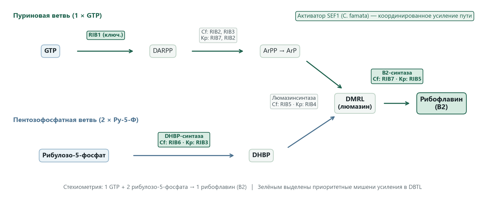
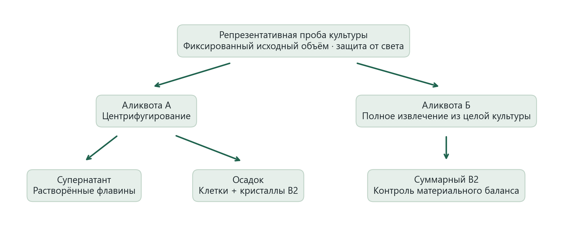
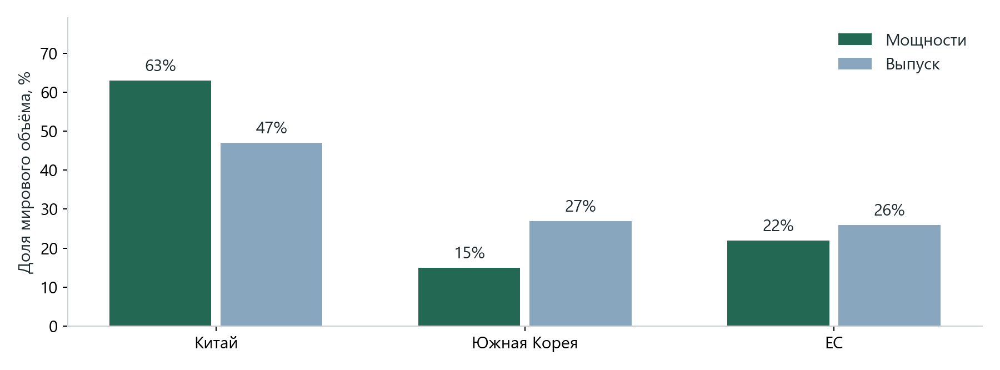
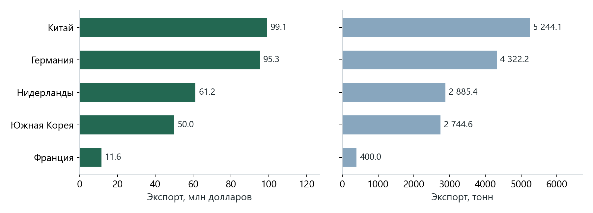
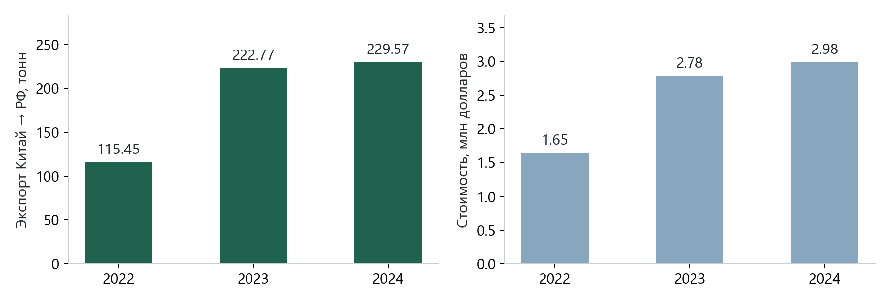
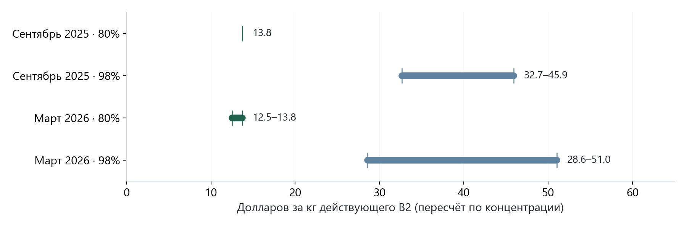

# Рибофлавин в дрожжах: от воспроизведения базового процесса к оптимизации DBTL

Аналитический отчёт и план экспериментальных работ · Ноябрь 2026

Цель проекта — воспроизвести опубликованный дрожжевой процесс биосинтеза витамина B2 и получить подтверждённый лабораторный титр, затем с помощью циклов Design–Build–Test–Learn (DBTL) повысить титр, выход и объёмную производительность и проверить лучшие штаммы в управляемом биореакторе. Производные FMN и FAD рассматриваются как второй этап развития платформы после закрепления результатов по B2.

Приоритетный продуцент — документированная продуктивная линия *Candida famata*. Если получить паспортизованный штамм с воспроизводимой методикой не удастся, потребуется выбрать между реконструкцией пути в *C. famata* и стартом на *Komagataella phaffii* — более доступной модельной системе с низким базовым титром, удобной для отработки методологии DBTL.

## 1. Цель и этапы проекта

Проект разбит на три последовательных этапа:

1. **Воспроизведение базового процесса.** Получить в лаборатории измеримый и воспроизводимый титр витамина B2 на уровне выбранной опорной публикации. Для этого требуются подтверждённый штамм, стандартная рецептура среды, фиксированный режим культивирования и количественный анализ B2 с контролем фона среды.
2. **Оптимизация в циклах DBTL.** Спроектировать ограниченную серию генетических и технологических модификаций, получить штаммы, измерить их в единых условиях и **повысить титр B2** относительно воспроизведённого базового штамма. На ранних раундах используются базовые статистические и интерпретируемые модели; переход к машинному обучению оправдан, когда при равном бюджете оно превосходит экспертный и случайный выбор вариантов.
3. **Проверка в биореакторе и оценка масштабирования.** Подтвердить улучшенные штаммы в управляемом аппарате. При переносе из колб меняются массоперенос кислорода, профиль питания, регулирование pH, плотность биомассы и распределение B2 между раствором, клетками и кристаллами.

Процесс оценивается по четырём независимым метрикам:

- **Титр** — масса B2 в пересчёте на объём исходной культуральной жидкости (г/л) с указанием измеренной фракции.
- **Средняя объёмная производительность** — титр, отнесённый к длительности стадии культивирования, г/(л·ч). В режиме fed-batch дополнительно учитывают изменение рабочего объёма и объём отобранных проб.
- **Выход по субстрату** — масса синтезированного B2 на массу фактически потреблённого источника углерода (г/г).
- **Стабильность** — воспроизводимость показателей между независимыми культивированиями и сохранение продуктивности после заданного числа пассажей без селективного давления.

Для оценки промышленной применимости к этим метрикам добавляются степень извлечения, чистота товарной формы, стоимость питательных сред, длительность полного цикла аппарата и соответствие нормативной спецификации.

## 2. Критерии выбора и сравнение альтернатив

### Критерии отбора

Выбор целевого продукта опирается на пять проектных критериев:

- **К1. Опорный референс и промышленная база.** Существуют опубликованный дрожжевой процесс с описанными генами, условиями и измеримыми показателями, а также действующее промышленное производство, задающее ориентир производительности.
- **К2. Быстрый лабораторный скрининг.** Первичный отбор вариантов выполняется доступным оптическим методом без обязательной хромато-масс-спектрометрии каждой пробы. ВЭЖХ применяется при постановке метода, для подтверждения лидеров и для контроля представительной выборки остальных образцов.
- **К3. Подтверждённый рынок и преимущество биосинтеза.** Учитываются реальные сегменты потребления в мире и в РФ, товарная форма продукта и конкурентоспособность ферментации относительно химического синтеза или экстракции.
- **К4. Развитие платформы.** Добавление 1–3 ферментативных стадий в том же продуценте открывает выход к более сложным продуктам (их ёмкость и маржинальность проверяются отдельно).
- **К5. Государственные приоритеты РФ.** Целевая субстанция входит в действующие перечни приоритетной продукции.

Научная новизна, патентная чистота и доступность биологического материала оцениваются отдельно наряду с пятью базовыми критериями.

| Критерий | Подтверждено для B2 | Требует проверки |
| --- | --- | --- |
| К1. Старт и индустрия | Описаны пути в K. phaffii и продуктивных линиях C. famata; действует зрелая ферментационная индустрия [1–3, 7] | Доступ к конкретному штамму и воспроизведение методики; промышленный выпуск ведётся и на недрожжевых платформах |
| К2. Быстрое измерение | Спектрофотометрия и флуориметрия пригодны для первичного скрининга [1, 3] | Матричная калибровка, учёт кристаллов и сопутствующих флавинов; подтверждение методом ВЭЖХ обязательно |
| К3. Рынок и биосинтез | Подтверждены международная торговля по HS 293623 и доминирование ферментации [25–29] | Текущий объём потребления в РФ и расчётная себестоимость собственного процесса |
| К4. Развитие платформы | Две ферментативные стадии до FMN и FAD; описаны дрожжевые продуценты [13–16] | Объём доступного рынка и ценовая премия FMN/FAD; конкуренция с другими маршрутами |
| К5. Приоритеты РФ | Витамин B2, его соединения и производные включены в п. 32 приказа Минсельхоза №392 [22] | Применимость конкретных программ поддержки к выбранной форме продукта и заявителю |

Витамин B2 сочетает воспроизводимый старт, быстрый оптический скрининг и прямое биохимическое продолжение до FMN и FAD; коммерческий спрос на производные требует отдельной проверки.

### Сравнение альтернативных направлений

В таблице 16 альтернативных направлений сопоставлены с платформой рибофлавина по условиям запуска первого цикла DBTL.

| Направление | К1: стартовая технологическая база | К2: требования к аналитике |
| --- | --- | --- |
| B2 → FMN → FAD | Нативный путь; метаболическая инженерия Candida или K. phaffii [1–3] | B2: оптика + ВЭЖХ; на следующем шаге — раздельная ВЭЖХ трёх флавинов |
| 1. Эрготионеин | Двухгенный грибной модуль в S. cerevisiae и Y. lipolytica; есть реакторные данные [19] | Колориметрический или ферментативный тест после валидации; ВЭЖХ для состава и экстракции |
| 2. SAM (адеметионин) | Дрожжевая ферментация с усилением предшественников и энергетики [33] | Внутриклеточная экстракция, ВЭЖХ, контроль стереоизомера и стабильности; возможен биосенсор |
| 3. Ликопин, β-каротин, астаксантин | Развитая инженерия каротиноидов с высокими титрами в Y. lipolytica [20] | Оптическая оценка требует предварительного лизиса, экстракции и ВЭЖХ-разделения изомеров |
| 4. Кроцетин / кроцины | Удлинение каротиноидного пути за счёт расщепления и гликозилирования | Разделение субстратов и гликозилированных форм; компартментализация искажает оптический сигнал |
| 5. Биксин / норбиксин (аннато) | Устоявшийся рынок растительного сырья; дрожжевой процесс требует проверки | Контроль состава апокаротиноидов и изомеров методом ВЭЖХ |
| 6. п-Кумаровая кислота → ресвератрол / нарингенин | Хорошо изученные пути; опубликован успешный ML-DBTL по п-кумаровой кислоте [32] | УФ-скрининг чувствителен к фону среды; для разделения близких ароматических продуктов нужна ВЭЖХ |
| 7. Редкие полифенолы и красители | Глабридин, бакучиол, куркумин и антоцианы требуют отдельных ферментативных путей | Многокомпонентный состав, отдельные аналитические стандарты и сложная пробоподготовка |
| 8. Пуллулан | Промышленный внеклеточный полисахарид Aureobasidium [35] | Многокритериальный контроль: масса полимера, молекулярная масса, вязкость и пигментация |
| 9. Биотин (B7) | Биосинтез изучен; ключевое ограничение — завершающая Fe–S-зависимая стадия [34] | Отсутствие селективного видимого сигнала; необходим отдельный количественный метод |
| 10. Рекомбинантный химозин | Зрелая область экспрессии и секреции рекомбинантных белков | Тест активности по свёртыванию молока, дополняемый контролем белковой чистоты и протеолиза |
| 11. Таурин | Крупнотоннажный продукт химического синтеза; эталонный дрожжевой процесс не выбран | Отсутствие прямого селективного УФ-поглощения; требуется дериватизация или ВЭЖХ |
| 12. Фолиновая кислота (фолинат) | Фармацевтическая субстанция со строгими требованиями к изомерной чистоте | Контроль окислительной стабильности, стереоизомеров и полиглутаматных форм |
| 13. 7-DHC → витамин D3 / 25-OH-D3 | Описаны дрожжевые продуценты стеролов [37] | Экстракция липидной фракции и ВЭЖХ-разделение близких стеролов |
| 14. 2′-Фукозиллактоза (2′-FL) | Опубликованы штаммы S. cerevisiae и Y. lipolytica с транспортом лактозы и синтезом GDP-фукозы [36] | Хроматографический анализ углеводов и побочных олигосахаридов без простого оптического теста |
| 15. Овотиол A | Исследовательский тиогистидиновый антиоксидант без подтверждённой промышленной базы | Селективность на фоне других тиолов, доступность стандарта и стабильность проб |
| 16. Селенонеин | Специализированное селенсодержащее соединение с ограниченными рыночными данными | Специация селена, требования безопасности и высокочувствительный следовой анализ |

### Анализ альтернатив

**Эрготионеин** — сильнейший резервный кандидат по технологической проработанности. В *Yarrowia lipolytica* получен титр 1,63 г/л за 220 ч, причём около 74% продукта оставалось внутри клеток [19], что усложняет выделение. В РФ требуется подтверждение спроса на субстанцию, а переход от эрготионеина к SAM как к следующему продукту невозможен: в синтезе эрготионеина SAM расходуется как донор метильных групп.

**S-Аденозилметионин (SAM)** оправдан при ориентации на фармацевтическую субстанцию и наличии профильного партнёра. В работе 2025 года достигнуто около 14 г/л в режиме fed-batch при подаче L-метионина [33], поэтому экономика зависит от цены аминокислотного предшественника. Основные ограничения старта — внутриклеточная локализация, контроль активного стереоизомера и стабильность. Объём закупок субстанции заметно меньше оборота готовых лекарств на основе адеметионина, а меры поддержки кормового метионина не распространяются на фармацевтический SAM.

**Каротиноиды** образуют зрелую платформу: в *Y. lipolytica* получены 17,6 г/л ликопина и 39,5 г/л β-каротина [20], а окраска упрощает первичный скрининг. Ограничения связаны с гидрофобностью, внутриклеточным накоплением, примесью сопутствующих пигментов и плотной конкуренцией с химическим синтезом и растительными экстрактами. Направление плотно исследовано с применением DBTL, что снижает научную новизну стартового цикла, а переход к астаксантину, кроцинам или аннато требует разных ферментативных модулей.

**Кроцины, аннато и редкие полифенолы** уступают на старте по сочетанию К1 и К2 из-за многостадийности, требований к локализации ферментов, низкой растворимости и сложной идентификации. Они оправданы при наличии проверенного штамма-референса и конкретного заказчика.

**п-Кумаровая кислота → ресвератрол / нарингенин** — сильный методологический резерв. В работе 2024 года два цикла DBTL повысили продукцию п-кумаровой кислоты на 68% (до 0,52 г/л) [32], причём после исчерпания прироста в исходной библиотеке авторы расширили пространство конструкций. На следующем этапе к ограничениям добавляются баланс малонил-CoA и селективность анализа. Рибофлавин выигрывает за счёт более простого оптического скрининга, действующей ферментационной индустрии и присутствия в приоритетном перечне РФ.

**Пуллулан** имеет зрелую промышленную базу, но для покупателя критичны молекулярная масса, вязкость, примеси и плёнкообразующие свойства [35]. Это усложняет массовый скрининг и плохо описывается стехиометрической метаболической моделью.

**Биотин** входит в государственные приоритеты, но лимитируется активностью ферментов и регенерацией железосерных кластеров биотинсинтазы [34]. В сочетании с отсутствием простого оптического скрининга и недоказанной экономикой дрожжевого процесса он проигрывает на старте.

**Рекомбинантный химозин** обладает промышленным спросом и удобным функциональным тестом, но относится к задачам белковой экспрессии и секреции. Он актуален только при смене профиля проекта на оптимизацию синтеза ферментов.

**Таурин и фолинат** исключены из-за отсутствия удобной связки воспроизводимого дрожжевого референса, быстрого скрининга и конкурентной себестоимости; для фолината дополнительный барьер создают окислительная нестабильность и контроль изомеров.

**7-Дегидрохолестерин (7-DHC) → витамин D3 / 25-OH-D3 и 2′-фукозиллактоза (2′-FL)** — перспективные прикладные ветки с подтверждёнными дрожжевыми путями [36, 37], но сложной хроматографией, контролем побочных метаболитов (а для 7-DHC — фотохимической или ферментативной конверсией) и строгой регуляторной квалификацией. Они оправданы при участии индустриального партнёра.

**Овотиол A и селенонеин** отложены из-за отсутствия подтверждённой промышленной технологии и сформированного коммерческого спроса. За пределами короткого списка также оставлены эктоин (сильная бактериальная конкуренция), хондроитинсульфат (контроль структуры полимера), глюкозамин / N-ацетилглюкозамин (специфическая углеводная аналитика) и бензоназоподобные нуклеазы (белковая продукция и очистка).

### Короткий список и условия пересмотра

| Вариант | Условия рационального выбора | Основания для пересмотра |
| --- | --- | --- |
| Рибофлавин (B2) — основной | Требуются воспроизводимый старт, быстрый скрининг и выход на производственные метрики | Недоступность подходящего штамма или аналитики; неконкурентная экономика выделения |
| Эрготионеин — резерв | Доступен проверенный генетический модуль и есть подтверждённый покупатель | Реальный спрос и готовая методика анализа перевешивают отсутствие прямого каскада |
| п-Кумаровая кислота / каротиноиды — методологический резерв | Приоритет — сравнение алгоритмов DBTL на хорошо изученной модели | Наличие в лаборатории готового штамма и настроенной аналитики |
| SAM, 2′-FL, стеролы — отдельная ветка | Привлечён профильный индустриальный партнёр с аналитической базой | Без партнёра и готовой аналитики риски старта слишком высоки |

Переход от B2 к FMN и FAD биохимически прямой, но оптимизация штамма под рибофлавин может не переноситься напрямую на фосфорилированные производные из-за расхода АТФ, транспорта и регуляции. Поэтому второй этап проверяется отдельными опытами и рыночной оценкой.

## 3. Выбор штамма-продуцента

### Дрожжи, бактерии, мицелиальные грибы и хемосинтетики

Перед выбором конкретного штамма необходимо обосновать выбор класса продуцента, поскольку в мировой промышленности витамин B2 сегодня получают преимущественно не дрожжами, а бактерией *Bacillus subtilis* и мицелиальным грибом *Ashbya gossypii* [7, 39, 40], а максимальные опубликованные титры FMN и FAD *de novo* получены в *Escherichia coli* [16].

| Класс продуцента | Опорные показатели (B2 / FMN / FAD) | Преимущества и ограничения для DBTL и масштабирования |
| --- | --- | --- |
| Дрожжи (*C. famata*, *K. phaffii*, *Y. lipolytica*, *S. cerevisiae*) | B2: до 16,4 г/л (*C. famata* fed-batch [2]), 0,02–0,125 г/л (*K. phaffii* [1]); FMN: 0,23–0,54 г/л, FAD: 0,45 г/л (*C. famata* [13–15]) | Раздельные монофункциональные гены *FMN1* и *FAD1* без бактериального RFN-рибопереключателя [7, 39, 40]; отсутствие эндотоксинов (ЛПС) и риска фагового лизиса; суспензионный рост удобен для DBTL. Ниже скорость роста, а у *C. famata* — чувствительность к железу и риск нестабильности [39] |
| Гетеротрофные бактерии (*B. subtilis*, *E. coli*, *C. ammoniagenes*) | B2: до 26–35 г/л за 2–3 сут (*B. subtilis* [7, 39, 40]); FMN: 3,46 г/л и FAD: 2,31 г/л (*E. coli* [16]); биокатализ FMN/FAD в *C. ammoniagenes* [7] | Максимальная скорость роста и наивысшие титры B2 и *de novo* FMN/FAD. У большинства видов бифункциональный фермент (*ribF*/*ribFC*) смешивает FMN и FAD и требует белковой инженерии; регуляция через RFN-рибопереключатель; у *E. coli* — эндотоксины (ЛПС); риски бактериофагов при масштабировании |
| Мицелиальные грибы (*A. gossypii*, *E. ashbyii*) | B2: 15–20 г/л за 6–8 сут на маслах (*A. gossypii* [7, 40]); природное накопление FAD описано у *E. ashbyii* [39] | Зрелая промышленная платформа B2 без эндотоксинов и бактериофагов. Мицелиальная морфология (гифы, пеллеты) и длительный цикл осложняют серийный оптический скрининг и быстрые раунды DBTL; у *E. ashbyii* — генетическая нестабильность [39] |
| Хемосинтетики — хемолитоавтотрофы и метанотрофы (*X. autotrophicus*, *C. necator*, *Methylocystis*) | B2: ~1,5 мкг/л на смеси CO2/N2/H2 (*X. autotrophicus* [40, 41]); следовые флавины у метанотрофов; промышленных штаммов FMN/FAD нет | Потенциал отказа от пищевых сахаров, но высокие затраты АТФ и NADPH на фиксацию CO2 (цикл Кальвина) конфликтуют с энергоёмким синтезом пуринов, FMN (+1 АТФ) и FAD (+2 АТФ). Титры на 6–7 порядков ниже промышленных; взрывоопасные газовые смеси (H2/O2), слабый генетический инструментарий и бифункциональная FAD-синтетаза исключают их для текущего цикла DBTL |

**Проектные предпосылки и аргументы в пользу дрожжей.** Дрожжевая платформа задана как стратегическая рамка DBTL для отстройки от перенасыщенных бактериальных решений (*B. subtilis*, *P. putida*, *C. glutamicum*), опоры на более широкую эукариотическую биохимию (перенос DBTL на белки, стеролы, липиды, вакуолярные метаболиты) и упрощения регуляторного профиля. Для каскада B2 → FMN → FAD это дополняют следующие факторы:
- **Архитектура FMN/FAD:** у *B. subtilis* (лидера по B2) синтез FMN/FAD ограничен бифункциональным *ribFC* и RFN-рибопереключателем; у *C. ammoniagenes* идёт двухстадийный биокатализ с дорогими FMN и АТФ [7]. У дрожжей *FMN1* и *FAD1* разделены без RFN [7, 39, 40]; даже в *E. coli* FAD13 (2,31 г/л FAD [16]) переносили дрожжевые *FMN1* и *FMNAT*.
- **Без ЛПС и фагов:** против грамотрицательной *E. coli* (лидера по *de novo* FMN/FAD [16]) дрожжи лишены эндотоксинов (ЛПС), что критично для инъекций и офтальмологии; против *B. subtilis* (грамположительной, без ЛПС) дрожжи дают фагоустойчивость и ценную белковую биомассу [44]. Безопасность B2 80% из ГМ-*S. cerevisiae* подтверждена EFSA (2026) при удалении клеток и ДНК [43].
- **Удобство для DBTL и научная ниша:** одноклеточная суспензия дрожжей проще мицелия *A. gossypii* для серийного скрининга, а замкнутый ML-DBTL на дрожжевом B2 → FMN малоизучен.

Ограничения фиксируются явно: по скорости и титру кормового B2 дрожжи уступают *B. subtilis* (26–35 г/л за 48–72 ч), а по *de novo* титрам FMN/FAD — *E. coli* [16, 39, 40]. Дрожжи рациональны для эукариотической платформы DBTL и безэндотоксиновых FMN/FAD; при приоритете промышленного кормового B2 альтернативой выступает *B. subtilis*.

### Candida famata — приоритетный дрожжевой продуцент

Выбор *Candida famata* опирается на серию публикаций по селекции и метаболической инженерии этого вида. На базе линии AF4 со сверхэкспрессией *SEF1*, *RIB1* и *RIB7* получен титр 16,4 г/л в режиме fed-batch в 7-литровом биореакторе [2]. Линия AF4 создана многоэтапной селекцией, поэтому перенос тех же трёх генов в случайный дикий изолят не воспроизводит этот результат.

В работе 2022 года к пятым суткам в колбах получены 204 мг/л для AF4, 261,2 мг/л для BRP, 511,26 мг/л для BRPI и 652,70 мг/л для BRPI/RIB1–RIB6 (+28% относительно BRPI) [3]. Эти колбовые данные задают ориентир для воспроизведения эффекта модификаций и не сопоставимы напрямую с реакторным режимом fed-batch.

В публикации 2024 года сообщается о 812,5 мг/л для BRPI на глюкозе и 1493,5 мг/л для модифицированного штамма на лигноцеллюлозном гидролизате за 120 ч [4]. Экономическая выгода от дешёвого сырья зависит от затрат на предобработку гидролизата, удаление ингибиторов роста и очистку продукта.

### Komagataella phaffii — резервная платформа

В работе Marx с соавторами использовано прежнее название *Pichia pastoris*; для линий X-33 и GS115 сегодня применяется название *Komagataella phaffii* [1]. Последовательная замена промоторов нативных генов пути B2 в колбах дала пошаговый рост титра от 6,9 мг/л (усиление *RIB1*) до 20,2 мг/л (усиление всех шести генов). В биореакторе получено около 125 мг/л в пересчёте на общий объём культуры (175 мг/л в отделённом супернатанте). Из-за высокой плотности биомассы объём жидкой фазы меньше общего объёма культуры, поэтому для межплатформенного сравнения берётся значение 125 мг/л.

*K. phaffii* удобна для отработки клонирования, аналитики и цикла DBTL при наличии локальной экспертизы. Поскольку её опубликованный титр на два порядка ниже, чем у продуктивных линий *C. famata*, выбор *K. phaffii* ориентирует первый этап прежде всего на методическую управляемость.

| Организм / линия | Опубликованный показатель | Роль в проекте |
| --- | --- | --- |
| C. famata (линия AF4 / BRP) | 16,4 г/л, fed-batch, биореактор 7 л [2] | Основной вариант при получении паспортизованной линии и полной методики |
| C. famata (BRPI / RIB1–RIB6) | 0,653 г/л, колбы, 120 ч [3] | Базовый ориентир для колбового воспроизведения |
| K. phaffii (усиление 6 генов пути) | 0,0202 г/л в колбах; ~0,125 г/л культуры в биореакторе [1] | Резервная платформа для отработки воспроизводимого цикла DBTL |
| Yarrowia lipolytica | Опубликованы инженерия пути B2 и капельный скрининг [5] | Возможная альтернатива при сильной локальной базе; титр требует проверки по полному тексту |
| Hyphopichia wangnamkhiaoensis | 16,68 мг/л (2024 г.); 0,5593 мг/(л·ч) в непрерывной культуре (2025 г.) [6] | Природный продуцент с низкими показателями и ограниченным генетическим инструментарием |
| Saccharomyces cerevisiae | Развитая генетика и геномные метаболические модели | Вспомогательная модель для отработки методик |
| Ashbya gossypii / Bacillus subtilis | Промышленные платформы производства B2 [7] | Внешние отраслевые ориентиры (нитчатый гриб и бактерия) |

### Доступность штаммов и таксономическая проверка

Упоминаемые в литературе линии VKM Y9, L20105, AF4, BRP и BRPI различаются по генотипу и истории селекции. Фактическая доступность VKM Y9 в коллекциях и условия передачи AF4, BRP или BRPI требуют предварительной проверки. Линия L20105 является лейциновым ауксотрофом и требует добавки лейцина в минимальные среды.

Видовое название *Candida famata* и близкие виды *Debaryomyces* (*D. hansenii*, *D. subglobosus*, *D. fabryi*) в публикациях часто смешиваются. Перед заказом запрашивают паспорт неклинического штамма (происхождение, генотип, видовая идентификация), а после получения верифицируют изолят секвенированием участков ITS/D1–D2.

Выбор организма фиксируется после проверки доступности материала: при получении документированной продуктивной линии *C. famata* воспроизводят её протокол; если доступен только дикий штамм *C. famata*, выделяют отдельную задачу реконструкции пути без ожидания 16,4 г/л на первом шаге; при отсутствии надёжного материала *C. famata* стартуют на *K. phaffii* или *Y. lipolytica*. Полный комплект синтетических конструкций закупают после утверждения ветки.

## 4. Путь биосинтеза и номенклатура генов

### Биосинтез рибофлавина de novo в дрожжах

На первом этапе проекта задача сводится к повышению титра самого витамина B2, поэтому основные инженерные мишени лежат в пути его синтеза de novo и в подводящих ветвях центрального метаболизма. Молекула рибофлавина собирается из двух предшественников — **гуанозинтрифосфата (GTP)** и **рибулозо-5-фосфата** (суммарная стехиометрия: **1 GTP + 2 рибулозо-5-фосфата → 1 B2**, с затратой NADPH):

1. **Пуриновая ветвь (от GTP к ArP).** Первый фермент пути — **GTP-циклогидролаза II (*RIB1*)** — раскрывает имидазольное кольцо GTP с образованием 2,5-диамино-6-рибозиламино-4(3H)-пиримидинон-5′-фосфата (DARPP), формиата и пирофосфата. Далее **редуктаза** (*RIB7* в *K. phaffii* / *RIB2* в *C. famata*) восстанавливает рибозильный остаток в рибитильный (с расходом NADPH), а **деаминаза** (*RIB2* / *RIB3*) дезаминирует пиримидиновое кольцо с получением 5-амино-6-рибитиламино-2,4(1H,3H)-пиримидиндиона-5′-фосфата (ArPP). Затем фосфатаза удаляет фосфатную группу, образуя 5-амино-6-рибитиламино-2,4(1H,3H)-пиримидиндион (ArP).
2. **Пентозофосфатная ветвь (к DHBP).** Параллельно **DHBP-синтаза** (*RIB3* в *K. phaffii* / *RIB6* в *C. famata*) превращает рибулозо-5-фосфат из окислительной ветви пентозофосфатного пути в 3,4-дигидрокси-2-бутанон-4-фосфат (DHBP) и формиат.
3. **Сборка кольца рибофлавина.** **Люмазинсинтаза** (*RIB4* / *RIB5*) конденсирует ArP и DHBP в 6,7-диметил-8-рибитиллюмазин (DMRL). На завершающем шаге **рибофлавинсинтаза** (*RIB5* / *RIB7*) катализирует дисмутацию двух молекул DMRL, давая одну молекулу рибофлавина (B2) и возвращая одну молекулу ArP в цикл.

Рисунок 4.1. Путь биосинтеза рибофлавина de novo в дрожжах с указанием названий генов в *C. famata* и *K. phaffii*. Выделены основные точки генетического усиления для первого этапа оптимизации B2 [1–3].

### Ключевые генетические рычаги для роста титра B2

При проектировании серий DBTL модификации затрагивают четыре уровня регуляции пути:

- **Снятие узких мест структурного пути (*RIB1*, *DHBP-синтаза*, *рибофлавинсинтаза*).** Входной фермент *RIB1* стабильно выступает главным лимитирующим звеном в обеих платформах [1–3]. Поскольку на один GTP требуются две молекулы рибулозо-5-фосфата, совместное усиление *RIB1* и *RIB6* (DHBP-синтазы) в *C. famata* устраняет дисбаланс двух ветвей и даёт дополнительный прирост титра (+28% в линии BRPI) [3]. Усиление финальной рибофлавинсинтазы (*RIB7* в *C. famata*) вместе с *RIB1* и *SEF1* обеспечило выход на 16,4 г/л в fed-batch [2]. В *K. phaffii* последовательное усиление всех шести структурных генов (*RIB1 → RIB3 → RIB7 → RIB5 → RIB2 → RIB4*) монотонно поднимало титр от 6,9 до 20,2 мг/л [1].
- **Транскрипционная регуляция (*SEF1*).** У *C. famata* транскрипционный активатор *SEF1* координированно усиливает экспрессию генов рибофлавинового пути; его сверхэкспрессия лежит в основе высокотитражных линий [2, 3].
- **Обеспечение предшественниками (GTP и рибулозо-5-фосфат).** При снятии ограничений внутри пути *RIB* лимитирующим становится приток через пуриновый синтез de novo (PRPP, GMP/GTP) и пентозофосфатный путь (рибулозо-5-фосфат, NADPH). Чрезмерное перенаправление пуринов способно тормозить рост и нарушать баланс аденилатов, поэтому силу промоторов подбирают экспериментально.
- **Секреция и отток в кофакторы.** При высоких титрах важен эффективный вывод B2 из клетки для снятия внутриклеточного накопления; часть рибофлавина фосфорилируется рибофлавинкиназой (*FMN1*) в FMN и далее FAD-синтетазой в FAD (на первом этапе этот отток минимален, а на втором этапе становится целевым маршрутом).

### Номенклатура генов и переход к FMN и FAD

В разных видах дрожжей номера генов *RIB* закреплены за разными ферментами [1, 3]. При заказе синтетической ДНК и сборке конструкций необходимо опираться на нуклеотидную последовательность и функциональную аннотацию генома конкретного штамма:

| Ферментативная функция | K. phaffii (P. pastoris) [1] | C. famata [3] |
| --- | --- | --- |
| GTP-циклогидролаза II (вход из GTP) | RIB1 | RIB1 |
| Редуктаза DARPP | RIB7 | RIB2 |
| Деаминаза пиримидинового интермедиата | RIB2 | RIB3 |
| DHBP-синтаза (вход из рибулозо-5-фосфата) | RIB3 | RIB6 |
| Люмазинсинтаза | RIB4 | RIB5 |
| Рибофлавинсинтаза | RIB5 | RIB7 |

Рисунок 4.2. Последовательные превращения рибофлавина в кофакторы второго этапа (FMN и FAD). Рибофлавинкиназа переносит фосфат с АТФ на B2 (образуются FMN и АДФ); FAD-синтетаза переносит аденилильный остаток с АТФ на FMN (образуются FAD и пирофосфат).

## 5. Этап 0: воспроизведение базового результата

### Критерии успешного воспроизведения

Перед стартом лабораторных работ утверждается протокол, фиксирующий опорную публикацию, штамм и контроль, состав среды, подготовку посевного материала, сосуд и рабочий объём, температуру, перемешивание, длительность, график отбора проб и аналитический метод. Допустимый разброс относительно литературного титра задаётся после оценки межсерийной вариабельности на имеющемся оборудовании.

Минимальный дизайн контрольного опыта включает:
- родительский штамм и литературный (либо реконструированный) продуцент;
- не менее трёх независимых биологических культивирований каждого варианта;
- инкубацию бесклеточной среды в тех же условиях для контроля фона;
- внешний стандарт B2;
- отбор временного ряда для отслеживания роста, накопления B2 и расхода сахара.

Последовательность работ: подтверждение чистоты и вида → закладка рабочего банка → предварительный тест роста и диапазона разведений → независимое воспроизведение → разбор отклонений. Если базовый титр не достигнут, причины диагностируются до запуска серии DBTL.

### Методика для Candida famata

В работе Petrovska с соавторами [3] культивирование проводят в 50 мл среды в колбах Эрленмейера на 250 мл при 30 °C и 220 об/мин в течение 120 ч. Описаны богатая среда (5 г/л дрожжевого экстракта, 10 г/л пептона, 20 г/л глюкозы) и минимальная среда YNB (6,7 г/л YNB, 20 г/л глюкозы); опубликованные титры таблицы 1 и рисунка 4 получены на YNB.

В тексте статьи указана необычно низкая начальная биомасса — 2 мг/л, а также расхождения температур между культивированием и отдельными измерениями экспрессии; эти детали уточняют до утверждения локального СОП.

Штаммы BRPI/RIB1–RIB6 созданы на фоне BRPI с конструкциями pTb/SAT1, линеаризацией AatII и селекцией на норзеотрицине (20 мг/л). При переносе на другой генетический фон проверяют совместимость маркера и сайтов рестрикции; трансформанты подтверждают ПЦР по участкам интеграции, секвенированием и при необходимости оценкой копийности. Для повторения реакторного результата 16,4 г/л [2] потребуется получить полный текст методики fed-batch и параметры конструкций, поскольку в доступной аннотации указаны только масштаб и итоговый титр.

### Анализ исходных кинетических данных

Рисунок 5.1. Динамика сухой биомассы (E, г/л) и накопления рибофлавина (F, мг/л) на среде YNB в колбах. Чёрная кривая — родительский штамм BRPI, серая — BRPI/RIB1–RIB6. Источник: Petrovska et al., 2022 [3], рис. 4 (панели E–F), лицензия CC BY 4.0 (https://creativecommons.org/licenses/by/4.0/).

К 120 ч модифицированный штамм даёт 652,70 ± 30,63 мг/л B2 против 511,26 ± 24,10 мг/л у родительского BRPI (среднее и стандартное отклонение по трём независимым пробам) при близкой биомассе (1,62 и 1,69 г/л). Прирост на ~28% обеспечивается ростом удельной продуктивности (до 403,40 мг B2 на грамм сухой биомассы; выход по потреблённой глюкозе в статье не приведён).

Из кинетики следуют три требования к лабораторным испытаниям: регистрация временного ряда, одновременное измерение биомассы и продукта, сравнение с родителем на том же генетическом фоне.

### Методика для Komagataella phaffii

В работе Marx с соавторами [1] использованы линии X-33 и GS115. Колбовые опыты вели в колбах 250 мл с отбойниками при 28 °C и 180 об/мин. Рабочий объём жидкости в тексте не указан, поэтому его фиксируют в локальном протоколе с учётом орбиты шейкера и аэрации.

Состав среды на 1 л: YNB без аминокислот — 13,4 г; глюкоза — 50 г; калий-фосфатный буфер (pH 6) — 100 мМ; биотин — 0,4 мг; гистидин — 40 мг; глутамат, метионин, лизин, лейцин и изолейцин — по 50 мг; CaCO3 — 3 г. Витаминный фон коммерческого YNB проверяют по паспорту партии и анализу бесклеточной среды.

В статье приведены две серии конструкций: экспрессия *RIB1* (включая ген *S. cerevisiae*) на базе pGAPZB и последовательная замена промоторов нативных генов. Пошаговое усиление *RIB1*, *RIB3*, *RIB7*, *RIB5*, *RIB2* и *RIB4* повышало колбовый титр: 6,9 → 9,1 → 10,2 → 13,2 → 14,9 → 20,2 мг/л. Практичный старт — воспроизвести одну чётко описанную ступень с контролем, затем расширять каскад. Параметры электропорации и селекции берут из стандартных руководств для выбранного штамма и вектора.

Биореакторный этап [1] выполняли в аппарате объёмом 5 л (начальная загрузка 1,75 л) при 25 °C, поддержании pH 5 аммиаком, DO выше 20%, перемешивании 600–1200 об/мин и аэрации 100 л/ч в режиме batch + fed-batch. При переносе на другой реактор режим настраивают по уровню DO, массопереносу кислорода и профилю питания из первоисточника.

### Параметры, фиксируемые в каждом опыте

- Идентификатор штамма, клона и партии среды; параметры посева, время и объём инокуляции.
- Температура, обороты шейкера, pH и доступные данные по растворённому кислороду.
- Оптическая плотность (с калибровкой на сухую биомассу), остаточный сахар и концентрация B2 по каждой фракции.
- Коэффициенты разведения, наличие кристаллов, объёмы отобранных проб, исходные приборные файлы и отклонения.
- Для fed-batch дополнительно: состав и масса подаваемого субстрата, текущий рабочий объём, расход титранта и пеногасителя.

## 6. Аналитический контроль

### Скрининг, подтверждение и материальный баланс

Аналитический контур включает три уровня: оптический скрининг для массового ранжирования вариантов, ВЭЖХ для подтверждения концентрации и состава флавинов и контроль материального баланса по фракциям.

Для экспресс-оценки B2 в осветлённом супернатанте применяют флуориметрию (в [3] — возбуждение 440 нм, эмиссия 535 нм) или спектрофотометрию (440–450 нм). Калибровочную кривую строят по стандарту B2 в рабочей матрице среды с фиксированной длиной оптического пути. На всех стадиях пробы защищают от света; допустимые условия хранения проверяют экспериментально, а для FMN/FAD дополнительно контролируют гидролиз FAD → FMN → B2.

### ВЭЖХ для внеклеточного рибофлавина

В методике [1] супернатант отделяли центрифугированием (1 мин, 13 000 об/мин; при переносе на другой ротор режим пересчитывают в g), смешивали 1:1 с двукратной подвижной фазой и фильтровали через PVDF 0,22 мкм.

Условия разделения: колонка Nucleosil C18 (150 × 4,6 мм, 5 мкм) с предколонкой 10 мм; поток 1 мл/мин; изократическая фаза — 50 мМ NaH2PO4/H3PO4 (pH 3), 1 мМ тетраметиламмонийхлорида, 12% ацетонитрила; ввод 100 мкл; детектирование при 223 и 445 нм. При переносе на имеющийся прибор уточняют объём ввода и время элюирования; для смесей B2, FMN и FAD дополнительно подтверждают разделение всех трёх пиков.

### Раздельное определение B2, FMN и FAD

Протокол Bio-protocol [8] использует колонку SunFire C18 (150 × 4,6 мм, 3,5 мкм, 35 °C), поток 1 мл/мин, длительность 12 мин и флуоресцентный детектор (470/530 нм). Подвижная фаза: 100 мМ формиата аммония, 100 мМ муравьиной кислоты и 25% метанола; калибровка по смеси B2, FMN и FAD в диапазоне 0,05–5 мкМ (0,05; 0,1; 0,5; 1 и 5 мкМ). Поскольку исходная методика разработана для бактерий, полноту экстракции из дрожжей и стабильность FMN/FAD валидируют отдельно.

Дрожжевая методика [9] применяет колонку Hypersil ODS (100 × 3 мм, 3 мкм), поток 0,5 мл/мин, ввод 10 мкл, элюенты — 50 мМ цитратный буфер (pH 2,5) и метанол в градиенте 5–100% метанола за 13,5 мин с промывкой и уравновешиванием, флуоресценцию 420/530 нм. Девятиточечная калибровка (1–500 мкг/л) требует значительного разведения высокотитражных проб. При переносе на другую колонку проверяют разрешение пиков, рабочее давление, времена удерживания и степень извлечения стандарта.

### Экстракция внутриклеточных флавинов

В дрожжевой методике [9] клетки (25 единиц OD660) осаждают (2876 g, 15 мин) и инкубируют ночь при 30 °C в растворе 0,9 М сорбитола, 0,1 М EDTA, 14 мМ β-меркаптоэтанола и Zymolyase 100T (500 мкг/мл), уточнив объём буфера. Сферопласты осаждают, ресуспендируют в 1 мл воды, добавляют равный объём стеклянных бусин (0,45 мм), встряхивают 10 мин на вортексе, выдерживают ночь при 25 °C, затем 30 мин при 65 °C и 30 мин при 4 °C, после чего отделяют экстракт (23 000 g, 10 мин). Полноту лизиса проверяют микроскопией.

Из-за длительности, использования токсичного β-меркаптоэтанола и нагрева этот метод может смещать соотношение B2, FMN и FAD. При постановке метода его целесообразно сравнить с быстрым холодным механическим разрушением клеток в оптимизированном экстрагенте по полноте лизиса, повторной экстракции осадка и сохранности внесённых стандартов.

### Учёт кристаллической фазы

Рисунок 6.1. Схема контроля материального баланса проб. Сумму масс B2 в жидкой фазе и осадке аликвоты А сверяют с общим B2 в аликвоте Б в пересчёте на одинаковый объём исходной культуры.

При повышенных титрах часть рибофлавина кристаллизуется в среде и при центрифугировании попадает в осадок вместе с клетками. В таких условиях концентрация в супернатанте занижает реальный внеклеточный выход, а осадок содержит сумму внутриклеточного и кристаллического B2.

Для точного учёта отбирают параллельные аликвоты:
1. осветлённый супернатант — растворённые флавины;
2. осадок с микроскопическим контролем кристаллов (если кристаллы не отделяются от клеток, показатель фиксируют как «B2 в осадке»);
3. целую культуру с полным растворением B2 — для независимой сверки суммарного баланса.

### Контроль качества измерений

- Пробы чистого растворителя, бесклеточной среды и проверка переноса между инъекциями.
- Подтверждение пиков по времени удерживания и добавке стандарта; в спорных случаях — спектральная или масс-спектрометрическая идентификация.
- Калибровка в рабочем линейном диапазоне и контрольный образец в каждой серии.
- Добавка стандарта до и после экстракции, тест стабильности проб и повторная экстракция осадка.
- Рабочие ориентиры исследовательской стадии: восстановление стандарта 80–120% и коэффициент вариации (CV) не выше 15%; при выходе на товарную спецификацию применяют фармакопейную валидацию.

## 7. Выделение и очистка продукта

Выделение товарного B2 решается отдельно от аналитической пробоподготовки. На низкотитражном старте достаточно достоверного количественного анализа в культуре: при малых концентрациях выделение сухого порошка экономически нецелесообразно.

### Патентные схемы выделения

Патент US5103005A [10] описывает щелочное растворение B2 в суспензии при pH 11,5–13,5 (оптимально 12,4–12,8) и умеренной температуре, отделение биомассы и кристаллизацию при снижении pH до 5,8–6,2 с получением продукта чистотой около 96%. При концентрациях ниже ~0,2 г/л осаждение в этих условиях не происходит — это важное ограничение для низкотитражных культур *K. phaffii*.

Патент US5210023A [11] описывает очистку выделенного технического B2 водой или разбавленной кислотой при нагревании (повышение чистоты, например, с 96 до 99%). Работа при температурах выше 100 °C требует герметичного оборудования под давлением.

### План отработки выделения

Разработка схемы начинается с определения распределения B2 между раствором, кристаллами и клетками. Затем в малом объёме тестируют схему растворения и осаждения в сравнении с контрольной аналитической экстракцией, фиксируя на каждой операции массу B2, объёмы потоков, чистоту, примеси и расход реагентов. Масштабирование проводят после сведения материального баланса.

Ключевые показатели узла выделения:
- **степень извлечения** — доля массы B2 исходной культуры, перешедшая в целевой продукт;
- **массовая чистота** — содержание действующего вещества в сухом продукте с учётом влаги и солей (в дополнение к хроматографической чистоте);
- **производительность** — масса кондиционного продукта в единицу времени.

На всех стадиях выделения растворы защищают от света и контролируют pH; итоговые требования к чистоте и примесям зависят от целевого сегмента (кормового, пищевого или фармацевтического).

## 8. Цикл DBTL: проектирование, проверка и моделирование

### Design: постановка эксперимента

В первой серии DBTL варьируют два-три механистически ясных фактора — баланс экспрессии генов *RIB*, снабжение предшественниками и режим питания с аэрацией — при фиксированной базовой среде и аналитике.

Рациональный стартовый объём серии — 12–24 генетических варианта с повторяющимся родительским контролем в каждом блоке. При ограниченном бюджете сохраняют независимые биологические повторы и контроли, сокращая число конструкций.

### Build: верификация штаммов

Для каждого варианта ведётся паспорт: карта конструкции, подтверждённая последовательность, родительский штамм, способ трансформации, проверка интеграции, номер независимого клона и ссылка в криобанке. В первой инженерной серии проверяют несколько независимых клонов на конструкцию, чтобы отделить эффект промотора от вариаций числа копий и клонального разброса.

Стабильные штаммы закладывают в рабочий банк. Единый идентификатор связывает генотип, протокол культивирования, пробы, исходные приборные файлы и расчёты.

### Test: дизайн измерений

Положение колб в шейкере и порядок ввода в ВЭЖХ рандомизируются, а родительский контроль включается в каждую серию для учёта межсерийного сдвига. Регистрируют рост, расход сахара и накопление B2. При использовании оптического скрининга методом ВЭЖХ проверяют не только лидеров, но и часть средних и слабых вариантов, чтобы исключить систематическое смещение отбора.

Опыт капельного флуоресцентного скрининга в *Y. lipolytica* [5] показывает, что сортировка отдельных клеток может преимущественно отражать внутриклеточное накопление, а не секрецию продукта — это ограничение учитывают при выборе формата теста.

### Learn: статистические модели и ML

Моделирование начинается с регуляризованных линейных или байесовских моделей, позволяющих оценить вклад факторов и неопределённость на малой выборке. Опубликованный инструмент рекомендаций ART [18] служит методическим ориентиром и проверяется на данных конкретного процесса.

При кросс-валидации технические повторы и клоны одной конструкции группируют, чтобы исключить утечку между обучающей и тестовой выборками; из предикторов исключают постопытные измерения (например, конечную биомассу). Главный критерий качества модели — точность прогноза в следующем раунде.

Стехиометрические модели метаболизма выявляют узкие места и теоретические выходы, но сами по себе не предсказывают титр по силе промотора. Перенос геномной модели *S. cerevisiae* на *C. famata* требует адаптации к геному, составу реакций, среде и экспериментальным скоростям роста.

### Оценка эффективности моделей

Со второго раунда экспериментальный бюджет делится поровну между рекомендациями модели, экспертным выбором и случайной выборкой из того же пространства конструкций. Сравнивают лучший подтверждённый титр, долю улучшенных вариантов, число опытов до заданного порога и стоимость цикла; лидеры проходят независимую проверку.

Если модель уступает контрольным стратегиям, проверяют объём выборки, информативность пространства конструкций и уровень аналитического шума. В открытой литературе не найдено прямого аналога комбинации перспективного ML-управляемого DBTL по дрожжевому B2 с проверкой переноса на FMN; перед публикацией или патентованием новых штаммов потребуется отдельный патентный поиск.

## 9. Масштабирование и производственные показатели

Титр 0,653 г/л за 120 ч [3] соответствует средней объёмной производительности 0,00544 г/(л·ч). Для 16,4 г/л [2] производительность не вычислялась, так как точная длительность ферментации отсутствует в доступной аннотации.

В патенте US5120655A [12] описан процесс в аппарате 450 л с титром 21 г/л за 200 ч (~0,105 г/(л·ч)). Этот ориентир показывает масштаб разрыва между колбовыми опытами и промышленной ферментацией.

В режиме fed-batch при переменном объёме дополнительно рассчитывают накопленную массу B2 с учётом отобранных проб и баланс субстрата. При оценке годового выпуска установки к времени ферментации прибавляют время на посев, стерилизацию, выгрузку и мойку.

### Этапы и критерии перехода

| Переход между этапами | Критерий прохождения | Действия при отклонении |
| --- | --- | --- |
| Аналитика → воспроизведение | Разделены сигнал B2 и фон среды; проверены разведения и экстракция | Доработка методики до начала серийных опытов |
| Воспроизведение → DBTL | Получен воспроизводимый базовый титр B2; расхождения с литературой объяснены | Проверка подлинности штамма, посева, среды, аэрации и базы расчёта |
| DBTL → биореактор | Повышение титра подтверждено повтором и не сопровождается критическим падением роста | Корректировка целевой функции и условий культивирования |
| Биореактор → технологическая оценка | Определены титр, производительность, выход, стабильность и баланс фракций | Диагностика лимитирования по кислороду, режиму питания, потерям и стабильности |
| Технологическая оценка → масштабирование | Подтверждены схема выделения, спецификация продукта и предварительная экономика | Доработка технологии до принятия решения о пилотном выпуске |

Целевую функцию DBTL формулируют многокритериально — с учётом титра, производительности, выхода по субстрату и ограничений по росту. Целевые пороги задаются под выбранную категорию продукта и требования заказчика.

## 10. Перспективные производные: FMN и FAD

Рибофлавин-5′-монофосфат (FMN) образуется фосфорилированием B2, флавинадениндинуклеотид (FAD) — аденилированием FMN. Развитие этой ветки опирается на созданные штаммы и аналитику, но требует отдельной отработки материального баланса и выделения.

| Опубликованный результат | Условия и особенности сравнения |
| --- | --- |
| C. famata, FMN: 231 мг/л за 40 ч [13] | Биореакторный опыт; при удлинении культивирования концентрация падает, критичен момент отбора |
| C. famata, FMN: 540 мг/л за 48 ч [14] | Биотрансформация отмытыми клетками на сыворотке; время наращивания биомассы не входит в 48 ч |
| C. famata, FAD: 451,5 мг/л за 40 ч [15] | Штамм T-FD-FM27, реактор 1,2 л; среда содержит добавки аденина и глицина |
| E. coli, FMN: 3457,3 мг/л; FAD: 2305,2 мг/л [16] | Два отдельных бактериальных штамма (FMN08 и FAD13) в режиме fed-batch; конкурентный ориентир |

Для FMN ключевые параметры качества — преобладание целевого 5′-изомера и содержание остаточных B2 и FAD; для FAD — целостность молекулы и устойчивость к гидролизу. Переход к производным целесообразен после стабилизации базового процесса по B2.

### Фармакопейные спецификации, химический синтез и альтернативные маршруты

В монографии USP–NF на рибофлавина фосфат натрия нормируется содержание действующего вещества 73–79% в пересчёте на рибофлавин на сухое вещество [17]. Этот диапазон отражает отношение молекулярных масс рибофлавина и безводной мононатриевой соли FMN (376,36 / 478,33 = 78,7%); примеси и изомерный состав нормируются отдельными испытаниями монографии. В промышленности FMN-Na по-прежнему получают химическим фосфорилированием ферментационного B2 неселективными реагентами (в частности POCl3), что сопровождается образованием изомерных и дифосфатных примесей [7, 40].

Полный химический синтез FAD известен с 1952 года [21], однако он многостадиен и характеризуется ограниченными выходами. Помимо *de novo* ферментации, для FMN и FAD развиты цельноклеточный биокатализ (в частности на *C. ammoniagenes* и *E. coli* из экзогенного B2/FMN и АТФ [7]) и бесклеточный ферментативный синтез с регенерацией АТФ из полифосфата (до ~1,2 г/л FAD за 2 ч [42]). Эти маршруты конкурируют с прямой ферментацией по селективности, стоимости экзогенных предшественников (АТФ, аденозина, чистого FMN) и затратам на очистку. Хемолитоавтотрофные бактерии (хемосинтетики) для синтеза FMN и FAD на данном этапе неконкурентоспособны из-за высоких энергетических затрат фиксации CO2 и следовых титров исходного B2 [40, 41]. При оценке спроса на свободный FAD важно учитывать, что во многих ферментных системах и диагностических наборах кофактор прочно связан с белком и расходуется минимально.

## 11. Рынок и экономическая оценка

### 11.1. Сегменты и спецификации продукта

Кормовой B2, пищевой/фармацевтический B2, натриевая соль FMN и FAD продаются по разным спецификациям и ценам, поэтому их объёмы и котировки сопоставляют в пересчёте на действующее вещество и конкретную категорию качества.

В таможенной статистике используется код HS 293623 («витамин B2 и его производные, несмешанные»). Он объединяет разные формы и концентрации, поэтому физическая масса потока отличается от массы чистого B2, а внешняя торговля не отражает напрямую запасы, реэкспорт, местное производство и витамин в составе готовых премиксов.

| Сегмент | Товарная форма | Ключевые требования покупателя |
| --- | --- | --- |
| Кормопроизводство | Концентрированный B2 (обычно 80%) для премиксов и комбикормов | Содержание активного вещества, сыпучесть, гранулометрия, низкое пыление, стабильность, цена |
| Обогащённые дрожжи (корма и пищевые ингредиенты) | Инактивированная сухая биомасса не-ГМО дрожжей с высоким B2 (30+ мг/г) [44] | Отсутствие ГМ-статуса (для цельной биомассы), содержание белка и B2, отсутствие стадий очистки порошка |
| Пищевая промышленность и БАД | Высокочистый B2 (≥98%) и разрешённые формы | Подлинность, профиль примесей, стабильность в рецептуре, соответствие пищевым регламентам |
| Фармацевтические субстанции (инъекции, офтальмология) | B2 или рибофлавина фосфат натрия (FMN) по фармакопее | Полная квалификация GMP, отсутствие эндотоксинов (ЛПС) и пирогенов, стерильность, контроль изомеров |
| Биокатализ и реагенты (FMN/FAD) | Специфицированная соль с заданной гидратностью и чистотой | Функциональная активность, чистота и стабильность при хранении; малый тоннаж |

В мировом производстве B2 ферментация вытеснила химический синтез [7, 28]. Новый производитель конкурирует прежде всего с крупнотоннажной промышленной ферментацией; локальное производство усиливает устойчивость поставок при условии соответствия спецификациям и конкурентной цены.

### 11.2. Мировые мощности и производство

По оценке FEFAC (ноябрь 2025 года), около 66% мирового рибофлавина идёт в животноводство [28]. В себестоимости готового корма доля B2 составляет менее 0,1%, поэтому для покупателей стабильность поставок и качество критичны наравне с ценой.

Рисунок 11.1. Региональное распределение мощностей и фактического выпуска B2 по оценке FEFAC (ноябрь 2025 года) [28, с. 15–16]. Базовый год панели в источнике отдельно не указан.

По данным IFEEDER/DIS/LCS (ноябрь 2025 года), мировые мощности по B2 в 2023 году составляли около 15,9 тыс. т/год при спросе и предложении около 9 тыс. т/год (загрузка ~57%) [29]. Избыток мощностей означает, что рост спроса может закрываться существующими заводами. Оба отчёта оценивают долю Китая в мировых мощностях на уровне 63–64%.

### 11.3. Международная торговля (HS 293623)

Статистика WITS / UN Comtrade подтверждает крупнотоннажный масштаб категории [25]. В 2024 году крупнейшими странами-экспортёрами стали Китай ($99,08 млн; 5,24 тыс. т), Германия ($95,29 млн; 4,32 тыс. т), Нидерланды ($61,19 млн; 2,89 тыс. т) и Южная Корея ($50,03 млн; 2,74 тыс. т).

Рисунок 11.2. Пять крупнейших стран-экспортёров по стоимости в статистике WITS за 2024 год (HS 293623) [25]. Агрегат ЕС исключён во избежание двойного счёта; показатели включают реэкспорт.

Высокие объёмы экспорта из Нидерландов отражают роль европейских торговых хабов: страна-экспортёр не всегда совпадает со страной синтеза, а средняя экспортная цена зависит от ассортимента и торговых наценок.

### 11.4. Российский рынок и структура поставок

По собственной отчётности РФ за 2021 год (последний полный открытый год в WITS), импорт по HS 293623 составил 277,273 т на $5,04551 млн [26]; основными поставщиками по массе были Китай, Южная Корея и Германия.

Для 2022–2024 годов доступны зеркальные данные стран-экспортёров о поставках в РФ [27]. Из-за отличий зеркальной статистики от прямой импортной (базис FOB против CIF и неполный охват стран) динамика приведена по единому источнику — отчётности Китая.

Рисунок 11.3. Экспорт Китая в РФ по HS 293623 в 2022–2024 годах: 115,450 т ($1,65 млн), 222,771 т ($2,78 млн) и 229,573 т ($2,98 млн) [27]. Средняя стоимость (FOB) составила $14,25, $12,48 и $13,00/кг. Рост китайских поставок отражает перераспределение каналов и не означает двукратного расширения всего российского потребления.

В 2024 году три непересекающиеся группы — Китай, ЕС (агрегат) и Индия — сообщили экспорт в РФ суммарно 283,667 т на $4,44027 млн [27]:

| Группа отчётности (экспорт в РФ, 2024) | Масса, т | Стоимость, млн USD | Средняя стоимость, USD/кг |
| --- | --- | --- | --- |
| Китай | 229,573 | 2,98431 | 13,00 |
| ЕС (агрегат) | 49,803 | 1,04414 | 20,97 |
| Индия | 4,291 | 0,41182 | 95,97 |
| Итого по трём группам | 283,667 | 4,44027 | 15,65 |

Высокая удельная стоимость поставок из Индии указывает на неоднородность ассортимента внутри кода HS 293623 (включая высокочистые формы и производные), однако без детализации партий отнести её к конкретному продукту нельзя.

Статус российского производства остаётся неопределённым. В 2022 году сообщалось о планах строительства завода B2 в Башкортостане [23]; в карточке резидента ОЭЗ ООО «Биорон» (обновлена 11.12.2023) указана проектная мощность 900 т/год с вводом в конце 2024 года [31]. IFEEDER (2025) связывает ожидаемый прирост мощностей вне Китая с Россией [29], тогда как FEFAC относит действующий выпуск к Китаю, Южной Корее и ЕС [28]. Фактический статус запуска требует отдельной проверки.

### 11.5. Ценовые ориентиры по концентрациям

По обзорам поставщика VEGA, ориентиры FOB в сентябре 2025 года составляли около $11/кг для кормового B2 80% и $32–45/кг для B2 98%, а в марте 2026 года — $10–11/кг и $28–50/кг соответственно [30].

Рисунок 11.4. Ориентиры VEGA (FOB), пересчитанные на 1 кг действующего B2 (цена продукта / массовая доля B2) [30]. Для сентября 2025 года это $13,75/кг активного вещества в 80%-ном продукте и $32,65–45,92/кг в 98%-ном.

Премия за высокочистый B2 (98%) связана с дополнительной очисткой и требованиями пищевой или фармацевтической квалификации.

### 11.6. Перспективы FMN, FAD, инъекционного сегмента и обогащённых дрожжей

Ключевые рынки **FMN** и **FAD** — это не кормовые премиксы, а инъекционные и офтальмологические препараты (включая растворы для парентерального питания и кросслинкинга роговицы), детское питание и диагностика. В РФ флагманским потребителем рибофлавина фосфата натрия выступает «Цитофлавин» (2 мг рибофлавина/мл раствора и 5 мг/таблетку [38]; на рынке также присутствуют дженерики и ампулы «Рибофлавин-мононуклеотид»). По данным RNC Pharma, за 9 месяцев 2022 года в РФ было реализовано **3,8 млн упаковок «Цитофлавина»** на ~3,1 млрд руб. в ценах дистрибьюторов (~5 млн упаковок и свыше 4 млрд руб. в годовом выражении) [45].

Принципиально важно разделять оборот готового лекарства (миллиарды рублей) и ёмкость рынка самой субстанции (API). В одной упаковке «Цитофлавина» содержится порядка 100–250 мг рибофлавинового эквивалента (~0,13–0,32 г безводного FMN-Na), поэтому **5 млн упаковок/год соответствуют лишь ~0,8–1,6 т/год субстанции FMN-Na**; с учётом прочих инъекционных и офтальмологических препаратов суммарная потребность РФ в фармацевтическом FMN оценивается в **~1–3 т/год**. При оптовой цене стандартного FMN-Na $60–120/кг и высокочистого фарм-грейда $200–400/кг российский рынок одной только субстанции составляет ориентировочно **$0,15–0,6 млн/год** — при высокой стоимости GMP-квалификации и наличии у части игроков собственного химического фосфорилирования из импортного B2.

На мировом уровне масштаб кратно выше: по оценочным отраслевым обзорам, глобальный рынок готовых инъекций рибофлавина фосфата натрия оценивается в **~$453 млн (2024)**, а глобальный рынок субстанции FAD (офтальмология, биокатализ, диагностика) — в **~$70–74 млн (2025)** [46]. Именно для инъекционных и офтальмологических форм FMN/FAD отсутствие бактериальных эндотоксинов (ЛПС) даёт дрожжам прямое технологическое преимущество перед *E. coli* [16], но коммерциализация этой ветки требует либо партнёрства с производителем готовых лекарственных форм (где сосредоточена основная маржа), либо экспортной ориентации.

Отдельная промежуточная ниша первого этапа для дрожжей — **кормовые и пищевые дрожжи, обогащённые рибофлавином** (в отличие от бактериального осадка, сама дрожжевая биомасса является ценным белковым продуктом и не требует дорогой кристаллизации порошка). В работе Kuenz с соавторами (2023) на природном не-ГМО штамме *Meyerozyma guilliermondii* получен выход **30 мг B2 на 1 г сухой биомассы** (против 0,007–0,04 мг/г у обычных кормовых дрожжей) для органического животноводства [44]. Однако продажа цельной сухой биомассы напрямую допустима преимущественно для **не-ГМО штаммов**: при использовании ГМ-дрожжей (как в досье EFSA 2026 года на *S. cerevisiae* [43]) регуляторы требуют отделения биомассы и подтверждённого отсутствия жизнеспособных клеток и остаточной ДНК [24, 43].

| Сегмент проверки | Вопросы к потенциальным заказчикам | Влияние на стратегию |
| --- | --- | --- |
| Премиксы и комбикорма (B2 80%) | Форма B2, концентрация, объём и график партий, целевая цена активного вещества | Требования к титру (>15–20 г/л) и себестоимости крупнотоннажного B2 |
| Обогащённые кормовые/пищевые дрожжи | Требования к ГМО-статусу, целевое содержание B2 (мг/г), цена белково-витаминной биомассы | Возможность ранней монетизации на не-ГМО штаммах без стадии очистки B2 |
| Фармацевтический FMN (инъекции, офтальмология) | Спецификация 5′-изомера и лимиты ЛПС, годовой тоннаж, готовность к кооперации по ГЛС | Оценка целесообразности ветки FMN в РФ vs экспорт |
| Биокатализ и диагностика (FAD) | Потребность в свободном FAD или ферменте со связанным кофактором; годовой расход и цена | Уточнение реальной ёмкости сегмента FAD |

### 11.7. Государственные приоритеты и регулирование

Витамин B2, его соединения и производные включены в пункт 32 перечня приоритетной продукции (приказ Минсельхоза России от 06.06.2025 №392) [22]. Применимость конкретных мер поддержки зависит от категории продукта и статуса заявителя.

Для продукта из ГМ-продуцента заранее учитывают требования к отсутствию жизнеспособных клеток, остаточной ДНК и технологических примесей [24]. Регистрационные маршруты для кормовой добавки, пищевого ингредиента, реактива и лекарственной субстанции существенно различаются по срокам и затратам.

### 11.8. Сценарная оценка выпуска и затрат

Объём перерабатываемой культуральной жидкости обратно пропорционален титру. При извлечении 80% на 1 кг очищенного B2 требуется 1250 л культуры при титре 1 г/л, 125 л при 10 г/л и 62,5 л при 20 г/л — это напрямую определяет нагрузку на фильтрацию, концентрирование и сушку.

Рисунок 11.5. Расчётный объём культуральной жидкости на 1 кг выделенного B2: 1000 / (титр, г/л × степень извлечения). Принято сценарное извлечение 80%.

Ниже показан расчётный годовой выпуск одного биореактора с конечным рабочим объёмом 1 м³ (фонд времени 8000 ч/год, простой 24 ч между циклами, извлечение 80%, без учёта брака и аварий):

| Сценарий ферментации | Выход B2 за цикл | Число циклов в год | Годовой выпуск активного B2 |
| --- | --- | --- | --- |
| 1 г/л за 120 ч | 0,8 кг | 55,6 | 44 кг |
| 10 г/л за 120 ч | 8,0 кг | 55,6 | 444 кг |
| 20 г/л за 200 ч | 16,0 кг | 35,7 | 571 кг |
| 20 г/л за 120 ч | 16,0 кг | 55,6 | 889 кг |

Удвоение титра (с 10 до 20 г/л) при удлинении цикла со 120 до 200 ч увеличивает годовой выпуск лишь на 29%, поэтому объёмная производительность включается в целевую функцию DBTL наравне с титром.

В кубовом аппарате 571 кг активного B2 в год эквивалентны 714 кг 80%-ного продукта (~$7,9 тыс. валовой выручки при $11/кг FOB) или 583 кг 98%-ного продукта (~$18,7–26,2 тыс. при $32–45/кг). Одиночный пилотный реактор служит для отработки процесса, тогда как товарный выпуск B2 требует кратно большего масштаба.

Чувствительность по углеродному сырью: при цене субстрата 40 руб./кг и извлечении 80% выходы 0,02; 0,05 и 0,10 г/г дают сырьевую составляющую 2500, 1000 и 500 руб./кг выделенного B2. Остальные статьи себестоимости (азотное питание, соли, энергия, амортизация, контроль качества и труд) включаются в полное ТЭО.

На первом этапе проект целесообразно ориентировать на получение воспроизводимого штамма и доказанного прироста показателей: самостоятельная продажа выделенного порошка B2 экономически оправдана только при выходе на промышленные титры (>10–15 г/л), чего сложно достичь за короткий горизонт с нуля на модельных дрожжах (20 мг/л). Альтернативные маршруты коммерциализации — ниша не-ГМО обогащённых кормовых/пищевых дрожжей на умеренных титрах [44], лицензирование/совместная разработка платформы DBTL с индустриальным партнёром и перенос на высокочистые безэндотоксиновые FMN/FAD после подтверждения спроса.

## 12. Итоговый план и требуемые ресурсы

Приоритетный путь — получить паспортизованную продуктивную линию *C. famata* и воспроизвести её процесс; при отсутствии доступа к материалу резервным стартом служит *K. phaffii*.

### Ожидаемые результаты по этапам

1. **Этап 1 — воспроизведение и первый подтверждённый B2.** Воспроизвести выбранную публикацию в лаборатории и получить измеримый, подтверждённый ВЭЖХ титр рибофлавина (ориентир — уровень базовой работы для выбранного штамма: ~0,5–0,65 г/л в колбах для линии *C. famata* BRPI/BRPI-RIB [3] либо ~7–20 мг/л в колбах для *K. phaffii* [1]), закрепив рабочий банк штамма и воспроизводимые СОП культивирования и анализа.
2. **Этап 2 — первый результат DBTL (рост титра).** Выполнить первый цикл (или серию циклов) Design–Build–Test–Learn по ключевым мишеням пути синтеза B2 и условиям культивирования и **получить подтверждённое повышение титра рибофлавина** относительно воспроизведённого базового штамма (с контролем роста, выхода по субстрату и скорости синтеза).
3. **Этап 3 — биореактор и выделение.** Подтвердить улучшенные штаммы в управляемом биореакторе в режиме fed-batch, свести материальный баланс по фракциям и отработать схему выделения B2 в малом объёме.
4. **Этап 4 — расширение на FMN и FAD (опционально).** После закрепления результатов по B2 и подтверждения коммерческого спроса перенести платформу на синтез производных.

### Оборудование и материалы

| Категория | Этап воспроизведения | Этап DBTL и биореактор |
| --- | --- | --- |
| Штаммы | Паспорт, продуцент и родительский контроль, видовая идентификация | Криобанк подтверждённых клонов и оценка стабильности |
| Культивирование | Ламинарный бокс, автоклав, шейкер-инкубатор, колбы, pH-метр | Биореактор с контролем pH, DO, аэрации, подачи питания и пены |
| Базовое оснащение | Аналитические весы, дозаторы, центрифуга, холодильник и морозильник | Оснащение для серийной пробоподготовки и учёта образцов |
| Аналитика | Спектрофотометр/флуориметр, ВЭЖХ, стандарт B2, измерение глюкозы | Стандарты FMN и FAD, методика раздельной ВЭЖХ; доступ к LC-MS при необходимости |
| Молекулярная биология | ПЦР и секвенирование для верификации | Сборка конструкций, трансформация, селекция, проверка интеграции и копийности |
| Пробоподготовка | Микроскоп, мембранные фильтры, светозащитная посуда, сушильный шкаф, лизис | Контроль кристаллов, стабильности проб и материального баланса |
| Расходные материалы | Компоненты сред, вода, посуда, стандарты, растворители для ВЭЖХ | Синтез ДНК, олигонуклеотиды, ферменты, реагенты для выделения |
| Инфраструктура и учёт | Вытяжной шкаф, утилизация отходов, лабораторный журнал | Версионирование СОП и резервное копирование исходных данных |

ВЭЖХ, секвенирование, LC-MS и часть биореакторных испытаний можно выполнять через центры коллективного пользования или подрядчиков, заранее подтвердив тарифы и сроки.

### Аналитическая нагрузка и структура бюджета

В типовом цикле DBTL 12 вариантов и родительский контроль в трёх повторах дают 39 культивирований. При пяти временных точках это 195 проб: полный анализ всех проб методом ВЭЖХ (12 мин на пробу [8]) займёт не менее 39 часов чистого времени прибора без калибровок и контролей. После валидации оптического скрининга подтверждение 20% выборки (лидеры и контрольные образцы) сокращает нагрузку до 39 инъекций (~7,8 ч работы ВЭЖХ).

Раздельный анализ супернатанта, осадка и целой культуры утраивает число экстрактов, поэтому баланс сначала валидируют на ограниченной выборке. Узкие места — вместимость шейкера, пробоподготовка и очередь на ВЭЖХ. При делении серии на блоки родительский контроль повторяют в каждом блоке.

| Статья бюджета | Принцип расчёта перед закупкой |
| --- | --- |
| Биологический материал | Приобретение штамма, оформление передачи, доставка, идентификация и закладка банка |
| Генетические конструкции | Число конструкций и проверяемых клонов × синтез, клонирование и секвенирование |
| Культивирование | Число независимых культур × рабочий объём × среды, стерилизация и расходный пластик |
| Аналитический контроль | Число проб и контролей качества × пробоподготовка и приборное время; стандарты, колонки, растворители |
| Биореакторные опыты | Число независимых запусков × эксплуатация реактора, питание, газы и расходники |
| Персонал и резерв | Фонд оплаты труда, обработка данных и резерв на повторные эксперименты |

Итоговая смета собирается после выбора штамма и получения коммерческих предложений. При сокращении бюджета сохраняют родительский контроль, биологические повторы и ВЭЖХ-подтверждение, уменьшая число конструкций в цикле или откладывая работы по FMN/FAD.

### Необходимые компетенции

- **Генетика дрожжей:** выбор и верификация линии, проектирование интеграционных конструкций, оценка стабильности.
- **Биопроцессная инженерия:** сопоставимость условий в колбах, массоперенос кислорода, режимы fed-batch и масштабирование.
- **Аналитическая химия:** ВЭЖХ-разделение B2, FMN и FAD, экстракция, матричные эффекты и материальный баланс.
- **Выделение и контроль качества:** подбор схемы кристаллизации/очистки и соответствие спецификациям.
- **Статистика и моделирование:** дизайн экспериментов, учёт блочных эффектов и перспективная валидация моделей.

### Условия запуска

Перед стартом лабораторной фазы согласуются шесть пунктов:
1. выбор опорной публикации и рабочего штамма;
2. подтверждение сроков и условий получения материала;
3. закрытие методических пробелов в локальном СОП;
4. подтверждение доступа к культивированию и ВЭЖХ;
5. утверждение целевого ориентира воспроизведения B2;
6. минимальный бюджет на независимые повторы и контроль качества.

## 13. Список источников

В перечне указана глубина проверки: «полный текст» означает сверку методических деталей по тексту статьи; «аннотация» указывает на необходимость запросить полный текст до утверждения СОП.

[1] Marx H., Mattanovich D., Sauer M. Overexpression of riboflavin biosynthetic pathway in *Pichia pastoris*. Microbial Cell Factories, 2008, 7:23. Полный текст. https://doi.org/10.1186/1475-2859-7-23

[2] Dmytruk K. et al. Construction and fed-batch cultivation of *Candida famata* with enhanced riboflavin production. Journal of Biotechnology, 2014. Аннотация. https://doi.org/10.1016/j.jbiotec.2013.12.005

[3] Petrovska Y. et al. Co-overexpression of *RIB1* and *RIB6* increases riboflavin production in the yeast *Candida famata*. Fermentation, 2022, 8(4):141. Полный текст. https://doi.org/10.3390/fermentation8040141

[4] Dzanaeva L. et al. Riboflavin production by *Candida famata* on glucose and lignocellulosic hydrolysate. FEMS Yeast Research, 2024, foae020. Полный текст; числовые показатели взяты из таблиц. https://doi.org/10.1093/femsyr/foae020

[5] Wagner J. M. et al. Engineering *Yarrowia lipolytica* for riboflavin production and high-throughput droplet screening. Metabolic Engineering, 2018. Библиографическая запись и материалы связанной диссертации. https://doi.org/10.1016/j.ymben.2018.04.015

[6] Работы по *Hyphopichia wangnamkhiaoensis*: International Journal of Molecular Sciences, 2024, 25:9430; Microorganisms, 2025, 13:817. https://doi.org/10.3390/ijms25179430 ; https://doi.org/10.3390/microorganisms13040817

[7] Liu S. et al. Microbial production of riboflavin: industrial strains and process overview. Microbial Cell Factories, 2020. Обзор. https://doi.org/10.1186/s12934-020-01302-7

[8] Yurgel S. N. et al. Quantification of flavins by HPLC. Bio-protocol, 2014, e1197. Полный текст (бактериальный протокол). https://bio-protocol.org/pdf/Bio-protocol1197.pdf

[9] Di Canito A. et al. Extraction and HPLC analysis of flavins in yeast. Journal of Fungi, 2023, 9:78. Полный текст. https://doi.org/10.3390/jof9010078

[10] US5103005A. Recovery of riboflavin. Патент (щелочное растворение и осаждение B2). https://patents.google.com/patent/US5103005A/en

[11] US5210023A. Purification of riboflavin. Патент (очистка технического твёрдого B2). https://patents.google.com/patent/US5210023A/en

[12] US5120655A. Riboflavin producing strains of microorganisms and method for selecting. Патент (пример культивирования в 450 л). https://patents.google.com/patent/US5120655A/en

[13] Yatsyshyn V. Y. et al. Metabolic engineering and medium optimization for FMN production in *Candida famata*. Metabolic Engineering, 2009; Biochemical Engineering Journal, 2010. https://doi.org/10.1016/j.ymben.2009.01.004 ; https://doi.org/10.1016/j.bej.2009.11.010

[14] Fedorovych D. et al. FMN production by washed *Candida famata* cells on whey-based medium. Yeast, 2023. Аннотация. https://doi.org/10.1002/yea.3843

[15] Yatsyshyn V. Y. et al. FAD production in *Candida famata*. Applied Microbiology and Biotechnology, 2014. https://doi.org/10.1007/s10295-014-1422-7

[16] Hou et al. Metabolic engineering of *Escherichia coli* for FMN and FAD production. Journal of Agricultural and Food Chemistry, 2026. Аннотация. https://doi.org/10.1021/acs.jafc.5c07311

[17] USP–NF Monograph: Riboflavin Sodium Phosphate. Определение содержания действующего вещества в пересчёте на рибофлавин. https://doi.org/10.31003/USPNF_M73550_01_01

[18] Radivojevic T. et al. A machine learning Automated Recommendation Tool for synthetic biology. Nature Communications, 2020, 11:4879. Полный текст. https://pmc.ncbi.nlm.nih.gov/articles/PMC7519645/

[19] van der Hoek S. A. et al. Engineering *Saccharomyces cerevisiae* (2019) and *Yarrowia lipolytica* (2022) for L-(+)-ergothioneine production. https://doi.org/10.3389/fbioe.2019.00262 ; https://doi.org/10.1002/1873-3468.14239

[20] Ma Y. et al. Removal of lycopene substrate inhibition enables high carotenoid productivity in *Yarrowia lipolytica*. Nature Communications, 2022, 13:572. Полный текст. https://doi.org/10.1038/s41467-022-28277-w

[21] Christie S. M. H., Kenner G. W., Todd A. R. Total synthesis of flavin-adenine-dinucleotide. Nature, 1952. https://doi.org/10.1038/170924a0

[22] Приказ Минсельхоза России от 06.06.2025 №392 (зарегистрирован 12.09.2025 №83535), пункт 32 (витамин B2, его соединения и производные). https://pravo.ppt.ru/prikaz/minselkhoz/n-392-347133

[23] РБК Уфа, 24.03.2022. Сообщение об инвестиционных планах по производству витамина B2 в Башкортостане. https://ufa.rbc.ru/ufa/24/03/2022/623c31ce9a79472bb7897f01

[24] Россельхознадзор, 19.07.2021. Разъяснение о контроле подлинности, эффективности и безопасности кормовых витаминов. https://fsvps.gov.ru/news/razjasnenie-rosselhoznadzora-o-vazhnosti-kontrolja-pokazatelej-podlinnosti-jeffektivnosti-i-bezopasnosti-vitaminov-dlja-zhivotnyh-i-riskah-kotorye-oni-mogut-predstavljat/

[25] World Bank WITS / UN Comtrade. Мировой экспорт рибофлавина и его производных (HS 293623), 2024. https://wits.worldbank.org/trade/comtrade/en/country/ALL/year/2024/tradeflow/Exports/partner/WLD/product/293623

[26] World Bank WITS / UN Comtrade. Импорт РФ по коду HS 293623, 2021 (отчётность России). https://wits.worldbank.org/trade/comtrade/en/country/RUS/year/2021/tradeflow/Imports/partner/ALL/product/293623

[27] World Bank WITS / UN Comtrade. Экспорт стран-партнёров в РФ по коду HS 293623, 2022–2024 (зеркальная статистика). https://wits.worldbank.org/trade/comtrade/en/country/All/year/2022/tradeflow/Exports/partner/RUS/product/293623 ; https://wits.worldbank.org/trade/comtrade/en/country/All/year/2023/tradeflow/Exports/partner/RUS/product/293623 ; https://wits.worldbank.org/trade/comtrade/en/country/All/year/2024/tradeflow/Exports/partner/RUS/product/293623

[28] FEFAC. Fact sheet: vulnerability of the EU feed sector, ноябрь 2025, с. 15–16 (раздел по витамину B2). https://fefac.eu/wp-content/uploads/2025/11/Fact-sheet-vulnerability-PUBLIC_rev20251118.pdf

[29] IFEEDER / Decision Innovation Solutions / LCS. Strategic Assessment on Impact of Vitamin and Amino Acid Supply Chain Disruptions on U.S. Food Security, ноябрь 2025. https://www.pig333.com/3tres3_common/art/pig333/21943/fitxers/251107_FINAL_IFEEDER_Vitamin_&_Amino_Acid_Report_IFEEDER_(PUBLIC).pdf

[30] VEGA. Vitamin Market Monthly Report, сентябрь 2025 и март 2026 (ценовые ориентиры FOB). https://www.vegapharma.com/uploads/20251011/VEGA%20Vitamin%20Market%20Monthly%20Report%20Of%20Sept%202025.pdf ; http://vegapharma.com/uploads/20260401/VEGA%20Vitamin%20Market%20Monthly%20Report%20Of%20Mar%202026.pdf

[31] Инвестиционный портал Республики Башкортостан. Карточка резидента ОЭЗ ООО «Биорон» (обновлена 11.12.2023). https://investrb.ru/ru/priority/sez/blagoveshchensk/ooo-bioron/

[32] Moreno-Paz S. et al. Hybrid in vitro/in vivo machine learning workflow for efficient promoter characterization. Nature Communications, 2024. https://doi.org/10.1038/s41467-024-49229-0

[33] Zhang et al. High-level S-adenosylmethionine production in *Saccharomyces cerevisiae* by metabolic engineering and biosensor-based high-throughput screening. Biotechnology Journal, 2025, e70032. https://doi.org/10.1002/biot.202400187

[34] Biotin Biosynthesis, Its Implications in Plant Development and Potential for Optimizing Microbial Production. International Journal of Molecular Sciences, 2024, 25:2646. https://doi.org/10.3390/ijms25052646

[35] Pullulan: A Biomedical Marvel with Diverse Applications. 2024 (обзор). https://pmc.ncbi.nlm.nih.gov/articles/PMC11053783/

[36] 2′-Fucosyllactose in yeast: *S. cerevisiae* (ACS Synthetic Biology, 2021) и обзор по *Y. lipolytica* (Journal of Fungi, 2024). https://doi.org/10.1021/acssynbio.0c00649 ; https://doi.org/10.3390/jof10030192

[37] Enhancing the metabolic flux of 7-dehydrocholesterol by regulating the competitive metabolic pathway in *Saccharomyces cerevisiae*. Frontiers in Bioengineering and Biotechnology, 2024. https://doi.org/10.3389/fbioe.2024.1405063

[38] Цитофлавин. Официальная информация о составе раствора и таблеток (рибофлавин в форме фосфата натрия). https://cytoflavin.ru/solution/ ; https://cytoflavin.ru/tablets/

[39] Ruchala J., Najdecka A., Wojdyla D., Liu W., Sibirny A. Regulation of Riboflavin Biosynthesis in Microorganisms and Construction of the Advanced Overproducers of This Vitamin. International Journal of Molecular Sciences, 2025, 26(13):6243. Обзор (фрагменты полного текста). https://doi.org/10.3390/ijms26136243

[40] Jiménez-Nava R. A., Chávez-Camarillo G. M., Cristiani-Urbina E. Biosynthesis, Regulation, and Biotechnological Production Strategies of Riboflavin (Vitamin B2) and Its Derivatives: A Review. Pharmaceuticals, 2026, 19(3):389. Обзор (фрагменты полного текста). https://doi.org/10.3390/ph19030389

[41] Sherbo R. S., Silver P. A., Nocera D. G. Riboflavin synthesis from gaseous nitrogen and carbon dioxide by a hybrid inorganic-biological system. Proceedings of the National Academy of Sciences, 2022, 119(37):e2210538119. Аннотация и разделы результатов. https://doi.org/10.1073/pnas.2210538119

[42] Sung Y.-J., Takahashi T., Lin Y.-H., Jia T. Z., Chiang Y.-R., Wang P.-H. Microalgal Polyphosphate Drives One-Pot Complete Enzymatic Generation of Flavin Adenine Dinucleotide from Adenosine and Riboflavin. ACS Sustainable Chemistry & Engineering, 2023. Аннотация. https://doi.org/10.1021/acssuschemeng.3c07312

[43] EFSA Panel on Additives and Products or Substances used in Animal Feed (FEEDAP). Safety and efficacy of a feed additive consisting of riboflavin 80% (vitamin B2) produced with *Saccharomyces cerevisiae* ATCC SD-8628 for all animal species (Amyris Inc). EFSA Journal, 2026, 24(5):e10120. Аннотация и спецификация. https://pmc.ncbi.nlm.nih.gov/articles/PMC13202301/

[44] Kuenz A., Tölle M., Bromann S. Investigations on riboflavin production by wild-type yeast strain for supplementation of organic feed. Organic Agriculture, 2023. Полный текст. https://doi.org/10.1007/s13165-023-00435-4

[45] Деловой Петербург, 14.11.2022. Данные RNC Pharma по продажам препарата «Цитофлавин» в РФ (3,8 млн упаковок и ~3,1 млрд руб. за 9 месяцев 2022 года). https://www.dp.ru/a/2022/11/14/Slishkom_pohozhie

[46] Global Info Research. Обзоры мирового рынка инъекций рибофлавина фосфата натрия (2025) и субстанции FAD (2026). Аннотации отчётов (оценочные ориентиры). https://www.marketresearch.com/GlobalInfoResearch-v4117/Global-Riboflavin-Sodium-Phosphate-Injection-40886242/ ; https://www.reportsandmarkets.com/reports/global-flavin-adenine-dinucleotide-market-4671972
