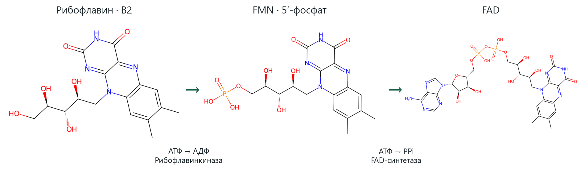
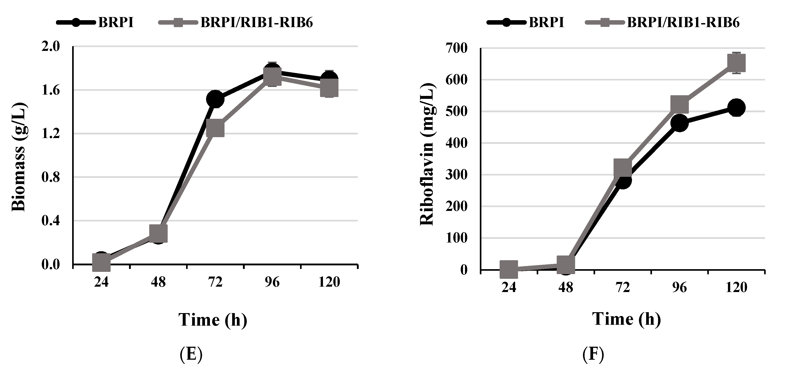
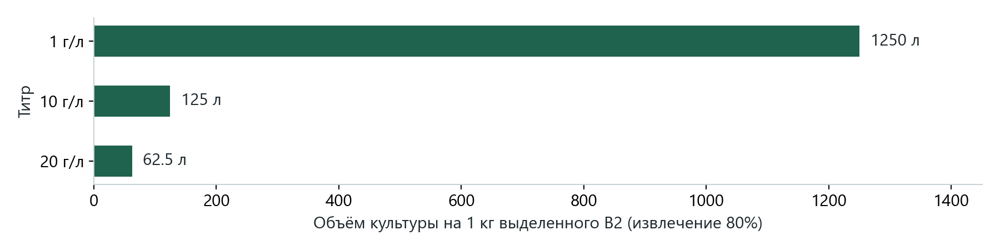

# Рибофлавин в дрожжах: от воспроизведения базового процесса к оптимизации DBTL

Аналитический отчёт и план экспериментальных работ · Ноябрь 2026

Цель проекта — воспроизвести опубликованный дрожжевой процесс биосинтеза витамина B2, затем с помощью циклов Design–Build–Test–Learn (DBTL) повысить титр, выход и объёмную производительность до уровня, пригодного для дальнейшего масштабирования. Переход к производным FMN и FAD рассматривается как второй этап развития платформы после подтверждения базового процесса по B2.

Приоритетный продуцент — документированная продуктивная линия *Candida famata*. При отсутствии доступа к паспортизованному штамму с воспроизводимой методикой необходимо отдельно решить, целесообразна ли самостоятельная реконструкция пути в *C. famata*, либо разумнее начать с *Komagataella phaffii* — более доступной модельной системы с существенно более низким опубликованным титром, подходящей для отработки цикла DBTL.

## 1. Цель и этапы проекта

Работа разбита на три последовательных этапа с проверяемым результатом на каждом шаге.

На первом этапе воспроизводится конкретный опубликованный результат по биосинтезу витамина B2 в дрожжах. Для этого требуются подтверждённый штамм, воспроизводимая рецептура среды, стандартный режим культивирования, количественная аналитика B2 и контроль фонового сигнала среды. Окрашивание культуры служит лишь качественным признаком и требует приборного подтверждения концентрации и состава флавинов.

На втором этапе запускается итеративный цикл Design–Build–Test–Learn: проектируется ограниченная серия генетических и технологических изменений, штаммы конструируются и проверяются в единых условиях, а состав следующей серии определяется по накопленным данным. На ранних раундах применяются базовые статистические и интерпретируемые модели; переход к методам машинного обучения обоснован при условии, что при равном экспериментальном бюджете они превосходят экспертный и случайный отбор вариантов.

На третьем этапе лучшие штаммы проверяются в управляемом биореакторе. Результаты колбовых опытов при масштабировании меняются из-за различий в массопереносе кислорода, профиле питания, регулировании pH, плотности биомассы и распределении рибофлавина между раствором, клетками и кристаллической фазой.

Эффективность процесса оценивается по четырём независимым метрикам:

- Титр — масса B2 в пересчёте на объём исходной культуральной жидкости (г/л) с обязательным указанием измеряемой фракции.
- Средняя объёмная производительность — титр, отнесённый к длительности соответствующей стадии культивирования, г/(л·ч). В режиме fed-batch дополнительно учитываются изменение рабочего объёма и объём отобранных проб.
- Выход по субстрату — масса синтезированного продукта на массу фактически потреблённого источника углерода (г/г), без подмены потреблённого сахара начальной загрузкой.
- Стабильность — воспроизводимость показателей в независимых культивированиях и сохранение продуктивности после заданного числа пассажей без селективного давления.

Для оценки промышленной применимости к этим четырём метрикам добавляются степень извлечения, чистота товарной формы, стоимость питательных компонентов, длительность полного цикла аппарата и соответствие нормативной спецификации.

## 2. Критерии выбора и сравнение альтернатив

### Критерии отбора

Отбор целевого продукта опирается на пять проектных критериев. Каждый из них проверяется по фактическим данным о субстанции, аналитике и регуляторном статусе:

- К1. Надёжный стартовый ориентир и промышленная база. Существуют опубликованный дрожжевой процесс с описанными генами, условиями и измеримыми показателями, а также действующее промышленное производство, задающее ориентир производительности.
- К2. Быстрый лабораторный скрининг. Первичный отбор вариантов в цикле DBTL должен выполняться доступным оптическим методом без обязательной хромато-масс-спектрометрии каждой пробы. Хроматография (ВЭЖХ) используется при постановке метода, для подтверждения лидеров и для контроля представительной выборки остальных образцов.
- К3. Подтверждённый рынок и конкурентоспособность биосинтеза на первом шаге. Учитываются реальные сегменты потребления в мире и в РФ, товарная форма продукта и экономическая сопоставимость с химическим синтезом или экстракцией.
- К4. Возможность развития платформы. Добавление 1–3 ферментативных стадий в том же продуценте должно открывать выход к более сложным продуктам. При этом ёмкость и маржинальность вторичных продуктов подлежат самостоятельной проверке.
- К5. Соответствие государственным приоритетам РФ. Проверяется наличие конкретной субстанции в действующих перечнях приоритетной продукции с учётом применимости мер поддержки к выбранной форме выпуска.

Научная новизна, патентная чистота и доступность биологического материала оцениваются отдельно наряду с пятью базовыми критериями.

| Критерий | Подтверждено для B2 | Требует проверки |
| --- | --- | --- |
| К1. Старт и индустрия | Описаны пути в K. phaffii и продуктивных линиях C. famata; действует зрелая ферментационная индустрия [1–3, 7] | Доступ к конкретному штамму и воспроизведение методики; в промышленности применяются и недрожжевые продуценты |
| К2. Быстрое измерение | Спектрофотометрия и флуориметрия пригодны для первичного скрининга [1, 3] | Матричная калибровка, учёт кристаллов и сопутствующих флавинов; подтверждение методом ВЭЖХ остаётся обязательным |
| К3. Рынок и биосинтез | Подтверждены международная торговля по HS 293623 и доминирование ферментации [25–29] | Текущий объём потребления в РФ и расчётная себестоимость собственного процесса |
| К4. Развитие платформы | Две ферментативные стадии до FMN и FAD; описаны дрожжевые продуценты [13–16] | Объём доступного рынка и ценовая премия FMN/FAD; конкуренция с альтернативными маршрутами |
| К5. Приоритеты РФ | Витамин B2, его соединения и производные включены в п. 32 приказа Минсельхоза №392 [22] | Условия применения конкретных программ поддержки к выбранной форме продукта и заявителю |

Витамин B2 сочетает проверяемый старт, быстрый оптический скрининг и прямое биохимическое продолжение до FMN и FAD. При этом коммерческий потенциал производных второго этапа остаётся открытым вопросом и требует отдельной проверки.

### Сравнение альтернативных направлений

В таблице сведены 16 альтернативных направлений, рассмотренных на этапе отбора, в сопоставлении с платформой рибофлавина. Оценка относится именно к задаче запуска первого цикла DBTL.

| Направление | К1: стартовая технологическая база | К2: требования к аналитике |
| --- | --- | --- |
| B2 → FMN → FAD | Нативный путь; метаболическая инженерия Candida или K. phaffii [1–3] | B2: оптика + ВЭЖХ; на следующем шаге — раздельная ВЭЖХ трёх флавинов |
| 1. Эрготионеин | Двухгенный грибной модуль в S. cerevisiae и Y. lipolytica; есть реакторные данные [19] | Специализированный колориметрический или ферментативный тест после валидации; ВЭЖХ для состава и полноты экстракции |
| 2. SAM (адеметионин) | Дрожжевая ферментация с усилением предшественников и энергетического метаболизма [33] | Внутриклеточная экстракция, ВЭЖХ, контроль активного стереоизомера и стабильности; возможен биосенсорный скрининг |
| 3. Ликопин, β-каротин, астаксантин | Развитая инженерия каротиноидов с высокими титрами в Y. lipolytica [20] | Оптическая оценка по цвету требует предварительного лизиса, экстракции и хроматографического разделения изомеров |
| 4. Кроцетин / кроцины | Удлинение каротиноидного пути за счёт расщепления и гликозилирования | Разделение субстратов и гликозилированных форм; компартментализация искажает прямую оптическую оценку |
| 5. Биксин / норбиксин (аннато) | Устоявшийся рынок растительного сырья; дрожжевой процесс требует дополнительной проверки | Контроль состава апокаротиноидов и изомеров методом ВЭЖХ |
| 6. п-Кумаровая кислота → ресвератрол / нарингенин | Хорошо изученные пути; опубликован успешный ML-DBTL по п-кумаровой кислоте [32] | УФ-скрининг чувствителен к фону среды; для разделения близких ароматических метаболитов требуется ВЭЖХ |
| 7. Редкие полифенолы и красители | Глабридин, бакучиол, куркумин и антоцианы требуют самостоятельных ферментативных маршрутов | Многокомпонентный состав, необходимость отдельных аналитических стандартов и сложная пробоподготовка |
| 8. Пуллулан | Промышленный внеклеточный полисахарид Aureobasidium [35] | Многокритериальный контроль: масса полимера, молекулярная масса, вязкость и остаточная пигментация |
| 9. Биотин (B7) | Биосинтетический путь изучен; ключевое ограничение — завершающая Fe–S-зависимая стадия [34] | Отсутствие селективного видимого сигнала; необходим отдельный количественный метод |
| 10. Рекомбинантный химозин | Зрелая область экспрессии и секреции рекомбинантных белков | Удобный тест активности по свёртыванию молока, дополняемый контролем белковой чистоты и протеолиза |
| 11. Таурин | Крупнотоннажный продукт, преимущественно химического синтеза; эталонный дрожжевой процесс не выбран | Отсутствие прямого селективного УФ-поглощения; требуется дериватизация или хроматографическое разделение |
| 12. Фолиновая кислота (фолинат) | Фармацевтическая субстанция со строгими требованиями к изомерной чистоте | Контроль окислительной стабильности, стереоизомеров и полиглутаматных форм |
| 13. 7-DHC → витамин D3 / 25-OH-D3 | Описаны дрожжевые продуценты стеролов [37] | Экстракция липидной фракции и ВЭЖХ-разделение близких стеролов |
| 14. 2′-Фукозиллактоза (2′-FL) | Опубликованы штаммы S. cerevisiae и Y. lipolytica с транспортом лактозы и синтезом GDP-фукозы [36] | Хроматографический анализ углеводов и побочных олигосахаридов без простого оптического теста |
| 15. Овотиол A | Исследовательский тиогистидиновый антиоксидант без подтверждённой промышленной базы | Селективность на фоне других тиолов, доступность стандарта и стабильность проб |
| 16. Селенонеин | Специализированное селенсодержащее соединение с ограниченными рыночными данными | Специация селена, требования безопасности и высокочувствительный следовой анализ |

### Анализ альтернатив

**Эрготионеин** остаётся наиболее сильным резервным кандидатом по технологической проработанности. В публикации по *Yarrowia lipolytica* получен титр 1,63 г/л за 220 ч, причём около 74% продукта оставалось внутри клеток [19], что заметно усложняет выделение при коротком генетическом пути. Для коммерческого обоснования в РФ требуется подтверждение спроса на сырьё. Кроме того, переход от эрготионеина к SAM как к следующему продукту биохимически некорректен: в синтезе эрготионеина SAM расходуется как донор метильных групп, поэтому наработать его из эрготионеина нельзя. Переносимы лишь общие компетенции по инженерии предшественников.

**S-Аденозилметионин (SAM)** оправдан при ориентации проекта непосредственно на фармацевтическую субстанцию и наличии профильного партнёра. В работе 2025 года достигнут титр около 14 г/л в режиме fed-batch при подаче L-метионина [33], то есть процесс зависит от стоимости аминокислотного предшественника. Основные ограничения для старта — внутриклеточная локализация, необходимость контроля активного стереоизомера и стабильности молекулы. При оценке рынка выручку готовых лекарственных препаратов на основе адеметионина следует отделять от объёма закупок самой субстанции, а нормативные меры поддержки кормового метионина нельзя автоматически распространять на фармацевтический SAM.

**Каротиноиды** образуют технологически сильную платформу: в *Y. lipolytica* опубликованы титры 17,6 г/л ликопина и 39,5 г/л β-каротина [20], а окраска облегчает предварительный скрининг. Сложности возникают на стадии пробоподготовки и выделения из-за гидрофобности, внутриклеточного накопления и примеси сопутствующих пигментов. При коммерческой оценке необходимо учитывать конкуренцию с химическим синтезом и растительными экстрактами в привязке к конкретной концентрации и маркировке продукта. Переход к астаксантину, кроцинам или аннато требует разных ферментативных модулей и технологических схем. Высокая плотность публикаций по DBTL в этой области повышает планку научной новизны, хотя и оставляет пространство для прикладной оптимизации.

**Кроцины, аннато и редкие полифенолы** проигрывают на старте по сочетанию К1 и К2 из-за многостадийности, требований к локализации ферментов, низкой растворимости и необходимости сложной химической идентификации. Эти направления целесообразно выделять в отдельные проекты при появлении проверенного штамма-референса и конкретного покупателя.

**п-Кумаровая кислота → ресвератрол / нарингенин** — сильный методологический резерв. В исследовании 2024 года применение DBTL позволило поднять продукцию п-кумаровой кислоты на 68% за два цикла (до 0,52 г/л) [32], причём после исчерпания прироста в исходной библиотеке авторы расширили пространство конструкций. Для коммерческого развития необходимо подтвердить стоимостное преимущество ферментации над химическим и растительным сырьём, а на следующем этапе — преодолеть ограничения по балансу малонил-CoA и селективности анализа. Рибофлавин выигрывает у этой ветки за счёт более простого оптического скрининга, действующей ферментационной индустрии и прямого присутствия в приоритетном перечне РФ.

**Пуллулан** имеет зрелую промышленную базу, однако меняет характер задачи: спецификация покупателя включает молекулярную массу, вязкость, примеси и плёнкообразующие свойства [35]. Это усложняет массовый скрининг, а стехиометрическая метаболическая модель плохо предсказывает характеристики полимера. Последующие химические модификации полисахарида также выходят за рамки простого наращивания низкомолекулярного биосинтетического пути.

**Биотин** входит в государственные приоритетные перечни, однако лимитируется активностью ферментов пути и обеспечением железосерных кластеров биотинсинтазы [34]. Хотя клеточные системы способны регенерировать Fe–S-кластеры, сочетание сложных биохимических ограничений, отсутствия простого оптического скрининга и недоказанной экономики дрожжевого процесса делает его неподходящим для первого проекта.

**Рекомбинантный химозин** обладает понятным промышленным спросом и удобным функциональным тестом, но относится к задачам белковой экспрессии и секреции. Его целесообразно рассматривать в случае смены профиля проекта с метаболической инженерии на оптимизацию синтеза ферментов.

**Таурин и фолинат** исключены из короткого списка из-за отсутствия удобной связки «воспроизводимый дрожжевой референс — быстрый скрининг — конкурентная себестоимость». Для фолината дополнительный барьер создают окислительная нестабильность и строгий контроль стереоизомерного состава.

**7-Дегидрохолестерин (7-DHC) → витамин D3 / 25-OH-D3 и 2′-фукозиллактоза (2′-FL)** представляют собой перспективные прикладные направления. Дрожжевые пути синтеза стеролов [37] и олигосахаридов грудного молока [36] подтверждены в литературе, но требуют специализированной хроматографии, контроля побочных продуктов и сложной квалификации пищевой или фармацевтической категории. В случае 7-DHC дополнительно учитывается последующая фотохимическая или ферментативная конверсия. Оба варианта оправданы при участии индустриального партнёра с готовой аналитической базой.

**Овотиол A и селенонеин** отложены из-за отсутствия подтверждённой промышленной технологии и сформированного коммерческого спроса. Аналогично за пределами короткого списка оставлены эктоин (требуется сравнение с развитыми бактериальными платформами), хондроитинсульфат (контроль структуры полимера), глюкозамин / N-ацетилглюкозамин (специфическая аналитика углеводов) и бензоназоподобные нуклеазы (задача белковой продукции и очистки). Патентная чистота этих направлений требует отдельного анализа.

### Короткий список и условия пересмотра

| Вариант | Условия рационального выбора | Основания для пересмотра |
| --- | --- | --- |
| Рибофлавин (B2) — основной | Требуются воспроизводимый старт, быстрый скрининг и понятный переход к производственным метрикам | Недоступность подходящего штамма или аналитики; заведомо неконкурентная экономика выделения |
| Эрготионеин — резерв | Доступен проверенный генетический модуль и есть подтверждённый покупатель | Конкретный коммерческий спрос и готовая методика анализа перевешивают отсутствие прямого каскада |
| п-Кумаровая кислота / каротиноиды — методологический резерв | Приоритет — отработка и сравнение алгоритмов DBTL на хорошо изученной модели | Наличие в лаборатории готового штамма и настроенной аналитики по этим соединениям |
| SAM, 2′-FL, стеролы — отдельная ветка | Привлечён профильный индустриальный партнёр с ресурсами на аналитику и регуляторную квалификацию | Высокая удельная цена продукта при отсутствии доступа к аналитике и каналам сбыта не компенсирует риски старта |

Переход от B2 к FMN и FAD биохимически прямой, однако оптимизация штамма под рибофлавин может не переноситься напрямую на фосфорилированные производные из-за изменения расхода АТФ, транспорта и регуляции. Поэтому эффективность второго этапа проверяется отдельными экспериментами и коммерческим анализом.

## 3. Выбор штамма-продуцента

### Candida famata — приоритетный продуцент

Выбор *Candida famata* опирается на опубликованную серию работ по селекции и метаболической инженерии этого вида. Для штамма на базе линии AF4 со сверхэкспрессией генов *SEF1*, *RIB1* и *RIB7* получен титр 16,4 г/л в режиме fed-batch в 7-литровом биореакторе [2]. Линия AF4 является результатом многоэтапной селекции; перенос тех же трёх генов в случайный дикий изолят не позволяет рассчитывать на сопоставимый титр.

В публикации 2022 года к пятым суткам культивирования в колбах получены 204 мг/л для AF4, 261,2 мг/л для BRP, 511,26 мг/л для BRPI и 652,70 мг/л для BRPI/RIB1–RIB6 [3]. Дополнительное усиление пути в BRPI дало прирост около 28%. Эти колбовые данные характеризуют конкретный протокол культивирования и не подлежат прямому сопоставлению с реакторным показателем 16,4 г/л.

В работе 2024 года приведены титры 812,5 мг/л для BRPI на глюкозе и 1493,5 мг/л для модифицированного штамма на лигноцеллюлозном гидролизате за 120 ч [4]. Использование дешёвого сырья требует отдельной оценки затрат на предобработку гидролизата, удаление ингибиторов роста и очистку конечного продукта.

### Komagataella phaffii — резервная платформа

В базовой работе Marx с соавторами использовано прежнее название *Pichia pastoris*; для линий X-33 и GS115 сегодня применяется таксономическое название *Komagataella phaffii* [1]. Последовательная замена промоторов нативных генов биосинтеза B2 в колбах обеспечила поэтапный рост титра от 6,9 мг/л (усиление *RIB1*) до 20,2 мг/л (усиление всех шести генов пути). В биореакторе достигнуто около 125 мг/л в пересчёте на общий объём культуры, что соответствует 175 мг/л в отделённом супернатанте.

Разница между двумя значениями объясняется высокой плотностью биомассы, при которой объём жидкой фазы существенно меньше общего объёма культуральной жидкости. Для межплатформенного сравнения корректно использовать значение 125 мг/л на объём культуры.

Платформа *K. phaffii* удобна для освоения клонирования, аналитики и методологии DBTL, особенно при наличии локальной экспертизы по этим дрожжам. Вместе с тем её опубликованный титр на два порядка ниже, чем у специализированных линий *C. famata*, поэтому выбор *K. phaffii* означает фокус на методической управляемости на первом этапе.

| Организм / линия | Опубликованный показатель | Роль в проекте |
| --- | --- | --- |
| C. famata (линия AF4 / BRP) | 16,4 г/л, fed-batch, биореактор 7 л [2] | Основной вариант при получении паспортизованной линии и полной методики |
| C. famata (BRPI / RIB1–RIB6) | 0,653 г/л, колбы, 120 ч [3] | Базовый ориентир для колбового воспроизведения |
| K. phaffii (усиление 6 генов пути) | 0,0202 г/л в колбах; ~0,125 г/л культуры в биореакторе [1] | Резервная платформа для отработки воспроизводимого цикла DBTL |
| Yarrowia lipolytica | Опубликованы инженерия пути B2 и капельный скрининг [5] | Возможная альтернатива при сильной локальной базе; целевой титр требует проверки по полному тексту |
| Hyphopichia wangnamkhiaoensis | 16,68 мг/л (2024 г.); 0,5593 мг/(л·ч) в непрерывной культуре (2025 г.) [6] | Природный продуцент с низкими текущими показателями и слабо развитым генетическим инструментарием |
| Saccharomyces cerevisiae | Развитая генетика и геномные метаболические модели | Вспомогательная модель для отработки методик |
| Ashbya gossypii / Bacillus subtilis | Промышленные платформы производства B2 [7] | Внешние отраслевые ориентиры (нитчатый гриб и бактерия) |

### Доступность штаммов и таксономическая проверка

Упоминаемые в литературе штаммы VKM Y9, L20105, AF4, BRP и BRPI имеют разные генотипы и историю селекции. Наличие штамма VKM Y9 в каталогах коллекций требует проверки фактической доступности к заказу, как и условия передачи AF4, BRP или BRPI. Штамм L20105 является лейциновым ауксотрофом и требует соответствующей среды при использовании в качестве контроля.

В научной литературе видовое название *Candida famata* и близкие виды рода *Debaryomyces* (*D. hansenii*, *D. subglobosus*, *D. fabryi*) часто употребляются неоднозначно. Перед приобретением штамма необходимо запросить паспорт, данные о происхождении, генотипе и видовой идентификации, а при получении — верифицировать изолят по последовательностям ITS/D1–D2. Работа ведётся с документированным неклиническим штаммом с соблюдением требований биобезопасности организации.

Окончательный выбор организма принимается по итогам проверки доступности материала:
- получена документированная продуктивная линия *C. famata* — воспроизведение её протокола;
- доступен только дикий штамм *C. famata* — выделение отдельной задачи реконструкции пути без привязки к титру 16,4 г/л на первом этапе;
- надёжный материал *C. famata* недоступен — запуск на *K. phaffii* или *Y. lipolytica* в зависимости от компетенций лаборатории.

Закупку полного комплекта синтетических конструкций целесообразно проводить только после утверждения выбранной ветки.

## 4. Путь биосинтеза и номенклатура генов

Биосинтез рибофлавина объединяет два метаболических потока: производное гуанозинтрифосфата (GTP) и углеродный фрагмент из рибулозо-5-фосфата. Их конденсация приводит к образованию люмазинового предшественника и далее рибофлавина. Продуктивность зависит как от активности ферментов самого пути, так и от снабжения пуринами, потока через пентозофосфатный путь, баланса восстановительных эквивалентов и внутриклеточной регуляции.

Рисунок 4.1. Последовательность ферментативных превращений B2 → FMN → FAD. Рибофлавинкиназа переносит фосфатную группу с АТФ на рибофлавин с образованием FMN и АДФ. FAD-синтетаза переносит аденилильный остаток с АТФ на FMN с выделением пирофосфата.

При проектировании конструкций критически важно учитывать различия в нумерации генов *RIB* у разных видов дрожжей [1, 3]:

| Ферментативная функция | K. phaffii (P. pastoris) [1] | C. famata [3] |
| --- | --- | --- |
| GTP-циклогидролаза II | RIB1 | RIB1 |
| Редуктаза раннего интермедиата | RIB7 | RIB2 |
| Деаминаза раннего интермедиата | RIB2 | RIB3 |
| Синтаза 3,4-дигидрокси-2-бутанона-4-фосфата | RIB3 | RIB6 |
| Люмазинсинтаза | RIB4 | RIB5 |
| Рибофлавинсинтаза | RIB5 | RIB7 |

Перед заказом синтетической ДНК для каждой мишени сверяются нуклеотидная последовательность и функциональная аннотация в геноме конкретного рабочего штамма.

Усиление пуринового синтеза способно увеличить приток предшественников к B2, но одновременно влияет на скорость роста и энергетический баланс аденилатов. Для последующей конверсии в FMN и FAD дополнительно возрастает потребность в АТФ. Любое перекрытие конкурирующих ветвей метаболизма требует предварительной оценки влияния на жизнеспособность штамма.

## 5. Этап 0: воспроизведение базового результата

### Критерии успешного воспроизведения

Перед началом экспериментов утверждается протокол, в котором зафиксированы опорная публикация, идентификатор штамма и контроля, состав среды, процедура подготовки посевного материала, тип и рабочий объём сосуда, температура, скорость перемешивания, длительность, график отбора проб и аналитическая методика. Допустимый диапазон отклонения от литературного титра устанавливается после оценки межсерийной вариабельности на имеющемся оборудовании.

Минимальный дизайн контрольного опыта включает:
- родительский штамм и литературный (или реконструированный) продуцент;
- не менее трёх независимых биологических культивирований на каждый вариант;
- контроль бесклеточной среды в тех же условиях инкубации;
- внешний стандарт B2;
- отбор временных точек для отслеживания роста, накопления B2 и расхода сахара.

Последовательность работ: подтверждение чистоты и видовой принадлежности → закладка рабочего банка → предварительный тест роста и диапазона разведений → независимое воспроизведение → анализ расхождений. Если базовый результат не достигнут, причины диагностируются до запуска серии оптимизации.

### Методика для Candida famata

В работе Petrovska с соавторами [3] культивирование проводят в 50 мл среды в колбах Эрленмейера объёмом 250 мл при 30 °C и 220 об/мин в течение 120 ч. Описаны богатая среда (5 г/л дрожжевого экстракта, 10 г/л пептона, 20 г/л глюкозы) и минимальная среда YNB (6,7 г/л YNB, 20 г/л глюкозы). Опубликованные титры в таблице 1 и на рисунке 4 получены на минимальной среде YNB.

В тексте публикации приведена начальная концентрация биомассы 2 мг/л — необычно низкое значение, которое требует уточнения по первичным материалам или у авторов до утверждения локального СОП. Также в статье отмечены различия температур между культивированием и отдельными опытами по анализу экспрессии.

Штаммы серии BRPI/RIB1–RIB6 созданы на базе модифицированного фона BRPI с использованием конструкций pTb/SAT1, линеаризации по сайту AatII и селекции на норзеотрицине (20 мг/л). При переносе на другой генетический фон проверяется совместимость маркера и сайтов рестрикции; трансформанты подтверждаются ПЦР по участкам интеграции, секвенированием и при необходимости оценкой числа копий.

Для повторения реакторного результата 16,4 г/л [2] потребуется получить полный текст методики fed-batch и параметры конструкций, поскольку в доступной аннотации приведены только масштаб и итоговый титр.

### Анализ исходных кинетических данных

Рисунок 5.1. Динамика сухой биомассы (панель E, г/л) и накопления рибофлавина (панель F, мг/л) в минимальной среде YNB в колбах. Чёрная кривая — родительский штамм BRPI, серая — BRPI/RIB1–RIB6. Источник: Petrovska et al., 2022 [3], рис. 4 (панели E–F), лицензия CC BY 4.0 (https://creativecommons.org/licenses/by/4.0/).

К 120 ч модифицированный штамм накапливает 652,70 ± 30,63 мг/л B2 против 511,26 ± 24,10 мг/л у родительского BRPI (среднее и стандартное отклонение по трём независимым пробам) при сопоставимой сухой биомассе (1,62 и 1,69 г/л). Прирост продукции около 28% достигается за счёт повышения удельной продуктивности клеток, а не роста биомассы.

Из кинетики следуют три требования к лабораторному тестированию: регистрация временного ряда, одновременное измерение биомассы и продукта, а также сравнение с родительским контролем на идентичном генетическом фоне. Приведённый в статье показатель 403,40 мг B2/г сухой биомассы отражает удельное накопление продукта и учитывается отдельно от выхода по потреблённому сахару.

### Методика для Komagataella phaffii

В работе Marx с соавторами [1] использованы линии X-33 и GS115. Колбовые опыты выполняли в колбах 250 мл с отбойниками при 28 °C и 180 об/мин. Точный рабочий объём жидкости в тексте статьи не указан, поэтому его необходимо зафиксировать в локальном протоколе с учётом диаметра орбиты шейкера и скорости переноса кислорода.

Состав среды на 1 л: YNB без аминокислот — 13,4 г; глюкоза — 50 г; калий-фосфатный буфер (pH 6) — 100 мМ; биотин — 0,4 мг; гистидин — 40 мг; глутамат, метионин, лизин, лейцин и изолейцин — по 50 мг; CaCO3 — 3 г. Витаминный состав коммерческого YNB проверяется по спецификации производителя и контролируется анализом бесклеточной среды до и после инкубации.

В статье описаны две разные линейки конструкций: экспрессия *RIB1* (включая вариант с геном из *S. cerevisiae*) на базе pGAPZB и серия последовательной замены промоторов нативных генов пути. Последовательное усиление *RIB1*, *RIB3*, *RIB7*, *RIB5*, *RIB2* и *RIB4* повышало титр в колбах по шагам: 6,9 → 9,1 → 10,2 → 13,2 → 14,9 → 20,2 мг/л. На первом шаге целесообразно воспроизвести одну чётко описанную ступень вместе с контрольным штаммом, после чего наращивать каскад. Параметры электропорации и селекции берутся из официальных протоколов для выбранного штамма и вектора.

Биореакторный этап [1] проводили в аппарате объёмом 5 л с начальной загрузкой 1,75 л при 25 °C, поддержании pH 5 раствором аммиака, растворённом кислороде (DO) выше 20%, перемешивании 600–1200 об/мин и подаче воздуха 100 л/ч с последовательными стадиями batch и fed-batch. При переносе на другой биореактор режим подбирается по целевому уровню DO и коэффициенту массопереноса кислорода согласно профилю питания из первоисточника.

### Параметры, фиксируемые в каждом опыте

В лабораторный журнал и таблицу эксперимента заносятся:
- идентификатор штамма, клона и партии питательной среды;
- параметры посевного материала, время и объём инокуляции;
- температура, скорость перемешивания, pH и доступные данные по растворённому кислороду;
- оптическая плотность с калибровкой на сухую массу клеток, остаточный сахар и концентрация B2 по каждой измеренной фракции;
- коэффициенты разведения, наличие кристаллического осадка и объёмы отобранных проб;
- исходные приборные файлы и все отклонения от протокола.

В режиме fed-batch дополнительно регистрируются состав и масса подаваемого субстрата, текущий рабочий объём, расход титранта и пеногасителя.

## 6. Аналитический контроль

### Скрининг, подтверждение и материальный баланс

Измерительная схема разделяется на три уровня: высокопроизводительный оптический скрининг для первичного ранжирования вариантов, хроматографическое подтверждение концентрации и состава флавинов, а также контроль материального баланса между фракциями.

Для предварительной оценки рибофлавина в прозрачном супернатанте подходят флуориметрия (в работе [3] использованы длины волн возбуждения 440 нм и эмиссии 535 нм) и спектрофотометрия в области 440–450 нм. Поскольку оптический сигнал зависит от состава среды, pH, светорассеяния и присутствия других флавинов, калибровочную кривую строят по стандарту B2 в рабочей матрице с учётом длины оптического пути.

На всех этапах отбора и хранения пробы защищают от света. Допустимое время хранения, температурный режим и влияние замораживания проверяют экспериментально. При работе с FMN и FAD отдельно контролируют степень гидролиза FAD → FMN → B2 в ходе пробоподготовки.

### ВЭЖХ для внеклеточного рибофлавина

В методике [1] супернатант отделяли центрифугированием в течение 1 мин при 13 000 об/мин (при переносе на другую центрифугу режим пересчитывают в относительное центробежное ускорение g), смешивали 1:1 с двукратной подвижной фазой и фильтровали через мембрану PVDF 0,22 мкм. Разведение 1:1 учитывается при расчёте итоговой концентрации.

Условия разделения: колонка Nucleosil C18 (150 × 4,6 мм, 5 мкм) с предколонкой 10 мм; скорость потока 1 мл/мин; изократическая подвижная фаза — 50 мМ NaH2PO4/H3PO4 (pH 3), 1 мМ тетраметиламмонийхлорида и 12% ацетонитрила; объём ввода 100 мкл; детектирование при 223 и 445 нм. Объём инжекции и фактическое время элюирования уточняются при настройке метода на конкретном хроматографе. При переходе к смесям B2, FMN и FAD требуется отдельная проверка хроматографического разделения всех трёх пиков.

### Раздельное определение B2, FMN и FAD

Протокол Bio-protocol [8] использует колонку SunFire C18 (150 × 4,6 мм, 3,5 мкм) при 35 °C, поток 1 мл/мин, длительность анализа 12 мин и флуоресцентный детектор (470/530 нм). Подвижная фаза: 100 мМ формиата аммония, 100 мМ муравьиной кислоты (конечная молярная концентрация в растворе) и 25% метанола. Калибровка строится по смеси B2, FMN и FAD в диапазоне 0,05–5 мкМ (0,05; 0,1; 0,5; 1 и 5 мкМ). Поскольку исходный протокол разработан для бактерий, хроматографические условия можно адаптировать, но полноту экстракции из дрожжей и сохранность FMN/FAD необходимо валидировать заново.

В дрожжевой методике [9] применяется колонка Hypersil ODS (100 × 3 мм, 3 мкм), поток 0,5 мл/мин, ввод 10 мкл, элюенты — 50 мМ цитратный буфер (pH 2,5) и метанол в градиенте 5–100% метанола за 13,5 мин с последующей промывкой и уравновешиванием, флуоресцентное детектирование при 420/530 нм. Девятиточечная калибровка охватывает диапазон 1–500 мкг/л, поэтому высокотитражные пробы требуют существенного разведения. При переносе на другую колонку или прибор проверяют разрешение пиков, рабочее давление, времена удерживания и степень извлечения стандарта.

### Экстракция внутриклеточных флавинов

В опубликованной дрожжевой процедуре [9] клетки, соответствующие 25 единицам OD660, осаждают (2876 g, 15 мин) и инкубируют при 30 °C в течение ночи в буфере с 0,9 М сорбитола, 0,1 М EDTA, 14 мМ β-меркаптоэтанола и Zymolyase 100T (500 мкг/мл), уточнив объём ресуспендирования. Сферопласты осаждают, ресуспендируют в 1 мл воды, добавляют равный объём стеклянных бусин (0,45 мм), встряхивают на вортексе 10 мин, выдерживают ночь при 25 °C, затем 30 мин при 65 °C и 30 мин при 4 °C, после чего отделяют экстракт центрифугированием (23 000 g, 10 мин). Полноту лизиса контролируют микроскопией.

Из-за большой длительности, использования токсичного β-меркаптоэтанола и нагрева этот метод может искажать исходное соотношение B2, FMN и FAD. На этапе постановки аналитики его целесообразно сравнить с быстрым холодным механическим разрушением клеток в оптимизированном экстрагенте, сопоставив полноту лизиса, выход при повторной экстракции осадка и сохранность внесённых стандартов на одинаковом объёме исходной культуры.

### Учёт кристаллической фазы

Рисунок 6.1. Схема контроля материального баланса при отборе проб. Сумму масс B2 в жидкой фазе и осадке аликвоты А сопоставляют с суммарным содержанием B2 в аликвоте Б после пересчёта на одинаковый объём исходной культуры.

При повышенных титрах часть рибофлавина выпадает в виде внеклеточных кристаллов, которые при центрифугировании осаждаются вместе с биомассой. В таких условиях концентрация в супернатанте занижает реальный внеклеточный выход, а анализ осадка отражает сумму внутриклеточного и кристаллического B2.

Для корректного учёта отбирают параллельные аликвоты:
1. осветлённый супернатант — растворённые флавины;
2. осадок с микроскопическим контролем кристаллов — суммарный B2 в осадке (при невозможности надёжно разделить клетки и кристаллы показатель фиксируют именно как «B2 в осадке»);
3. целую культуру с проверенным полным растворением — суммарный B2 для независимой сверки баланса.

Массу продукта в экстракте рассчитывают как произведение измеренной концентрации, объёма экстракта и коэффициента разведения. Для получения титра эту массу делят на объём отобранной исходной культуры; для расчёта удельного содержания — на сухую массу биомассы в пробе.

### Контроль качества измерений

- Регулярные пробы чистого растворителя, бесклеточной среды и проверка отсутствия переноса между инъекциями.
- Подтверждение идентичности пиков по времени удерживания и методу добавок стандарта; в спорных случаях — спектральное или масс-спектрометрическое подтверждение.
- Калибровка в пределах рабочего линейного диапазона и контрольный образец в каждой аналитической серии.
- Внесение стандарта до и после экстракции, тест стабильности проб и проверка полноты извлечения повторной экстракцией.
- В качестве рабочих ориентиров для исследовательской стадии можно принять степень восстановления стандарта 80–120% и коэффициент вариации (CV) не выше 15%; при переходе к товарной спецификации применяются фармакопейные или отраслевые требования валидации.

## 7. Выделение и очистка продукта

Аналитическая экстракция определяет количество вещества в пробе, тогда как технологическая схема выделения должна обеспечить заданную чистоту и высокий процент извлечения при приемлемых затратах реагентов и энергии.

На низкотитражном старте главной задачей остаётся достоверная аналитика в культуре: при малых концентрациях масса воды, биомассы и солей многократно превышает массу рибофлавина, что делает получение сухого порошка экономически нецелесообразным на первом этапе.

### Патентные схемы выделения

Патент US5103005A [10] описывает щелочное растворение рибофлавина в суспензии при pH 11,5–13,5 (оптимально 12,4–12,8) и умеренной температуре, отделение биомассы и последующую кристаллизацию при снижении pH до 5,8–6,2 в контролируемых окислительных условиях с получением продукта чистотой около 96%. В том же патенте отмечено, что при концентрациях ниже приблизительно 0,2 г/л осаждение в описанных условиях не происходит — это важное ограничение для низкотитражных культур *K. phaffii*.

Патент US5210023A [11] описывает дополнительную очистку уже выделенного технического B2 водой или разбавленной кислотой при нагревании, повышающую чистоту, например, с 96 до 99%. Температурные режимы выше 100 °C требуют герметичного оборудования под давлением и соблюдения соответствующих мер промышленной безопасности.

### План отработки выделения

Разработка схемы выделения начинается с определения распределения рибофлавина между раствором, кристаллами и клетками. Далее в малом объёме тестируется выбранная схема растворения и осаждения в сравнении с контрольной аналитической экстракцией. На каждой операции фиксируются масса B2 на входе и выходе, объёмы потоков, чистота, остаточные примеси и расход реагентов. Масштабирование выделения проводится после сведения материального баланса.

Основные показатели эффективности выделения:
- степень извлечения — отношение массы B2 в готовом продукте к массе B2 в исходной культуре;
- массовая чистота — доля действующего вещества в товарной форме на установленной основе (с учётом влаги и неорганических солей, в дополнение к хроматографической чистоте по площадям пиков);
- производительность узла выделения — масса кондиционного продукта в единицу времени.

Химические операции выполняются по согласованному СОП под вытяжкой, с защитой растворов от света, контролем pH и регламентированным обращением с растворителями. Требования к чистоте и остаточным примесям определяются целевым рынком (кормовым, пищевым или фармацевтическим).

## 8. Цикл DBTL: проектирование, проверка и моделирование

### Design: постановка эксперимента

Первая серия DBTL проверяет два-три механистически ясных фактора: баланс экспрессии ферментов рибофлавинового пути, обеспечение предшественниками и режим питания с аэрацией. Одновременное изменение большого числа генов, состава среды, длительности и аналитической процедуры лишает эксперимент интерпретируемости.

Рациональный стартовый размер серии — 12–24 генетических варианта с повторяющимся родительским контролем в каждом блоке. При ограниченном бюджете приоритет отдаётся сохранению независимых биологических повторов и контролей за счёт сокращения числа тестируемых конструкций.

### Build: верификация штаммов

Для каждого полученного варианта ведётся паспорт: карта конструкции, подтверждённая последовательность, родительский штамм, способ трансформации, проверка интеграции, номер независимого клона и ссылка на образец в криобанке. В первой инженерной серии важно проверять несколько независимых клонов на одну конструкцию, чтобы отделить эффект промотора от вариаций числа копий и клонального разброса.

Стабильные подтверждённые штаммы помещаются в рабочий банк. Единый идентификатор связывает генотип, протокол культивирования, пробы, исходные приборные файлы и итоговые расчёты.

### Test: дизайн измерений

Положение колб в шейкере и порядок хроматографического анализа рандомизируются, а родительский контроль включается в каждую серию для учёта межсерийного сдвига. Регистрируются динамика роста, потребление сахара и накопление B2. При использовании оптического скрининга для отбора лидеров методом ВЭЖХ проверяют также часть средних и слабых вариантов, чтобы исключить систематическое смещение отбора.

Опыт капельного флуоресцентного скрининга в *Y. lipolytica* [5] показывает, что сортировка отдельных клеток может преимущественно фиксировать внутриклеточное накопление, а не секрецию продукта. Это ограничение необходимо учитывать при выборе формата первичного теста.

### Learn: статистические модели и ML

Моделирование начинается с простых интерпретируемых инструментов — регуляризованных линейных или байесовских моделей, позволяющих оценить вклад факторов и неопределённость прогноза на малой выборке. Опубликованный инструмент рекомендаций ART [18] служит методическим ориентиром, но требует проверки на данных конкретного процесса.

При валидации моделей технические повторы и клоны одной конструкции группируются так, чтобы не попадать одновременно в обучающую и тестовую выборки. Основной критерий качества — точность предсказания в следующем экспериментальном раунде. Признаки, измеряемые только после окончания ферментации (например, конечная биомасса), исключаются из моделей, предназначенных для выбора конструкций до начала опыта.

Стехиометрические модели метаболизма полезны для выявления узких мест и расчёта теоретических выходов, однако сами по себе не предсказывают титр по силе промотора. Перенос геномной модели *S. cerevisiae* на *C. famata* требует адаптации к геному, составу реакций, среде и экспериментальным скоростям роста.

### Оценка эффективности моделей

Начиная со второго раунда, экспериментальный бюджет делится поровну между рекомендациями модели, экспертным выбором и случайной выборкой из того же пространства конструкций. Сравнение ведётся по лучшему подтверждённому результату, доле вариантов с приростом относительно контроля, числу опытов до заданного порога и стоимости цикла. Все лидеры проходят независимое повторное подтверждение.

Если алгоритм не превосходит контрольные стратегии, анализируются причины — нехватка данных, слабоинформативное пространство изменений или высокий аналитический шум — без пересмотра условий сравнения задним числом. В открытой литературе не найдено прямого аналога комбинации перспективного ML-управляемого DBTL по дрожжевому B2 с экспериментальной проверкой переноса на FMN, однако перед публикацией или патентованием новых штаммов потребуется полноценный патентный поиск.

## 9. Масштабирование и производственные показатели

Корректное сопоставление процессов требует единых определений продукта и длительности цикла. Титр 0,653 г/л за 120 ч [3] соответствует средней объёмной производительности около 0,00544 г/(л·ч). Для показателя 16,4 г/л из работы [2] скорость не вычислялась, поскольку точная длительность ферментации не указана в доступном тексте аннотации.

В патенте US5120655A [12] описан процесс в аппарате объёмом 450 л с титром 21 г/л за 200 ч, что даёт ориентир около 0,105 г/(л·ч). Этот исторический пример наглядно показывает разрыв между миллиграммовыми колбовыми результатами и масштабом промышленного производства.

В режиме fed-batch при переменном объёме дополнительно рассчитываются суммарная наработанная масса B2 с учётом отобранных проб и полный баланс субстрата. При оценке годовой мощности установки к времени ферментации прибавляются затраты времени на подготовку посева, стерилизацию, выгрузку и мойку аппарата.

### Этапы и критерии перехода

| Переход между этапами | Критерий прохождения | Действия при отклонении |
| --- | --- | --- |
| Аналитика → воспроизведение | Разделены сигнал B2 и фон среды; проверены разведения и полнота экстракции | Доработка аналитической методики до начала серийных опытов |
| Воспроизведение → DBTL | Независимые серии дают воспроизводимый результат; расхождения с литературой объяснены | Проверка подлинности штамма, посева, среды, аэрации и базы расчёта |
| DBTL → биореактор | Прирост показателей подтверждён повтором и не связан с критическим падением скорости роста | Корректировка целевой функции и условий культивирования |
| Биореактор → технологическая оценка | Определены титр, производительность, выход, стабильность и баланс фракций | Диагностика лимитирования по кислороду, режиму питания, потерям и стабильности штамма |
| Технологическая оценка → масштабирование | Подтверждены схема выделения, спецификация продукта и предварительная экономика | Доработка технологии до принятия решения о пилотном или промышленном выпуске |

Целевую функцию цикла DBTL целесообразно формулировать многокритериально — с учётом производительности, выхода по субстрату и ограничений по росту. Целевые пороги задаются под выбранную категорию продукта на основе отраслевых ориентиров и требований заказчика.

## 10. Перспективные производные: FMN и FAD

Рибофлавин-5′-монофосфат (FMN) образуется путём фосфорилирования B2, а флавинадениндинуклеотид (FAD) — последующим аденилированием FMN. Развитие этой ветки позволяет использовать уже созданные штаммы и аналитическую инфраструктуру, но требует отдельной отработки материального баланса и выделения.

| Опубликованный результат | Условия и особенности сравнения |
| --- | --- |
| C. famata, FMN: 231 мг/л за 40 ч [13] | Биореакторный опыт; при более длительном культивировании отмечено снижение концентрации, критичен момент отбора |
| C. famata, FMN: 540 мг/л за 48 ч [14] | Биотрансформация отмытыми клетками на среде с сывороткой; время предварительного наращивания биомассы не входит в 48 ч |
| C. famata, FAD: 451,5 мг/л за 40 ч [15] | Штамм T-FD-FM27, реактор 1,2 л; среда содержит добавки аденина и глицина |
| E. coli, FMN: 3457,3 мг/л; FAD: 2305,2 мг/л [16] | Два отдельных бактериальных штамма (FMN08 и FAD13) в режиме fed-batch; внешний конкурентный ориентир |

Для FMN ключевыми параметрами качества выступают преобладание целевого 5′-изомера и содержание остаточного B2 и FAD; для FAD — целостность молекулы и устойчивость к гидролизу. Работы по производным запускаются после получения стабильной базы по B2, чтобы избежать одновременного наложения рисков платформы и новой аналитики.

### Фармакопейные спецификации и химический синтез

В монографии USP–NF на рибофлавина фосфат натрия нормируется содержание действующего вещества 73–79% в пересчёте на рибофлавин на сухое вещество [17]. Этот диапазон отражает отношение молекулярных масс рибофлавина и безводной мононатриевой соли FMN (376,36 / 478,33 = 78,7%). Примесный профиль и изомерный состав регламентируются отдельными показателями монографии.

Полный химический синтез FAD известен с 1952 года [21]. На рынке конкурируют химические, ферментативные и клеточные способы получения флавиновых кофакторов, и выбор технологии определяется селективностью, затратами на очистку и соответствием спецификации заказчика. При оценке спроса на FAD также важно учитывать, что во многих ферментных системах и диагностических наборах кофактор прочно связан с белком и расходуется в минимальных количествах.

## 11. Рынок и экономическая оценка

### 11.1. Сегменты и спецификации продукта

Товарным продуктом проекта является рибофлавин (или его производные) в конкретной коммерческой форме и категории качества. Кормовой B2, пищевой/фармацевтический B2, натриевая соль FMN и FAD различаются по спецификациям и ценообразованию, поэтому их объёмы и цены сопоставляются только после приведения к действующему веществу и категории.

В международной таможенной статистике применяется код HS 293623 («витамин B2 и его производные, несмешанные»). Он охватывает разные формы и концентрации, поэтому физическая масса таможенного потока не совпадает с массой чистого B2, а средняя удельная стоимость отражает структуру смеси. Кроме того, данные по внешней торговле не учитывают изменение складских запасов, реэкспорт, внутреннее производство и витамин в составе готовых премиксов.

| Сегмент | Товарная форма | Ключевые требования покупателя |
| --- | --- | --- |
| Кормопроизводство | Концентрированный B2 (обычно 80%) для премиксов и комбикормов | Содержание активного вещества, сыпучесть, гранулометрия, низкое пыление, стабильность, цена за кг действующего вещества |
| Пищевая промышленность и БАД | Высокочистый B2 (98% и выше) и разрешённые формы для обогащения или окрашивания | Подлинность, профиль примесей, стабильность в рецептуре, соответствие пищевым регламентам |
| Фармацевтические субстанции | B2 или рибофлавина фосфат натрия по фармакопейной спецификации | Полная квалификация производителя, стабильность серий, нормативное досье, жёсткий контроль примесей |
| Биокатализ и реагенты (FMN/FAD) | Специфицированная соль с заданной гидратностью и чистотой | Функциональная активность, химическая чистота и стабильность при хранении; малый тоннаж поставок |

В мировом производстве B2 ферментация уже вытеснила химический синтез [7, 28]. Новый производитель конкурирует прежде всего с крупнотоннажной оптимизированной ферментацией. Локальное происхождение продукта повышает устойчивость цепочек поставок для российских потребителей, но требует соответствия спецификациям и конкурентоспособной цены.

### 11.2. Мировые мощности и производство

По оценке Европейской федерации производителей кормов (FEFAC, ноябрь 2025 года), около 66% мирового объёма рибофлавина потребляется в животноводстве [28]. При этом доля B2 в себестоимости готового корма составляет менее 0,1%, поэтому для крупных покупателей критичны стабильность поставок и гарантированное качество наряду с ценой.

Рисунок 11.1. Региональное распределение производственных мощностей и фактического выпуска B2 по отраслевой оценке FEFAC (ноябрь 2025 года) [28, с. 15–16]. Отдельный базовый год для панели в отчёте не указан.

По данным отчёта IFEEDER/DIS/LCS (ноябрь 2025 года), мировые мощности по B2 в 2023 году оценивались примерно в 15,9 тыс. т/год при мировом спросе и предложении около 9 тыс. т/год, что соответствует загрузке мощностей на уровне 57% [29]. Избыток действующих мощностей означает, что органический рост мирового спроса может закрываться существующими заводами без автоматического дефицита. Оценки доли Китая в мощностях у FEFAC и IFEEDER близки (63–64%), однако из-за различий в методиках данные двух источников рассматриваются раздельно.

### 11.3. Международная торговля (HS 293623)

Статистика WITS / UN Comtrade по коду HS 293623 подтверждает крупнотоннажный товарный масштаб категории [25]. В 2024 году крупнейшими странами-экспортёрами выступили Китай ($99,08 млн; 5,24 тыс. т), Германия ($95,29 млн; 4,32 тыс. т), Нидерланды ($61,19 млн; 2,89 тыс. т) и Южная Корея ($50,03 млн; 2,74 тыс. т).

Рисунок 11.2. Пять крупнейших стран-экспортёров по стоимости в статистике WITS за 2024 год (HS 293623) [25]. Агрегат ЕС исключён во избежание двойного счёта. Показатели включают реэкспорт, поэтому суммарный экспорт превышает мировой выпуск.

Значительные объёмы экспорта из Нидерландов иллюстрируют роль европейских торговых и логистических хабов: страна-экспортёр часто отличается от страны производства, а различия средней экспортной цены отражают ассортимент и торговую наценку. Точная оценка конечного мирового потребления требует исключения реэкспорта и приведения всех потоков к единой концентрации.

### 11.4. Российский рынок и структура поставок

По данным собственной таможенной отчётности России за 2021 год (последний полный открытый год в базе WITS), импорт по коду HS 293623 составил 277,273 т на сумму $5,04551 млн [26]. Основными поставщиками по массе выступали Китай, Южная Корея и Германия.

Для периода 2022–2024 годов доступны зеркальные данные стран-экспортёров о поставках в РФ [27]. Поскольку зеркальная статистика отличается от импортной по базису оценки стоимости (FOB против CIF), моменту учёта и охвату партнёров, динамика приведена отдельно по единому источнику — отчётности Китая.

Рисунок 11.3. Экспорт из Китая в РФ по коду HS 293623 в 2022–2024 годах: 115,450 т ($1,65 млн), 222,771 т ($2,78 млн) и 229,573 т ($2,98 млн) [27]. Расчётная средняя стоимость потока (FOB) составила $14,25, $12,48 и $13,00 за кг соответственно. Рост китайского экспорта в 2022–2024 годах отражает перераспределение каналов поставок и не означает двукратного расширения всего российского потребления.

В 2024 году три непересекающиеся группы отчётности — Китай, ЕС (агрегат) и Индия — зафиксировали экспорт в Россию общим объёмом 283,667 т на сумму $4,44027 млн [27]:

| Группа отчётности (экспорт в РФ, 2024) | Масса, т | Стоимость, млн USD | Средняя стоимость, USD/кг |
| --- | --- | --- | --- |
| Китай | 229,573 | 2,98431 | 13,00 |
| ЕС (агрегат) | 49,803 | 1,04414 | 20,97 |
| Индия | 4,291 | 0,41182 | 95,97 |
| Итого по трём группам | 283,667 | 4,44027 | 15,65 |

Высокая удельная стоимость поставок из Индии указывает на неоднородность ассортимента внутри кода HS 293623 (включая высокочистые формы и производные), однако без детализации партий её нельзя однозначно отнести к конкретному продукту. При коммерческом планировании цены и объёмы следует проверять по отдельным спецификациям.

Статус отечественного производства остаётся фактором неопределённости. В открытых источниках публиковались планы строительства завода витамина B2 в Башкортостане [23]; в карточке резидента ОЭЗ ООО «Биорон» (обновление от 11.12.2023) заявлена проектная мощность 900 т/год с плановым вводом в конце 2024 года [31]. В обзоре IFEEDER (2025) возможный прирост мощностей вне Китая также связывается с Россией [29], тогда как FEFAC относит действующий выпуск к Китаю, Южной Корее и ЕС [28]. Фактический статус запуска и текущая загрузка российского производства требуют отдельной проверки на рынке.

### 11.5. Ценовые ориентиры по концентрациям

По ежемесячным рыночным обзорам поставщика VEGA, ориентировочные цены FOB в сентябре 2025 года составляли около $11/кг для кормового B2 80% и $32–45/кг для B2 98%, а в марте 2026 года — $10–11/кг и $28–50/кг соответственно [30]. Фактические условия закупки зависят от производителя, объёма партии, спецификации, логистики и таможенных расходов.

Рисунок 11.4. Рыночные ориентиры VEGA (FOB), пересчитанные на килограмм действующего B2 (цена коммерческого продукта / массовая доля B2) [30]. Для сентября 2025 года это $13,75/кг активного вещества в 80%-ном продукте и $32,65–45,92/кг в 98%-ном.

Нормировка на активное вещество устраняет разницу в концентрации, но премия за высокочистый B2 (98%) связана с дополнительной очисткой и требованиями пищевой или фармацевтической квалификации. Оценка экономики проекта должна строиться в привязке к ценам промышленных партий выбранной категории.

### 11.6. Перспективы FMN и FAD

В России подтверждено серийное фармацевтическое применение рибофлавина фосфата натрия: согласно официальной информации о препарате «Цитофлавин», в его состав входит 2 мг рибофлавина (в виде фосфата натрия) на 1 мл раствора и 5 мг на таблетку [38].

При этом физический тоннаж фармацевтических субстанций ограничен. Например, 1 млн таблеток по 5 мг соответствует 5 кг рибофлавинового эквивалента, или около 6,35 кг безводного мононатриевого FMN без учёта технологических потерь и степени гидратации. Следовательно, высокий оборот готового лекарственного средства часто сочетается с относительно небольшим годовым спросом на субстанцию.

Для свободного FAD подтверждено применение в биокатализе и лабораторных исследованиях, однако открытых данных по российскому балансу потребления свободного FAD недостаточно. Перед запуском второго этапа необходимо провести прямой опрос потенциальных заказчиков по спецификациям, годовым объёмам и целевым ценам.

| Сегмент проверки | Вопросы к потенциальным заказчикам | Влияние на стратегию проекта |
| --- | --- | --- |
| Премиксы и комбикорма | Требуемая форма B2, минимальная концентрация, объём и график партий, целевая цена активного вещества | Оценка требований к себестоимости крупнотоннажного B2 |
| Пищевые ингредиенты и БАД | Спецификация чистоты, профиль примесей, упаковка, пакет документов и процедура квалификации | Расчёт дополнительных затрат на очистку и контроль качества |
| Фармацевтический FMN | Спецификация соли и примесей, стабильность, требования к допуску нового поставщика | Решение о коммерческой целесообразности ветки FMN |
| Биокатализ и диагностика | Потребность в свободном FAD или готовом ферменте со связанным кофактором; реальный годовой расход | Уточнение реальной ёмкости сегмента FAD |

### 11.7. Государственные приоритеты и регулирование

Витамин B2, его соединения и производные включены в пункт 32 перечня приоритетной продукции (приказ Минсельхоза России от 06.06.2025 №392) [22]. При обращении за мерами государственной поддержки потребуется проверить соответствие конкретного проекта, категории выпускаемой продукции и статуса заявителя правилам выбранной программы.

При получении продукта с использованием генетически модифицированного продуцента заранее учитываются регуляторные требования к отсутствию жизнеспособных клеток, остаточной ДНК и технологических примесей [24]. Регистрационные маршруты для кормовой добавки, пищевого ингредиента, реактива и фармацевтической субстанции существенно различаются по срокам и бюджету, поэтому их необходимо включать в экономическую модель на ранней стадии.

### 11.8. Сценарная оценка выпуска и затрат

Объём перерабатываемой культуральной жидкости обратно пропорционален титру. При сценарии извлечения 80% для получения 1 кг очищенного B2 требуется 1250 л культуры при титре 1 г/л, 125 л при 10 г/л и 62,5 л при 20 г/л. Этот материальный баланс определяет нагрузку на фильтрацию, концентрирование и сушку.

Рисунок 11.5. Расчётный объём культуральной жидкости на 1 кг выделенного B2: 1000 / (титр, г/л × степень извлечения). Принято сценарное извлечение 80%.

В таблице ниже приведена иллюстративная оценка годового выпуска одного биореактора с конечным рабочим объёмом 1 м³ при фонде рабочего времени 8000 ч/год, межоперационном простое 24 ч между циклами и извлечении 80% (теоретический верхний предел без учёта брака и внеплановых остановок):

| Сценарий ферментации | Выход B2 за цикл | Число циклов в год | Годовой выпуск активного B2 |
| --- | --- | --- | --- |
| 1 г/л за 120 ч | 0,8 кг | 55,6 | 44 кг |
| 10 г/л за 120 ч | 8,0 кг | 55,6 | 444 кг |
| 20 г/л за 200 ч | 16,0 кг | 35,7 | 571 кг |
| 20 г/л за 120 ч | 16,0 кг | 55,6 | 889 кг |

Рост титра вдвое (с 10 до 20 г/л) при одновременном увеличении длительности ферментации со 120 до 200 ч повышает годовой выпуск лишь примерно на 29%. По этой причине объёмная производительность должна входить в целевую функцию DBTL наравне с титром.

В масштабе кубового реактора 571 кг активного B2 в год эквивалентны 714 кг 80%-ного продукта (около $7,9 тыс. валовой выручки в год при ориентире $11/кг FOB) или 583 кг 98%-ного продукта (около $18,7–26,2 тыс. при ориентире $32–45/кг). Одиночный пилотный аппарат служит инструментом отработки технологии и подтверждения экономики, тогда как промышленный выпуск товарного B2 требует кратно большего масштаба.

Оценка чувствительности по углеродному сырью: при условной цене субстрата 40 руб./кг и извлечении 80% выходы 0,02; 0,05 и 0,10 г/г дают сырьевую составляющую 2500, 1000 и 500 руб./кг выделенного B2 (цена субстрата / (выход × извлечение)). Расходы на азотное питание, соли, аэрацию, энергоресурсы, стерилизацию, персонал, амортизацию оборудования, контроль качества и утилизацию отходов рассчитываются отдельно в рамках технико-экономического обоснования.

С коммерческой точки зрения первый этап целесообразно ориентировать на получение воспроизводимого штамма и доказанного прироста технологических показателей. Дальнейшая коммерциализация может строиться через совместную разработку с действующим производителем, лицензирование процесса или контрактное масштабирование на основе полного ТЭО. Ветка FMN/FAD рассматривается как самостоятельное расширение после подтверждения спроса и спецификаций.

## 12. Итоговый план и требуемые ресурсы

Проект стартует с воспроизведения опубликованного дрожжевого процесса синтеза B2, после чего выполняются последовательные циклы DBTL для повышения титра, выхода и объёмной производительности. Приоритетным продуцентом выступает паспортизованная продуктивная линия *C. famata*; при отсутствии доступа к материалу резервным стартом служит *K. phaffii* с учётом более низкого базового титра.

### Ожидаемые результаты

1. **Базовая платформа:** верифицированный штамм, рабочий криобанк, утверждённые СОП культивирования и анализа, воспроизведённый литературный ориентир (либо задокументированный разбор расхождений).
2. **Оптимизация DBTL:** охарактеризованная коллекция вариантов и данные нескольких циклов, подтверждающие вклад генетических и технологических факторов и проверяющие эффективность модельных рекомендаций.
3. **Масштабирование и выделение:** подтверждение лучших штаммов в управляемом биореакторе, сведённый материальный баланс по фракциям и проверенная в малом объёме схема выделения B2.

После закрепления результатов по рибофлавину принимается решение о запуске отдельной программы по FMN и FAD.

### Оборудование и материалы

| Категория | Этап воспроизведения | Этап DBTL и биореактор |
| --- | --- | --- |
| Штаммы | Паспорт, продуцент и родительский контроль, видовая идентификация | Криобанк подтверждённых клонов и оценка стабильности |
| Культивирование | Ламинарный бокс, автоклав, шейкер-инкубатор, колбы, pH-метр | Биореактор с контролем pH, DO, аэрации, подачи питания и пены |
| Базовое оснащение | Аналитические весы, дозаторы, центрифуга, холодильник и морозильник | Оснащение для серийной пробоподготовки и учёта образцов |
| Аналитика | Спектрофотометр/флуориметр, ВЭЖХ, стандарт B2, измерение глюкозы | Стандарты FMN и FAD, методика раздельной ВЭЖХ; доступ к LC-MS при необходимости |
| Молекулярная биология | ПЦР и секвенирование для верификации | Сборка конструкций, трансформация, селекция, проверка интеграции и копийности |
| Пробоподготовка | Микроскоп, мембранные фильтры, светозащитная посуда, сушильный шкаф, лизис | Контроль кристаллов, стабильности проб и материального баланса |
| Расходные материалы | Компоненты сред, вода, посуда, стандарты, растворители для ВЭЖХ | Синтез ДНК, олигонуклеотиды, ферменты, реагенты для выделения |
| Инфраструктура и учёт | Вытяжной шкаф, утилизация отходов, лабораторный журнал | Версионирование СОП и резервное копирование исходных данных |

Часть дорогостоящего оборудования (ВЭЖХ, секвенирование, LC-MS, биореакторные испытания) может привлекаться через центры коллективного пользования или профильных подрядчиков. Доступность, тарифы и сроки очередей подтверждаются до составления календарного графика.

### Аналитическая нагрузка и структура бюджета

Для планирования пропускной способности рассмотрим один типовой цикл: 12 инженерных вариантов и родительский контроль в трёх независимых повторах дают 39 культивирований. При отборе пяти временных точек формируется 195 проб. При длительности хроматографического анализа 12 мин [8] полная проверка всех проб займёт не менее 39 часов чистого времени прибора без учёта калибровок и контролей качества. После валидации оптического скрининга подтверждение 20% выборки (лидеры и контрольные образцы) сокращает нагрузку до 39 инъекций, или около 7,8 часов работы ВЭЖХ.

Параллельное измерение супернатанта, осадка и целой культуры утраивает число экстрактов, поэтому полный материальный баланс сначала валидируется на ограниченной выборке. Основными узкими местами выступают вместимость шейкера, ручная пробоподготовка и доступность ВЭЖХ. При разбиении серии на несколько последовательных блоков родительский контроль включается в каждый блок.

| Статья бюджета | Принцип расчёта перед закупкой |
| --- | --- |
| Биологический материал | Приобретение штамма, оформление передачи, доставка, идентификация и закладка банка |
| Генетические конструкции | Число конструкций и проверяемых клонов × стоимость синтеза, клонирования и секвенирования |
| Культивирование | Число независимых культур × рабочий объём × стоимость сред, стерилизации и пластика |
| Аналитический контроль | Число проб и контролей качества × пробоподготовка и приборное время; стандарты, колонки и растворители |
| Биореакторные опыты | Число независимых запусков × аренда или эксплуатация реактора, питание, газы и расходники |
| Персонал и резерв | Фонд оплаты труда, обработка данных и выделенный резерв на повторные эксперименты |

Итоговая смета формируется после выбора штамма-продуцента и сбора актуальных коммерческих предложений. При сокращении бюджета приоритет сохраняется за родительским контролем, биологическими повторами и хроматографическим подтверждением за счёт уменьшения числа конструкций в цикле или переноса работ по FMN/FAD.

### Необходимые компетенции

- **Генетика дрожжей:** выбор и верификация линии, проектирование интеграционных конструкций, оценка стабильности.
- **Биопроцессная инженерия:** сопоставимость условий в колбах, перенос кислорода, режимы fed-batch и масштабирование.
- **Аналитическая химия:** ВЭЖХ-разделение B2, FMN и FAD, экстракция, матричные эффекты и материальный баланс.
- **Выделение и контроль качества:** подбор схемы кристаллизации/очистки и соответствие отраслевым спецификациям.
- **Статистика и моделирование:** планирование экспериментов, учёт блочных эффектов и перспективная валидация моделей.

### Условия запуска

Перед стартом лабораторной фазы согласуются шесть позиций:
1. выбор опорной публикации и рабочего штамма;
2. подтверждение сроков и условий получения материала;
3. закрытие методических пробелов в локальном СОП;
4. подтверждение доступа к культивированию и хроматографии;
5. утверждение критерия воспроизведения базового результата;
6. минимальный бюджет на независимые повторы и контроль качества.

Последовательность реализации остаётся поэтапной: подтверждение воспроизводимости и аналитики → проверка эффективности DBTL на серии улучшений → биореакторная и экономическая оценка процесса по B2 и целесообразности перехода к FMN и FAD.

## 13. Список источников

В перечне указана глубина проверки каждого источника: «полный текст» означает сверку методических деталей по доступному тексту публикации; «аннотация» указывает на необходимость запроса полного текста перед составлением лабораторного СОП. Патентные документы приводятся как описанные в них технологические примеры.

[1] Marx H., Mattanovich D., Sauer M. Overexpression of riboflavin biosynthetic pathway in *Pichia pastoris*. Microbial Cell Factories, 2008, 7:23. Полный текст. https://doi.org/10.1186/1475-2859-7-23

[2] Dmytruk K. et al. Construction and fed-batch cultivation of *Candida famata* with enhanced riboflavin production. Journal of Biotechnology, 2014. Аннотация; для точного повторения требуется полный протокол. https://doi.org/10.1016/j.jbiotec.2013.12.005

[3] Petrovska Y. et al. Co-overexpression of *RIB1* and *RIB6* increases riboflavin production in the yeast *Candida famata*. Fermentation, 2022, 8(4):141. Полный текст. https://doi.org/10.3390/fermentation8040141

[4] Dzanaeva L. et al. Riboflavin production by *Candida famata* on glucose and lignocellulosic hydrolysate. FEMS Yeast Research, 2024, foae020. Полный текст; числовые показатели взяты из таблиц. https://doi.org/10.1093/femsyr/foae020

[5] Wagner J. M. et al. Engineering *Yarrowia lipolytica* for riboflavin production and high-throughput droplet screening. Metabolic Engineering, 2018. Библиографическая запись и материалы связанной диссертации. https://doi.org/10.1016/j.ymben.2018.04.015

[6] Работы по *Hyphopichia wangnamkhiaoensis*: International Journal of Molecular Sciences, 2024, 25:9430; Microorganisms, 2025, 13:817. https://doi.org/10.3390/ijms25179430 ; https://doi.org/10.3390/microorganisms13040817

[7] Liu S. et al. Microbial production of riboflavin: industrial strains and process overview. Microbial Cell Factories, 2020. Обзорная публикация. https://doi.org/10.1186/s12934-020-01302-7

[8] Yurgel S. N. et al. Quantification of flavins by HPLC. Bio-protocol, 2014, e1197. Полный текст (бактериальный протокол). https://bio-protocol.org/pdf/Bio-protocol1197.pdf

[9] Di Canito A. et al. Extraction and HPLC analysis of flavins in yeast. Journal of Fungi, 2023, 9:78. Полный текст. https://doi.org/10.3390/jof9010078

[10] US5103005A. Recovery of riboflavin. Патент (щелочное растворение и осаждение B2). https://patents.google.com/patent/US5103005A/en

[11] US5210023A. Purification of riboflavin. Патент (очистка технического твёрдого B2). https://patents.google.com/patent/US5210023A/en

[12] US5120655A. Riboflavin producing strains of microorganisms and method for selecting. Патент (пример культивирования в 450 л). https://patents.google.com/patent/US5120655A/en

[13] Yatsyshyn V. Y. et al. Metabolic engineering and medium optimization for FMN production in *Candida famata*. Metabolic Engineering, 2009; Biochemical Engineering Journal, 2010. https://doi.org/10.1016/j.ymben.2009.01.004 ; https://doi.org/10.1016/j.bej.2009.11.010

[14] Fedorovych D. et al. FMN production by washed *Candida famata* cells on whey-based medium. Yeast, 2023. Аннотация. https://doi.org/10.1002/yea.3843

[15] Yatsyshyn V. Y. et al. FAD production in *Candida famata*. Applied Microbiology and Biotechnology, 2014. https://doi.org/10.1007/s10295-014-1422-7

[16] Hou et al. Metabolic engineering of *Escherichia coli* for FMN and FAD production. Journal of Agricultural and Food Chemistry, 2026. Аннотация. https://doi.org/10.1021/acs.jafc.5c07311

[17] USP–NF Monograph: Riboflavin Sodium Phosphate. Определение содержания действующего вещества в пересчёте на рибофлавин. https://doi.org/10.31003/USPNF_M73550_01_01

[18] Radivojevic T. et al. A machine learning Automated Recommendation Tool for synthetic biology. Nature Communications, 2020, 11:4879. Полный текст. https://pmc.ncbi.nlm.nih.gov/articles/PMC7519645/

[19] van der Hoek S. A. et al. Engineering *Saccharomyces cerevisiae* (2019) and *Yarrowia lipolytica* (2022) for L-(+)-ergothioneine production. https://doi.org/10.3389/fbioe.2019.00262 ; https://doi.org/10.1002/1873-3468.14239

[20] Ma Y. et al. Removal of lycopene substrate inhibition enables high carotenoid productivity in *Yarrowia lipolytica*. Nature Communications, 2022, 13:572. Полный текст. https://doi.org/10.1038/s41467-022-28277-w

[21] Christie S. M. H., Kenner G. W., Todd A. R. Total synthesis of flavin-adenine-dinucleotide. Nature, 1952. https://doi.org/10.1038/170924a0

[22] Приказ Минсельхоза России от 06.06.2025 №392 (зарегистрирован 12.09.2025 №83535), пункт 32 (витамин B2, его соединения и производные). https://pravo.ppt.ru/prikaz/minselkhoz/n-392-347133

[23] РБК Уфа, 24.03.2022. Сообщение об инвестиционных планах по производству витамина B2 в Башкортостане. https://ufa.rbc.ru/ufa/24/03/2022/623c31ce9a79472bb7897f01

[24] Россельхознадзор, 19.07.2021. Разъяснение о контроле подлинности, эффективности и безопасности кормовых витаминов. https://fsvps.gov.ru/news/razjasnenie-rosselhoznadzora-o-vazhnosti-kontrolja-pokazatelej-podlinnosti-jeffektivnosti-i-bezopasnosti-vitaminov-dlja-zhivotnyh-i-riskah-kotorye-oni-mogut-predstavljat/

[25] World Bank WITS / UN Comtrade. Мировой экспорт рибофлавина и его производных (HS 293623), 2024. https://wits.worldbank.org/trade/comtrade/en/country/ALL/year/2024/tradeflow/Exports/partner/WLD/product/293623

[26] World Bank WITS / UN Comtrade. Импорт РФ по коду HS 293623, 2021 (отчётность России). https://wits.worldbank.org/trade/comtrade/en/country/RUS/year/2021/tradeflow/Imports/partner/ALL/product/293623

[27] World Bank WITS / UN Comtrade. Экспорт стран-партнёров в РФ по коду HS 293623, 2022–2024 (зеркальная статистика). https://wits.worldbank.org/trade/comtrade/en/country/All/year/2022/tradeflow/Exports/partner/RUS/product/293623 ; https://wits.worldbank.org/trade/comtrade/en/country/All/year/2023/tradeflow/Exports/partner/RUS/product/293623 ; https://wits.worldbank.org/trade/comtrade/en/country/All/year/2024/tradeflow/Exports/partner/RUS/product/293623

[28] FEFAC. Fact sheet: vulnerability of the EU feed sector, ноябрь 2025, с. 15–16 (раздел по витамину B2). https://fefac.eu/wp-content/uploads/2025/11/Fact-sheet-vulnerability-PUBLIC_rev20251118.pdf

[29] IFEEDER / Decision Innovation Solutions / LCS. Strategic Assessment on Impact of Vitamin and Amino Acid Supply Chain Disruptions on U.S. Food Security, ноябрь 2025. https://www.pig333.com/3tres3_common/art/pig333/21943/fitxers/251107_FINAL_IFEEDER_Vitamin_&_Amino_Acid_Report_IFEEDER_(PUBLIC).pdf

[30] VEGA. Vitamin Market Monthly Report, сентябрь 2025 и март 2026 (ценовые ориентиры FOB). https://www.vegapharma.com/uploads/20251011/VEGA%20Vitamin%20Market%20Monthly%20Report%20Of%20Sept%202025.pdf ; http://vegapharma.com/uploads/20260401/VEGA%20Vitamin%20Market%20Monthly%20Report%20Of%20Mar%202026.pdf

[31] Инвестиционный портал Республики Башкортостан. Карточка резидента ОЭЗ ООО «Биорон» (обновлена 11.12.2023). https://investrb.ru/ru/priority/sez/blagoveshchensk/ooo-bioron/

[32] Moreno-Paz S. et al. Hybrid in vitro/in vivo machine learning workflow for efficient promoter characterization. Nature Communications, 2024. https://doi.org/10.1038/s41467-024-49229-0

[33] Zhang et al. High-level S-adenosylmethionine production in *Saccharomyces cerevisiae* by metabolic engineering and biosensor-based high-throughput screening. Biotechnology Journal, 2025, e70032. https://doi.org/10.1002/biot.202400187

[34] Biotin Biosynthesis, Its Implications in Plant Development and Potential for Optimizing Microbial Production. International Journal of Molecular Sciences, 2024, 25:2646. https://doi.org/10.3390/ijms25052646

[35] Pullulan: A Biomedical Marvel with Diverse Applications. 2024 (обзор). https://pmc.ncbi.nlm.nih.gov/articles/PMC11053783/

[36] 2′-Fucosyllactose in yeast: *S. cerevisiae* (ACS Synthetic Biology, 2021) и обзор по *Y. lipolytica* (Journal of Fungi, 2024). https://doi.org/10.1021/acssynbio.0c00649 ; https://doi.org/10.3390/jof10030192

[37] Enhancing the metabolic flux of 7-dehydrocholesterol by regulating the competitive metabolic pathway in *Saccharomyces cerevisiae*. Frontiers in Bioengineering and Biotechnology, 2024. https://doi.org/10.3389/fbioe.2024.1405063

[38] Цитофлавин. Официальная информация о составе раствора и таблеток (рибофлавин в форме фосфата натрия). https://cytoflavin.ru/solution/ ; https://cytoflavin.ru/tablets/
